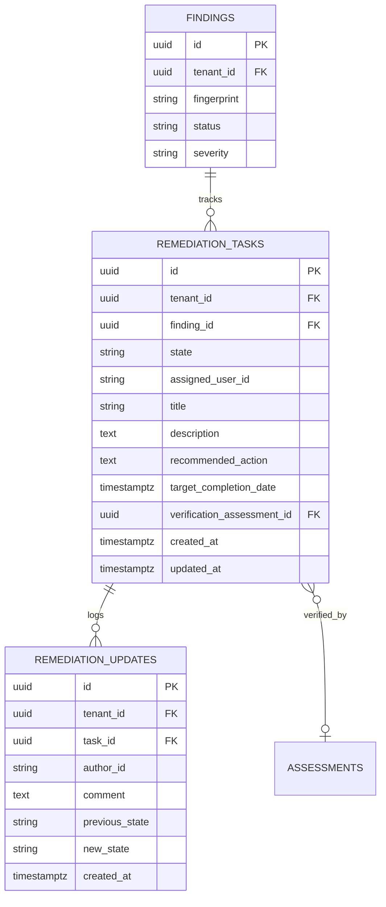
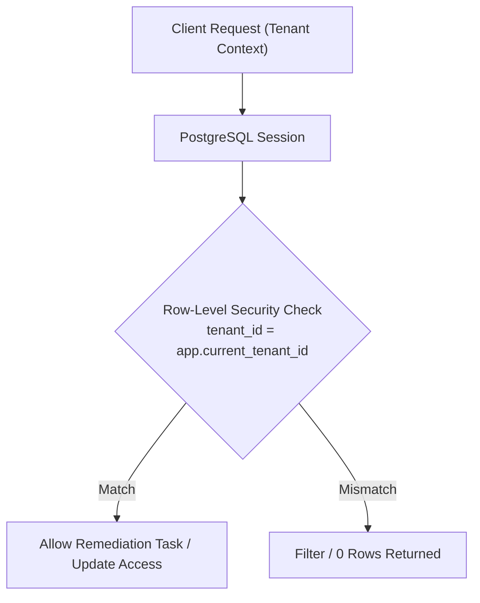

# Remediation Tracking Domain and Data Model

## 1. Overview & Purpose

The Remediation Tracking Domain provides structured tracking of actions, workflows, and verification activities intended to resolve security findings discovered during automated or manual assessments.

Remediation records are explicitly decoupled from finding records:
- **Separation of Concerns:** A persistent finding records the observed security flaw and its lifecycle (e.g. `NEW`, `CONFIRMED`, `RESOLVED`, `REOPENED`), whereas remediation records track human and engineering tasks (e.g., code patches, infrastructure updates, configuration changes) directed toward fixing the problem.
- **Multiple Actions per Finding:** A single security vulnerability may require multiple discrete remediation actions (e.g., deploying an emergency WAF rule, rotating compromised API keys, and upgrading a backend dependency).
- **Identity Preservation:** Mutating or closing a remediation task never mutates the underlying finding identity, fingerprint, or observation timeline.
- **Verification Decoupling:** Marking a remediation action completed does not automatically resolve a finding; resolution requires empirical verification by subsequent scans or assessments.

---

## 2. Core Domain Types & Lifecycle States

### Remediation States
- `OPEN`: Task created and awaiting scheduling or assignment.
- `PLANNED`: Task scheduled with planned milestone or target completion date.
- `IN_PROGRESS`: Engineering or operations team actively implementing the remediation fix.
- `BLOCKED`: Remediation blocked pending an external dependency or upstream vendor release.
- `READY_FOR_VERIFICATION`: Fix deployed to target environment; ready for verification assessment.
- `COMPLETED`: Remediation task successfully executed and verified.
- `REOPENED`: Remediation reopened due to failed verification or regression.

---

## 3. Database Schema & Multi-Tenant Isolation

The remediation domain is enforced in PostgreSQL via migration `000021_remediation_tracking.up.sql`.

### Invariants:
1. **Tenant Isolation (ADR-0002):** Both `remediation_tasks` and `remediation_updates` enforce PostgreSQL Row-Level Security (`RESTRICTIVE` policy on `tenant_id = current_setting('app.current_tenant_id', true)::uuid`).
2. **Referential Integrity:** Deleting a finding cascades to its remediation tasks. Deleting a remediation task cascades to its update history. Deleting or archiving an assessment sets `verification_assessment_id` to NULL without deleting the remediation task.
3. **Audit History:** `remediation_updates` provides an append-only timeline of all state transitions and comments for auditability.
