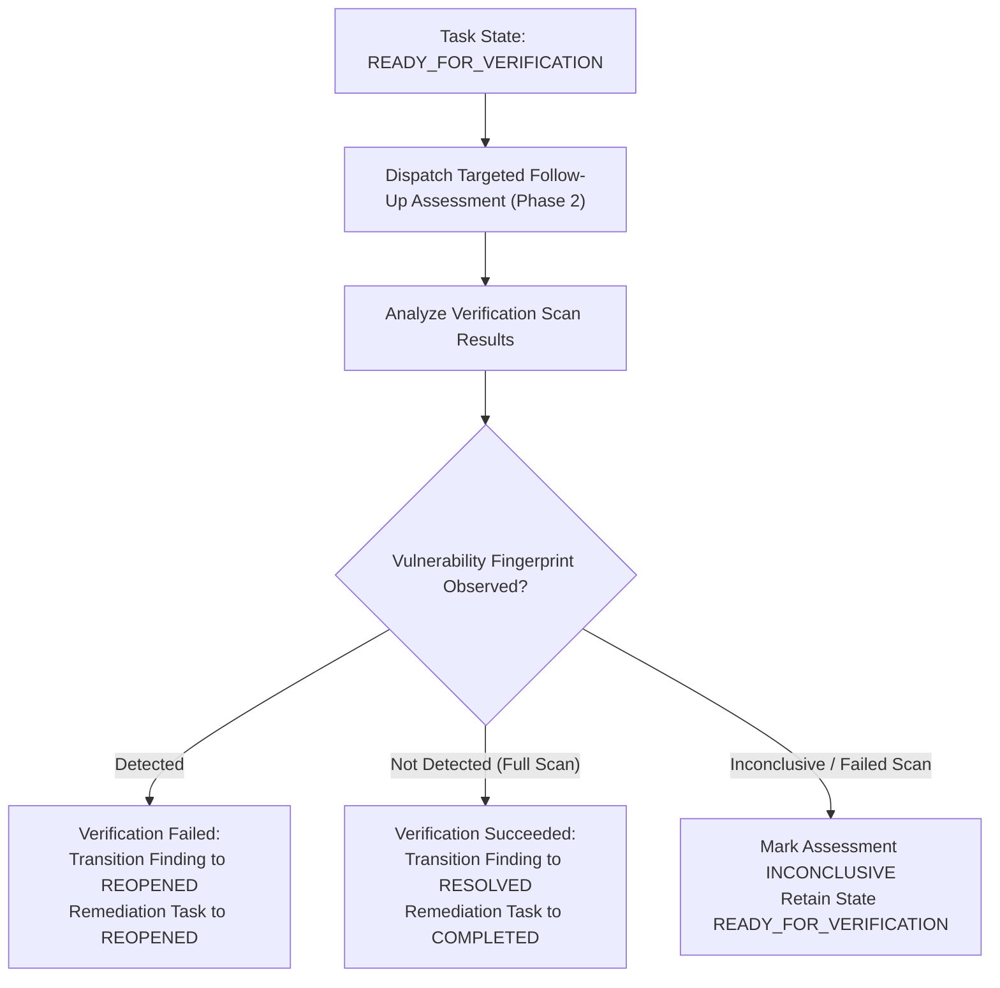

# Remediation Verification Through Follow-Up Assessments

## 1. Overview & Purpose

Remediation Verification evaluates whether engineering actions have empirically resolved a vulnerability by cross-referencing remediation tasks with subsequent assessment scan observations.

A central architectural invariant is that **remediation completion alone does not resolve a finding**. Only empirical evidence from a valid follow-up assessment with full scanner coverage can transition a finding from `CONFIRMED` or `IN_PROGRESS` to `RESOLVED`.

---

## 2. Verification Outcomes & Lifecycle Transitions

| Verification Outcome | Criteria | Remediation Task Action | Finding Lifecycle Action |
|---|---|---|---|
| `VERIFIED_RESOLVED` | Assessment succeeded, original scanner executed, vulnerability fingerprint **not detected** | Transitions to `COMPLETED` | Transitions from `CONFIRMED`/`IN_PROGRESS` to `RESOLVED` |
| `VERIFICATION_FAILED_STILL_PRESENT` | Assessment succeeded, original scanner executed, vulnerability fingerprint **still detected** | Transitions to `REOPENED` with required rationale | If previously `RESOLVED`, transitions to `REOPENED`. If already open, remains open |
| `INCONCLUSIVE_INSUFFICIENT_COVERAGE` | Assessment succeeded, but did **not** execute the scanner that detected the original flaw | Retains state `READY_FOR_VERIFICATION` | Finding status unchanged |
| `ASSESSMENT_FAILED` | Assessment aborted, cancelled, or failed during execution | Retains state `READY_FOR_VERIFICATION` | Finding status unchanged |

---

## 3. Scope & Multi-Tenant Enforcement

1. **Target Scope Verification:**
   The follow-up assessment target must match the finding's affected endpoint (`ErrScopeMismatch` raised on mismatch).
2. **Scanner Coverage Verification:**
   Absence of evidence is not evidence of absence. A finding cannot be marked resolved if the follow-up assessment omitted the scanning engine originally responsible for identifying the finding.
3. **Multi-Tenant Isolation (ADR-0002):**
   Assessments, remediation tasks, and findings must belong to the exact same tenant boundary.
