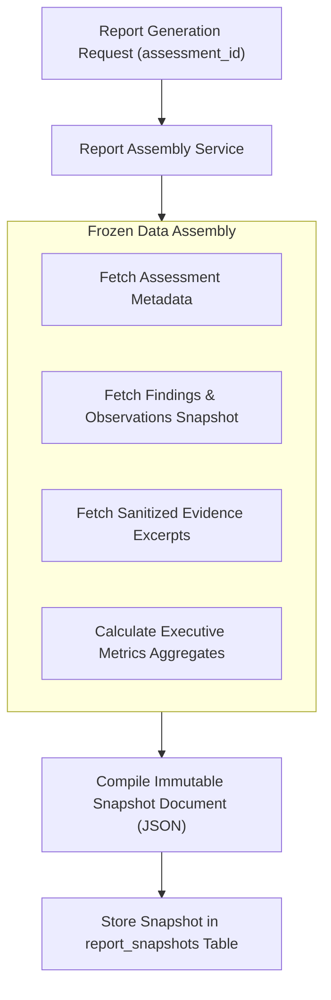

# Report Snapshot and Data Assembly Service

## 1. Overview & Purpose

The Report Snapshot and Data Assembly Service creates immutable, point-in-time snapshots of assessment records, persistent findings, sanitized evidence excerpts, and remediation guidance.

Security reports must be immutable: subsequent edits, finding status changes, or re-scans must never alter a previously generated, client-delivered report. To guarantee integrity, the assembler captures all required records into a canonical `ReportV1` document, computes a SHA-256 cryptographic audit hash over the canonical JSON bytes, and persists the snapshot to the `report_snapshots` table.

---

## 2. Assembly Workflow & Consistency

1. **Tenant Authorization:** Ensures the invoking user and assessment match the active tenant boundary (`ADR-0002`).
2. **Metadata Collection:** Extracts target boundaries, scanner execution profiles, timestamps, and execution limitations.
3. **Findings & Evidence Snapshot:** Point-in-time extraction of findings associated with the assessment. All evidence excerpts are verified for applied redactions (`RedactionApplied: true`, `ADR-0005`).
4. **Remediation Plan Integration:** Queries active remediation tasks and due dates linked to the findings.
5. **Aggregate Metrics Calculation:** Computes total findings, severity breakdowns, priority bands, and composite risk ratings.
6. **Integrity Sealing:** Computes SHA-256 digest over the serialized report document and embeds it into `provenance.audit_hash`.
7. **Storage:** Persists the snapshot in `report_snapshots` with PostgreSQL Row-Level Security enabled.
