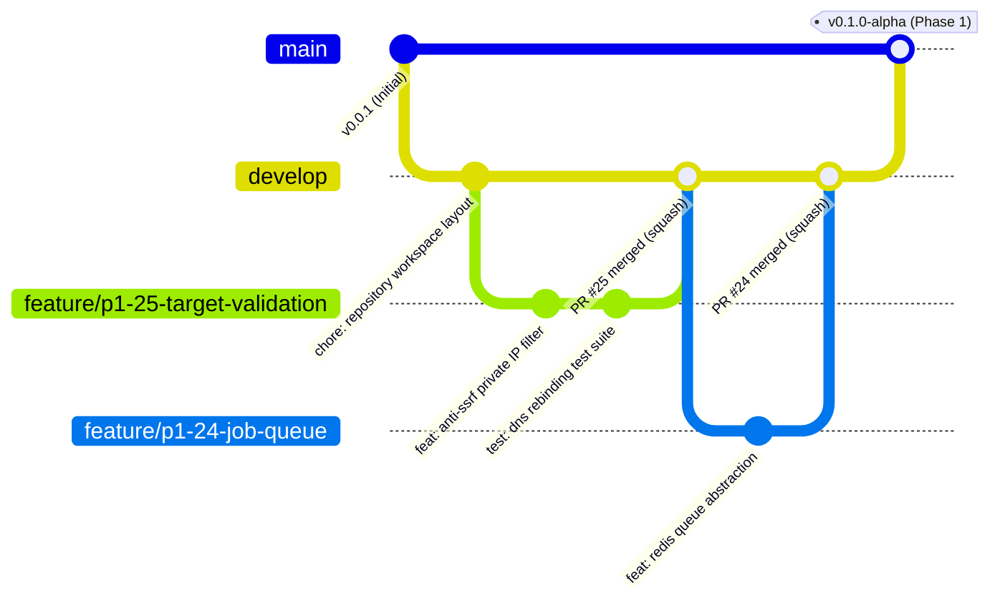

# Kelvin Security Platform — Repository Layout

**Document Control**

| Field | Value |
| :--- | :--- |
| **Status** | Baseline — Peer-Reviewed |
| **Milestone** | Phase 1 — Foundation & Core Architecture (`P1-08`) |
| **Depends On** | `docs/architecture/decisions/` (`P1-07`) |
| **Owner** | Platform Engineering |
| **Review Cadence** | Quarterly, and on any workspace restructuring |
| **Related Docs** | `CONTRIBUTING.md`, `README.md`, `docs/architecture/SYSTEM_ARCHITECTURE.md` |
| **Classification** | Internal — Engineering Specification |

---

## 1. Executive Summary

Kelvin is organized as a **monorepo** with a strict, predefined directory hierarchy that isolates applications (`apps/`) from shared libraries (`packages/`). This separation prevents circular imports, decouples business domains, enables independent deployment of backend services, frontend dashboard, and worker daemons, and keeps container images lean by excluding unrelated code.

This document defines the approved top-level workspace hierarchy, the responsibilities of each directory, the boundary rules between apps and packages, and the onboarding orientation for new contributors.

---

## 2. Top-Level Workspace Hierarchy

```
Kelvin/                                          # Repository root
├── .github/                                     # GitHub configuration & governance
│   ├── CODEOWNERS                               # Code ownership rules
│   └── workflows/                               # CI/CD pipeline definitions
├── apps/                                        # Deployable applications (owned domains)
│   ├── api/                                     # API control plane (Go)
│   │   ├── cmd/                                 # Application entrypoints
│   │   ├── internal/                            # Private application code
│   │   │   ├── auth/                            # Auth & tenant RBAC
│   │   │   ├── scope/                           # Target scope & validation
│   │   │   ├── orchestrator/                    # Assessment job orchestrator
│   │   │   └── findings/                        # Finding normalization & dedup
│   │   ├── pkg/                                 # Library code safe for external use
│   │   ├── configs/                             # Configuration files
│   │   ├── db/                                  # SQL migrations (golang-migrate, ADR-0002)
│   │   ├── openapi/                             # OpenAPI 3.1 API contract (source of truth)
│   │   ├── deploy/                              # Deployment manifests (K8s, Docker)
│   │   ├── go.mod                               # Go module definition
│   │   └── README.md                            # App-specific README
│   ├── web/                                     # Frontend SPA (React/TypeScript)
│   │   ├── src/                                 # Frontend source code
│   │   │   ├── components/                      # Shared UI components
│   │   │   ├── pages/                           # Route page components
│   │   │   ├── hooks/                           # Custom React hooks
│   │   │   ├── services/                        # API client services
│   │   │   └── store/                           # Client-side state
│   │   ├── public/                              # Static assets
│   │   ├── package.json                         # Node manifest
│   │   └── README.md                            # App-specific README
│   └── worker/                                  # Sandboxed scanner workers (Go)
│       ├── cmd/                                 # Worker entrypoints
│       │   └── runner/                          # Worker daemon
│       ├── internal/                            # Private worker code
│       │   ├── adapters/                        # Scanner adapter implementations
│       │   ├── sandbox/                         # Container sandboxing
│       │   └── egress/                          # Egress proxy & DNS pinning
│       ├── pkg/                                 # Library code safe for external use
│       ├── configs/                             # Worker configuration
│       ├── deploy/                              # Worker deployment manifests
│       ├── go.mod                               # Go module definition
│       └── README.md                            # App-specific README
├── packages/                                    # Shared libraries (no deployable entrypoint)
│   ├── schemas/                                 # Canonical JSON/YAML schemas
│   │   ├── scan-profile.schema.json             # Scan profile schema (ADR-0005)
│   │   ├── finding.schema.json                  # Canonical finding schema
│   │   ├── assessment.schema.json               # Assessment job schema
│   │   ├── api-envelope.schema.json             # Standard API success envelope (P1-09)
│   │   ├── api-error.schema.json                # RFC 7807 Problem Details envelope (P1-09)
│   │   └── README.md                            # Package README
│   ├── common/                                  # Shared cross-cutting utilities
│   │   ├── logging/                             # Structured logging helpers
│   │   ├── errors/                              # Canonical error types
│   │   ├── validation/                          # Shared validation helpers
│   │   └── README.md                            # Package README
├── docs/                                        # Engineering & product documentation
│   ├── architecture/                            # Architecture specifications & ADRs
│   │   ├── SYSTEM_ARCHITECTURE.md               # High-level system architecture
│   │   ├── DATA_MODEL.md                        # Relational domain data model & ERD (P1-10)
│   │   ├── SCAN_PROFILES.md                     # Declarative scan profiles
│   │   ├── REPOSITORY_LAYOUT.md                 # This document
│   │   └── decisions/                           # Architecture Decision Records (ADRs)
│   │       ├── 0000-template.md                 # ADR Markdown template
│   │       ├── ADR-0001.md                      # Backend framework & runtime
│   │       ├── ADR-0002.md                      # Relational persistence layer
│   │       ├── ADR-0003.md                      # Job queue & state broker
│   │       ├── ADR-0004.md                      # Frontend architecture & design system
│   │       └── ADR-0005.md                      # Worker containerization & sandboxing
│   ├── security/                                # Security & compliance documents
│   │   ├── THREAT_MODEL.md                      # STRIDE threat model
│   │   └── ACCEPTABLE_USE.md                    # Acceptable Use Policy
│   ├── product/                                 # Product & UX documents
│   │   └── PERSONAS.md                          # User personas & journey maps
│   ├── api/                                     # API design standards & contracts
│   │   └── API_STANDARDS.md                     # REST API standards (P1-09)
│   ├── PRODUCT_VISION.md                        # Product vision & non-goals
│   ├── MVP_AND_PHASE_BIFURCATION.md             # MVP scope & phase boundaries
│   ├── ARCHITECTURE_AND_FEATURES.md             # Feature & architecture overview
│   └── ROADMAP.md                               # Engineering roadmap & milestones
├── tests/                                       # Cross-cutting integration tests
│   └── README.md
├── scripts/                                     # Build, test, release scripts
│   └── README.md
├── .gitignore                                   # Git ignore rules
├── .env.example                                 # Example environment variables
├── CONTRIBUTING.md                              # Contribution guidelines
├── LICENSE                                      # Apache-2.0 license
└── README.md                                    # Repository orientation & onboarding
```

---

## 3. Directory Responsibilities

| Directory | Type | Deployable | Responsibility | Primary Tech |
| :--- | :--- | :--- | :--- | :--- |
| `apps/api` | Application | ✅ Yes | Control plane: auth, scope, orchestrator, findings service | Go |
| `apps/web` | Application | ✅ Yes | Frontend SPA dashboard | React/TypeScript |
| `apps/worker` | Application | ✅ Yes | Sandboxed scanner worker daemons & adapters | Go |
| `packages/schemas` | Library | ❌ No | Canonical JSON/YAML schemas consumed by apps | JSON/YAML |
| `packages/common` | Library | ❌ No | Shared logging, errors, validation utilities | Go/TypeScript |
| `docs/` | Documentation | ❌ No | Product, architecture, security, roadmap specs | Markdown |
| `tests/` | Testing | ❌ No | Cross-cutting integration & security tests | Go/TypeScript |
| `scripts/` | Tooling | ❌ No | Build, test, release, dev scripts | Shell/TypeScript |

---

## 4. Boundary Rules Between Apps and Packages

### 4.1 Dependency Direction

Dependencies flow **one direction only**: apps may depend on packages, but **packages must never depend on apps**.

```
apps/api  ─────┐
               ├──► packages/schemas
apps/web  ─────┘         packages/common
apps/worker ─┘
```

Violating this rule creates circular imports and prevents independent compilation/deployment of services.

### 4.2 Import Rules

| Direction | Allowed? | Rationale |
| :--- | :--- | :--- |
| App → Package | ✅ Yes | Apps consume shared schemas and utilities. |
| Package → App | ❌ No | Packages are domain-agnostic; importing apps couples them to deployable concerns. |
| Package → Package | ⚠️ Restricted | `packages/common` may not import `packages/schemas`; schemas may import common types only. |
| App → App | ❌ No | Apps are independent deployable units; no app may import another app's internal code. |

### 4.3 Visibility Rules

* `internal/` directories within an app are private to that app and may not be imported by any other app or package.
* `pkg/` directories within an app contain library code explicitly safe for import by other apps (rare; prefer promoting to `packages/`).
* `packages/` code is public within the monorepo but has no deployable entrypoint of its own.

---

## 5. Branching Strategy (Trunk-Based Development)

Kelvin enforces **Trunk-Based Gitflow** with squash merges. Direct commits to `main` are prohibited.

### 5.1 Branch Lifecycle



### 5.2 Branch Types

| Branch Type | Pattern | Source | Target | Example |
| :--- | :--- | :--- | :--- | :--- |
| Main release | `main` | `develop` (tagged) | — | `main` |
| Integration trunk | `develop` | `main` | `main` (release) | `develop` |
| Feature | `feature/<issue>-<desc>` | `develop` | `develop` (squash) | `feature/p1-25-target-validation` |
| Bugfix | `fix/<issue>-<desc>` | `develop` | `develop` (squash) | `fix/p1-26-scope-validation` |
| Docs | `docs/<issue>-<desc>` | `develop` | `develop` (squash) | `docs/p1-08-repo-layout` |
| Hotfix | `hotfix/<issue>-<desc>` | `main` | `main` + `develop` | `hotfix/p1-27-critical-fix` |

### 5.3 Rules

1. **Feature branches are short-lived** (≤ 5 days). Long-lived branches cause merge conflicts and drift.
2. **All feature work targets `develop`**, never `main` directly.
3. **`main` only receives tagged releases** from `develop`.
4. **Squash merge** to `develop`/`main` to maintain a linear, bisectable history.
5. **Branch names reference the planning issue** (e.g., `P1-08`) for traceability.

---

## 6. Commit Convention (Conventional Commits)

Kelvin uses **[Conventional Commits](https://www.conventionalcommits.org/)** to automate changelog generation, semantic versioning, and `git bisect` debugging.

### 6.1 Commit Format

```
<type>(<optional scope>): <description>

[optional body]

[optional footer(s)]
```

### 6.2 Commit Types

| Type | Use Case | Example |
| :--- | :--- | :--- |
| `feat` | New feature | `feat(api): add target scope validation` |
| `fix` | Bug fix | `fix(worker): handle scanner OOM crash` |
| `docs` | Documentation only | `docs: update repository layout spec` |
| `style` | Formatting, no code change | `style: format Go files with gofmt` |
| `refactor` | Code restructure, no behavior change | `refactor(web): extract findings table component` |
| `perf` | Performance improvement | `perf(api): reduce findings query latency` |
| `test` | Adding or correcting tests | `test(api): add SSRF negative test suite` |
| `chore` | Build, CI, dependencies | `chore(deps): update Go to 1.22` |
| `revert` | Revert a previous commit | `revert: remove unused worker adapter` |

### 6.3 Scope

Scope indicates the affected area: `api`, `web`, `worker`, `schemas`, `common`, `deps`, `ci`, or `docs`. Omit the scope for cross-cutting changes.

### 6.4 Examples

```
feat(api): implement RFC 1918 scope rejection
fix(worker): correct container memory limit parsing
docs(layout): document apps vs packages boundary
chore(deps): bump redis client to v9
test(api): add tenant isolation row-level security tests
```

### 6.5 Breaking Changes

Append `!` after the type/scope and include a `BREAKING CHANGE:` footer:

```
feat(api)!: remove deprecated assessment endpoint

BREAKING CHANGE: The /assessments/legacy endpoint is removed. Use /assessments/v2.
```

---

## 7. Pull Request Review Conventions

| Gate | Requirement |
| :--- | :--- |
| CI | 100% passing automated CI (linting, static analysis, unit tests) |
| Security | Mandatory security negative tests for input validation and authentication |
| Review | Minimum 1 approved code review from code owners (.github/CODEOWNERS) |
| History | Linear Git history via Squash & Merge |
| Convention | Commit messages conform to Conventional Commits |

---

## 8. Code Ownership (.github/CODEOWNERS)

Critical security and architectural modules have designated code owners. See `.github/CODEOWNERS` for the complete mapping.

Owned areas include:
* Scope engine & anti-SSRF guards (`apps/api/internal/scope/`)
* Worker sandboxing & egress (`apps/worker/internal/sandbox/`, `apps/worker/internal/egress/`)
* Authentication & RBAC (`apps/api/internal/auth/`)
* Canonical schemas (`packages/schemas/`)
* Security documentation (`docs/security/`)

---

## 9. Onboarding Orientation for New Contributors

A newcomer should be able to locate any subsystem within seconds using this map:

| Looking for... | Navigate to |
| :--- | :--- |
| Project vision & non-goals | `docs/PRODUCT_VISION.md` |
| High-level architecture | `docs/architecture/SYSTEM_ARCHITECTURE.md` |
| Domain data model & ERD | `docs/architecture/DATA_MODEL.md` |
| Architecture decisions | `docs/architecture/decisions/ADR-000*.md` |
| API standards & contract | `docs/api/API_STANDARDS.md`, `apps/api/openapi/openapi.yaml` |
| Threat model | `docs/security/THREAT_MODEL.md` |
| Acceptable use policy | `docs/security/ACCEPTABLE_USE.md` |
| Scan profiles | `docs/architecture/SCAN_PROFILES.md` |
| User personas & journeys | `docs/product/PERSONAS.md` |
| API backend code | `apps/api/` |
| Frontend dashboard code | `apps/web/` |
| Worker daemon & adapters | `apps/worker/` |
| Shared schemas | `packages/schemas/` |
| Shared utilities | `packages/common/` |
| Contribution rules | `CONTRIBUTING.md` |
| Code owners | `.github/CODEOWNERS` |
| CI pipelines | `.github/workflows/` |
| Roadmap & milestones | `docs/ROADMAP.md` |

---

## 10. Governance

1. **Layout changes require an ADR.** Restructuring the workspace, adding new top-level directories, or changing boundary rules requires a new ADR in `docs/architecture/decisions/`.
2. **No ad-hoc directories.** New top-level directories beyond those defined here are prohibited without Platform Engineering approval.
3. **Dependency direction is enforced in CI.** CI checks that packages do not import apps and apps do not import other apps' internals.
4. **Review cadence.** This document is reviewed quarterly and on any workspace restructuring.

---

## 11. Traceability

| Artifact | Reference |
| :--- | :--- |
| Planning reference | `P1-08` |
| Milestone | Phase 1 — Foundation & Core Architecture |
| Blocked by | `P1-07` — `docs/architecture/decisions/` (Technology Stack Decisions) |
| System architecture | `docs/architecture/SYSTEM_ARCHITECTURE.md` |
| Contribution guidelines | `CONTRIBUTING.md` |
| Code ownership | `.github/CODEOWNERS` |
| Repository orientation | `README.md` |

---

*Kelvin Security Platform — Phase 1 Engineering Backlog*
