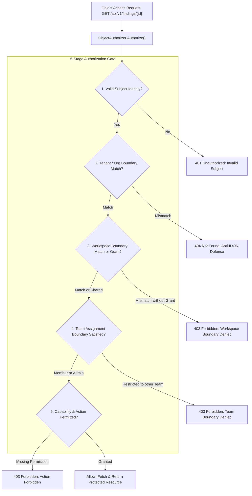

# Resource-Level and Object-Level Authorization Architecture (P4-12)

## Executive Summary

Role-Based Access Control (RBAC) answers "what kind of actions can this user perform in general?", while Object-Level and Resource-Level Access Control answers "can this user perform this specific action on this specific object right now?".

Issue **P4-12** implements a centralized server-side object authorization engine that defends against Insecure Direct Object References (IDOR), prevents cross-tenant and cross-workspace leakage, enforces team boundaries, and validates background task execution.

---

## 1. Threat Model & Anti-IDOR Protections

### 1.1 Insecure Direct Object References (IDOR)
An attacker possessing an account in Tenant A should never be able to discover or access resources belonging to Tenant B, even if they guess or predict valid object identifiers (UUIDs or sequential IDs).

**Anti-IDOR Invariant:**
When an object's `tenant_id` or `organization_id` does not match the subject's cryptographically verified tenant context, the system returns `ErrResourceNotFound` rather than an explicit `403 Forbidden`. This completely prevents timing and error response enumeration of foreign objects.

### 1.2 Multi-Boundary Evaluation
Access is granted if and only if **all** of the following boundaries are satisfied:



---

## 2. Core Components

### 2.1 Subject Context
Captures the verified caller principal:
- `UserID`: Unique identity of user or service identity.
- `OrganizationID`: Root organization.
- `TenantID`: Cryptographically validated database tenant (ADR-0002).
- `WorkspaceID`: Current active workspace.
- `Roles`: Assigned built-in roles (`RoleOrgOwner`, `RoleWorkspaceAdmin`, etc.).
- `Permissions`: Direct permission map including dynamically resolved custom roles.
- `TeamIDs`: Array of teams the subject belongs to.

### 2.2 Resource Descriptor
Standardized envelope describing any protected entity:
- `Type`: Domain resource type (`finding`, `assessment`, `evidence`, `report`, `target`, `integration`).
- `ID`: Object identifier.
- `OrganizationID` & `TenantID`: Cryptographic tenancy attributes.
- `WorkspaceID`: Owning workspace.
- `AssignedTeamID`: Optional restriction to a specific team.

### 2.3 Cross-Workspace Sharing Evaluation
When an object is stored in Workspace B, but a user in Workspace A attempts to access it:
- If the subject holds an organization-wide role (`RoleOrgOwner`, `RoleOrgAdmin`, `RoleSecurityAdmin`), access across workspaces within their organization is permitted.
- Otherwise, the authorizer consults `SharingResolver.HasActiveSharingGrant(...)` to verify whether an active grant permits cross-workspace read/execute access.

### 2.4 Background Task & Job Context Preservation
Asynchronous operations (e.g. background scan execution, PDF report rendering, webhook delivery) must never execute with unbound root privileges.
- `BackgroundJobContext` encapsulates the initiating subject's security context.
- When worker tasks process background jobs, `AuthorizeBackgroundJob` enforces the identical 5-stage authorization gate, preventing background privilege escalation across tenants.

---

## 3. Integration Patterns

### 3.1 HTTP / API Handlers
```go
subject, ok := iam.SubjectFromContext(r.Context())
if !ok {
    http.Error(w, "Unauthorized", http.StatusUnauthorized)
    return
}

resource := iam.ResourceDescriptor{
    Type:           "finding",
    ID:             finding.ID.String(),
    OrganizationID: finding.OrganizationID,
    TenantID:       finding.TenantID,
    WorkspaceID:    finding.WorkspaceID,
}

if err := authorizer.Authorize(r.Context(), subject, resource, iam.PermissionFindingRead); err != nil {
    if errors.Is(err, iam.ErrResourceNotFound) {
        http.Error(w, "Finding not found", http.StatusNotFound)
        return
    }
    http.Error(w, err.Error(), http.StatusForbidden)
    return
}
```

---

## 4. Acceptance Criteria & Verification Matrix

| Acceptance Criterion | Verification Method | Status |
| :--- | :--- | :--- |
| Server-side authorization on protected resources | Unit test `TestObjectAuthorizer_DirectObjectAccess` | Verified |
| Anti-IDOR identifier guessing defense | Negative test returning `ErrResourceNotFound` on cross-tenant probe | Verified |
| API, download, export path equivalence | Standardized `ResourceDescriptor` validation across all access points | Verified |
| Background job authorized context preservation | Unit test `TestObjectAuthorizer_BackgroundJobContext` | Verified |
| Automated negative tests for unauthorized access | `TestObjectAuthorizer_PermissionRestrictions` & `TestObjectAuthorizer_TeamRestrictions` | Verified |
