# Risk Score Explainability Architecture

## Overview
The Kelvin **Risk Score Explainability** subsystem provides full transparency and mathematical accountability for every assigned risk score and priority band.

Rather than presenting an opaque number, the explainability engine exposes:
1. **The Exact Scoring Model Version** (`kelvin.risk_engine.v1`).
2. **Explicit Factor Categorization** that distinguishes **Measured Signals** (CVSS, scanner severity, proof confidence, active threat intelligence) from **Manual Context** (target environment, network exposure, asset criticality, PII presence) and **Heuristics** (conservative defaults).
3. **Structured Breakdown** with points, multipliers, and plain-language descriptions.
4. **Human-Readable Summary Narrative** summarizing the primary risk drivers.
5. **Auditable Historical Replay** guaranteeing that scores remain explainable even if scoring models evolve.

```mermaid
flowchart LR
    Score["Calculated Risk Score: 8.5 (HIGH)\nModel: kelvin.risk_engine.v1"] --> Explainer["Explainability Engine"]

    subgraph Factors ["Explained Factor Breakdown"]
        F1["Base Technical Severity: High (8.0 pts)\n[Category: MEASURED]"]
        F2["Evidentiary Confidence: Certain (0.95, factor 0.98x)\n[Category: MEASURED]"]
        F3["Target Exposure: Public Facing (1.20x)\n[Category: MANUAL_CONTEXT]"]
        F4["Asset Importance: Production Web App (1.25x)\n[Category: MANUAL_CONTEXT]"]
        F5["Threat Boost: CISA KEV Known Exploited (+1.0 pt)\n[Category: MEASURED]"]
    end

    Explainer --> Factors
    Factors --> Summary["Structured JSON + Plain-Language Summary"]
    Summary --> API["Exposed via GET /api/v1/findings/{id}/risk-explanation"]
```



## Factor Taxonomy & Categories

| Category | Description | Examples |
|---|---|---|
| `MEASURED` | Deterministically observed or verified technical properties from scanner results, CVSS vectors, and threat feeds. | Base Severity (`CRITICAL`=9.5, `HIGH`=8.0), CVSS v3.1 base score, Evidentiary Confidence score, CISA KEV presence, EPSS probability. |
| `MANUAL_CONTEXT` | Administrator-defined or inventory-discovered operational attributes of the affected system. | Deployment Environment (`PRODUCTION`, `STAGING`), Network Reachability (`PUBLIC_INTERNET`), Business Criticality (`TIER_1_CRITICAL`), Data Sensitivity (`CONTAINS_PII`). |
| `HEURISTIC` | Conservative default values applied when context is unestablished or omitted. | Default exposure (`UNKNOWN` -> 1.00x), Default criticality (`UNKNOWN` -> 1.00x), Default confidence attenuation. |

## Core Architectural Invariants

1. **Strict Tenant Isolation (ADR-0002):**
   - Findings and risk explanations are partitioned by `tenant_id`.
   - Access to `/api/v1/findings/{id}/risk-explanation` enforces tenant boundary checks.

2. **Evidence & Secret Redaction (ADR-0005):**
   - The explanation exposes mathematical factors, multipliers, and public CVE/CWE identifiers.
   - Internal credentials, authorization tokens, internal host topologies, and sensitive query strings are completely redacted.

3. **Immutable Historical Auditability:**
   - Finding records persist their input factors, model version, and calculation timestamps in `findings.risk_factors` and `findings.risk_score`.
   - Subsequent changes to scoring engine algorithms do not retroactively invalidate or misrepresent historical assessments.

## API Endpoint

`GET /api/v1/findings/{id}/risk-explanation`

**Example Response:**
```json
{
  "data": {
    "finding_id": "c1f72782-b364-44b4-82a9-0414f6e3c548",
    "model_version": "kelvin.risk_engine.v1",
    "risk_score": 8.5,
    "priority_band": "HIGH",
    "summary": "Finding assigned HIGH priority (score 8.5) by model kelvin.risk_engine.v1. Base severity 8.0 scaled by confidence 0.95 (0.98x factor) with exposure (x1.20) and criticality (x1.25) modifiers and +1.0 threat intelligence boost (CISA KEV Known Exploited).",
    "factors": [
      {
        "name": "Base Technical Severity",
        "category": "MEASURED",
        "raw_value": "HIGH",
        "score_impact": 8.0,
        "description": "Baseline impact derived from HIGH scanner classification"
      },
      {
        "name": "Evidentiary Confidence",
        "category": "MEASURED",
        "raw_value": "0.95 (CERTAIN)",
        "multiplier": 0.98,
        "description": "Proof certainty scaled risk baseline with 0.98x attenuation factor"
      },
      {
        "name": "Target Exposure",
        "category": "MANUAL_CONTEXT",
        "raw_value": "PUBLIC_INTERNET",
        "multiplier": 1.20,
        "description": "Network reachability factor (x1.20 multiplier applied)"
      },
      {
        "name": "Asset Criticality",
        "category": "MANUAL_CONTEXT",
        "raw_value": "TIER_1_CRITICAL",
        "multiplier": 1.25,
        "description": "Business impact tier factor (x1.25 multiplier applied)"
      },
      {
        "name": "Threat Intelligence Boost",
        "category": "MEASURED",
        "raw_value": "CISA KEV Known Exploited (+1.0)",
        "score_impact": 1.0,
        "description": "Active exploitation signals elevated operational urgency"
      }
    ],
    "assessed_at": "2026-11-02T13:20:00Z"
  }
}
```
