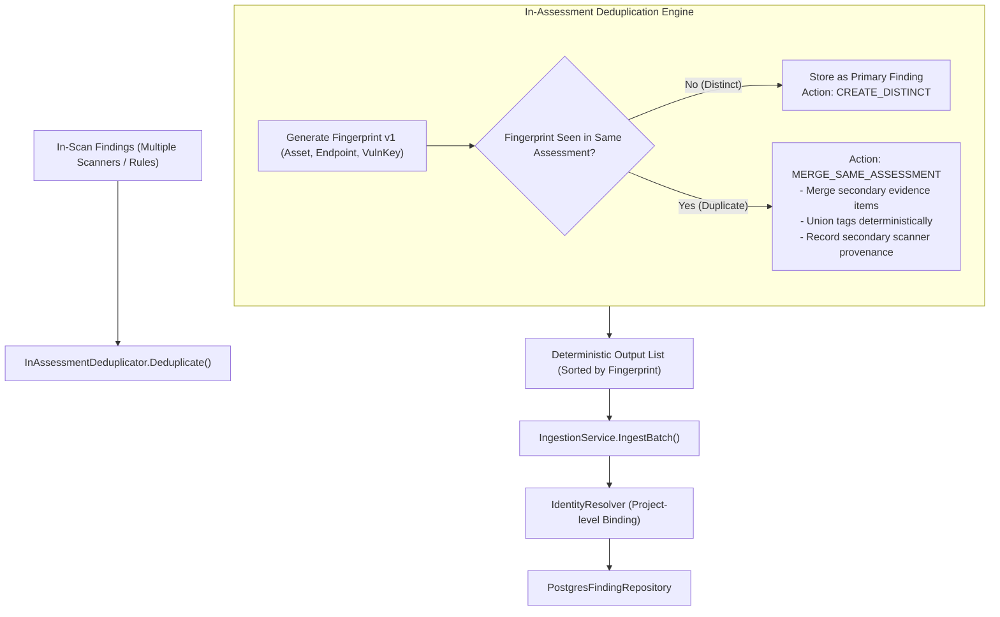

# Same-Assessment Duplicate Detection

## Overview

Within a single assessment, multiple security tools (e.g., Nuclei and OWASP ZAP), multiple engine rules, or repeated scans against sub-resources often report identical vulnerabilities on the same target. Without in-scan deduplication, these duplicate reports inflate finding counts, pollute triage pipelines, and fragment evidence.

The **Same-Assessment Duplicate Detection Engine** intercepts findings within the assessment intake pipeline, identifies identical findings via deterministic fingerprinting (ADR-0004), merges secondary evidence references, preserves scanner source provenance, and ensures distinct vulnerabilities at different locations are never collapsed.

---

## Architecture & Workflow

---

## Invariant Rules & Deduplication Logic

1. **Fingerprint-Driven Matching:**
   - Findings are deduplicated **strictly** using the deterministic fingerprint algorithm established in P3-03 (`SHA-256(asset | endpoint | vuln_key)`).
   - Findings are **never** merged solely based on fuzzy title, description, or severity similarity.
2. **Location Distinction:**
   - Vulnerabilities sharing identical titles or CWE IDs but occurring at different endpoints (e.g. `/api/v1/auth` vs `/api/v1/profile`) produce distinct fingerprints and remain separate findings.
3. **Evidence Aggregation:**
   - When duplicate reports occur, secondary evidence items (payloads, request/response records, log snippets) are merged without duplicating identical payloads.
   - All unique evidence references are retained under the unified persistent finding observation.
4. **Provenance Preservation:**
   - The primary scanner is retained, and all participating secondary scanners (e.g. `["nuclei", "owasp-zap"]`) are recorded in the observation metadata under `secondary_scanners` and `provenance_<scanner>`.
5. **Deterministic Output:**
   - Deduplicated results are ordered deterministically by fingerprint digest to ensure reproducible test fixtures and pipeline execution.
