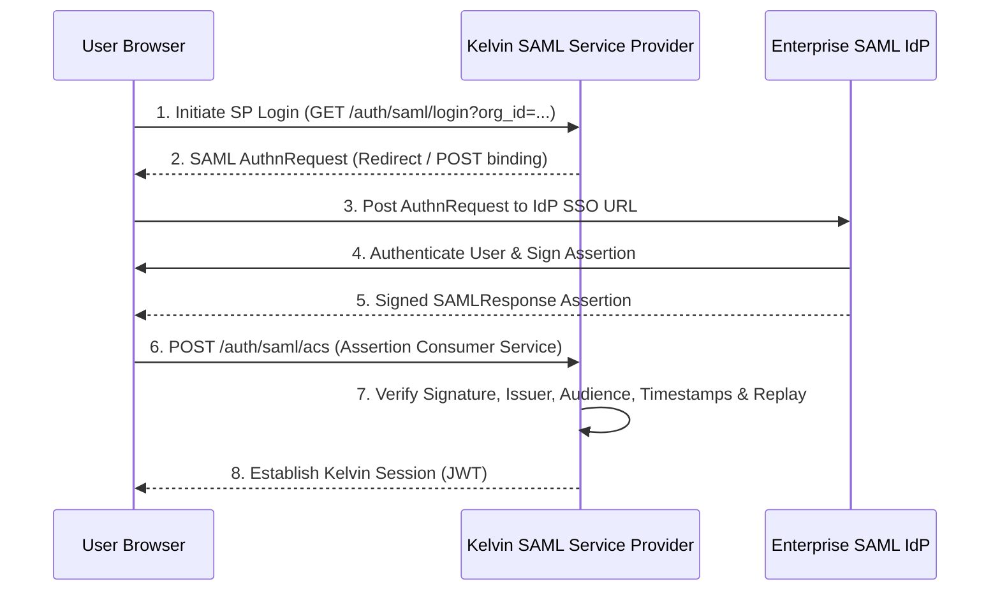

# SAML 2.0 Enterprise SSO Architecture (P4-14)

## Executive Summary

Enterprise identity federation often relies on SAML 2.0 (Security Assertion Markup Language).

Issue **P4-14** implements an enterprise-ready SAML 2.0 Service Provider (SP) subsystem supporting SP-initiated federation, XML digital signature verification, temporal validity checks, audience enforcement, replay protection, and dual-certificate zero-downtime rollover.

---

## 1. Authentication & Verification Workflow



---

## 2. Security Invariants & Defenses

### 2.1 Cryptographic Signature Verification
Assertions must be cryptographically signed by the identity provider.
- Verified against the organization's stored X.509 public signing certificate.
- Untrusted or forged certificates are rejected (`ErrSAMLInvalidSignature`).

### 2.2 Dual-Certificate Zero-Downtime Rollover
Identity provider signing certificates inevitably expire (typically on 1 to 3-year cycles).
- The system supports a primary (`idp_x509_cert`) and secondary (`idp_x509_cert_secondary`) certificate configuration.
- During certificate renewal, the new certificate is staged as secondary. Incoming assertions signed by either certificate succeed.
- Once the IdP completes switchover, the administrator promotes the secondary certificate to primary with a single audited operation (`RolloverCertificate`).

### 2.3 Replay Cache Defense
- Every SAML assertion includes a unique identifier `ID` (e.g. `_assertion_uuid_1001`).
- `SAMLReplayCache` records consumed IDs along with their `NotOnOrAfter` timestamp.
- If an assertion with the same ID arrives again within its validity window, it is rejected immediately (`ErrSAMLAssertionReplayed`).

### 2.4 Strict Audience, Issuer, and Recipient Matching
- **Issuer**: Must strictly equal the configured `idp_entity_id`.
- **Audience**: Must match Kelvin's configured SP Entity ID (`sp_entity_id`, scoped per organization).
- **Recipient**: Must strictly equal the registered Assertion Consumer Service URL (`acs_url`).

### 2.5 Temporal Validity Window
- Assertions are rejected if `now > NotOnOrAfter + clockSkew` (`ErrSAMLAssertionExpired`).
- Assertions are rejected if `now < NotBefore - clockSkew` (`ErrSAMLAssertionPremature`).
- Clock skew tolerance is bounded to 2 minutes.

---

## 3. Database Schema

The SAML 2.0 configuration is stored in `saml_configurations`:

```sql
CREATE TABLE IF NOT EXISTS saml_configurations (
  id                       UUID PRIMARY KEY DEFAULT gen_random_uuid(),
  organization_id          UUID NOT NULL REFERENCES organizations(id) ON DELETE CASCADE,
  idp_entity_id            VARCHAR(512) NOT NULL,
  sso_url                  VARCHAR(512) NOT NULL,
  sp_entity_id             VARCHAR(512) NOT NULL,
  acs_url                  VARCHAR(512) NOT NULL,
  idp_x509_cert            TEXT NOT NULL,
  idp_x509_cert_secondary  TEXT NOT NULL DEFAULT '',
  enabled                  BOOLEAN NOT NULL DEFAULT true,
  enforce_sso              BOOLEAN NOT NULL DEFAULT false,
  created_at               TIMESTAMPTZ NOT NULL DEFAULT clock_timestamp(),
  updated_at               TIMESTAMPTZ NOT NULL DEFAULT clock_timestamp(),
  CONSTRAINT uq_saml_org UNIQUE (organization_id)
);

CREATE INDEX IF NOT EXISTS idx_saml_configurations_org
  ON saml_configurations (organization_id);
```

---

## 4. Acceptance Criteria & Test Verification

| Acceptance Criterion | Verification Method | Status |
| :--- | :--- | :--- |
| SP-initiated AuthnRequest generation | `TestSAMLService_AuthnRequestAndAssertion/generate_SP-initiated_AuthnRequest` | Verified |
| Full assertion validation & attribute extraction | `TestSAMLService_AuthnRequestAndAssertion/validate_valid_SAML_assertion_successfully` | Verified |
| Replay protection cache | `TestSAMLService_AuthnRequestAndAssertion/replay_protection:_consuming_assertion_twice_is_rejected` | Verified |
| Audience, Issuer, and Recipient checks | Verified via mismatch test cases | Verified |
| Zero-downtime certificate rollover | `TestSAMLService_AuthnRequestAndAssertion/secondary_certificate_succeeds_during_rollover_window` | Verified |
