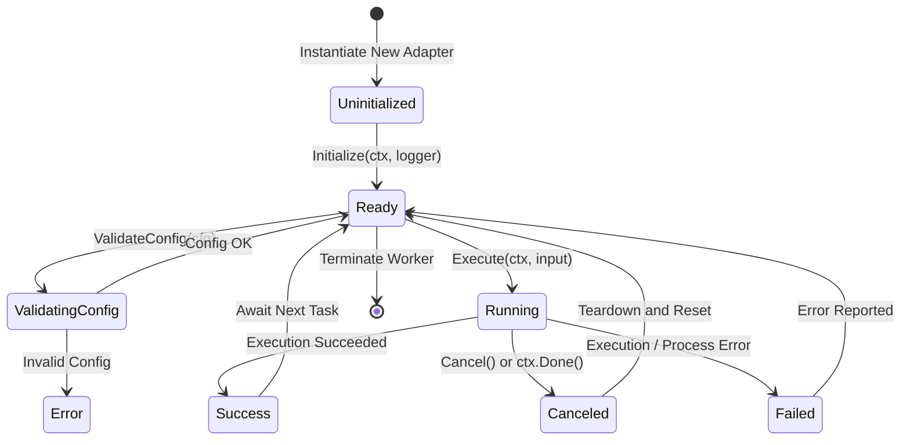
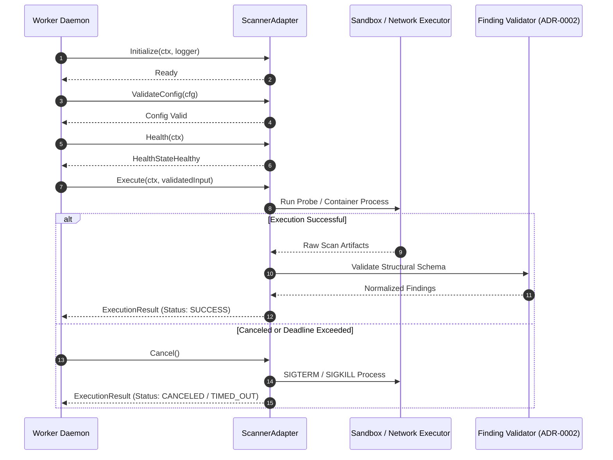

# Kelvin — Scanner Adapter Interface & Lifecycle Specification

**Document Control**

| Field | Value |
| :--- | :--- |
| **Status** | Phase 2 Baseline |
| **Milestone** | Phase 2 — Assessment Engine & Scanner Integrations (`P2-02`) |
| **Owner** | Platform Engineering / Worker Runtime |
| **Related decisions** | `ADR-0002` (Canonical Finding Schema), `ADR-0005` (Worker Execution Isolation) |
| **Related specifications** | `MVP_SCANNER_SELECTION.md`, `EXECUTION_ISOLATION.md`, `FINDING_SCHEMA.md` |

---

## 1. Overview & Purpose

The `ScannerAdapter` Go interface defines the standard execution contract between the KELVIN assessment worker daemon and underlying scanning tools. By establishing an explicit, uniform lifecycle, KELVIN decouples high-level orchestration, queue consumption, and multi-tenant authorization from scanner-specific invocation logic.

Whether assessing a target via built-in Go network probes (HTTP Preflight, TLS Assessor, Security Headers) or invoking containerized third-party tooling (OWASP ZAP Baseline, Nuclei) inside rootless OCI sandboxes, all adapters adhere to the exact same lifecycle contract.

---

## 2. Architecture & Lifecycle State Machine

The scanner adapter lifecycle enforces strict state progression: an adapter must be initialized before execution, verifies all task inputs against authorization constraints, and handles cancellation gracefully.



### Execution Sequence



---

## 3. Go Interface Definition

The canonical interface is located at `apps/worker/internal/adapter/adapter.go`:

```go
type ScannerAdapter interface {
    Name() string
    Version() string
    Initialize(ctx context.Context, logger *zap.Logger) error
    ValidateConfig(cfg Config) error
    Capabilities() Capabilities
    Health(ctx context.Context) HealthStatus
    Execute(ctx context.Context, input ExecutionInput) (ExecutionResult, error)
    Cancel() error
}
```

### Operations Breakdown

| Operation | Timing | Responsibility | Security Invariant |
| :--- | :--- | :--- | :--- |
| `Name()` | Startup / Discovery | Returns unique lowercase alphanumeric name (e.g. `preflight`, `zap`). | Immutable across worker lifetime. |
| `Version()` | Registration | Returns adapter / engine version for telemetry and provenance tracking. | Bound into immutable assessment manifest. |
| `Initialize()` | Worker Startup | Binds structured logger with contextual metadata and establishes baseline assets. | Must be idempotent or fail fast on re-initialization. |
| `ValidateConfig()` | Pre-Execution | Rejects unknown, malformed, or out-of-boundary configuration options. | Prevents injection of arbitrary flags or unsafe parameters. |
| `Capabilities()` | Routing / Planning | Returns operational profile (passive vs active, protocols, concurrency). | Orchestrator verifies profile compatibility before dispatch. |
| `Health()` | Periodic / Probing | Checks binary presence, runtime permissions, and connectivity. | Fail-closed: unhealthy adapters reject task dispatch. |
| `Execute()` | Task Dispatch | Executes the assessment against validated target within hard deadline bounds. | Sandboxed container or bounded egress transport only. |
| `Cancel()` | User / Supervisor Abort | Terminates child processes, cleans up temporary mounts, and cancels HTTP contexts. | Must complete synchronously without leaking background processes. |

---

## 4. Security & Architectural Invariants

1. **ADR-0005 Sandboxing:** All external scanner engines run inside isolated, rootless OCI containers (`UID 10001`, dropped capabilities, seccomp profiles, and read-only root filesystems).
2. **Untrusted Output Boundary:** Scanner stdout/stderr, diagnostics, and raw findings are untrusted data. Adapters never trust output format and strictly validate payloads against `finding.v1.json` before ingestion.
3. **No Direct Database Access:** Adapters must not query or mutate PostgreSQL or Redis directly. Worker daemons handle job persistence and queue ack/fail transitions.
4. **Context & Deadline Enforcement:** Adapters honor `context.Context` cancellation and hard execution deadlines. If deadline expires, container supervisor terminates execution immediately.

---

## 5. Traceability

| Requirement | Artifact |
| :--- | :--- |
| Interface Specification | `apps/worker/internal/adapter/adapter.go` |
| Reference Implementation | `apps/worker/internal/adapter/reference.go` |
| Conformance Test Suite | `apps/worker/internal/adapter/adapter_test.go` |
| Tracking Issue | `.github/issues/phase-2/P2-02_DEFINE_SCANNER_ADAPTER_INTERFACE.md` |
