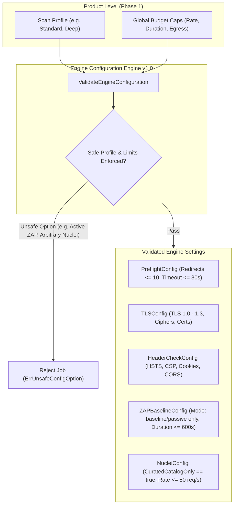

# Kelvin — Scanner Configuration Schema Specification

**Document Control**

| Field | Value |
| :--- | :--- |
| **Status** | Phase 2 Baseline |
| **Milestone** | Phase 2 — Assessment Engine & Scanner Integrations (`P2-05`) |
| **Owner** | Platform Engineering / Assessment Engine |
| **Related decisions** | `ADR-0005` (Execution Sandboxing), `MVP_SCANNER_SELECTION.md` |
| **Related specifications** | `SCAN_PROFILES.md`, `TARGET_SCOPE_ENFORCEMENT.md`, `EXECUTION_ISOLATION.md` |

---

## 1. Overview & Purpose

The Scanner Configuration Schema defines the strongly-typed, bounded settings governing each approved scanner engine in KELVIN Phase 2.

A primary security requirement is ensuring that **user-supplied configuration can never override platform safety guardrails**. For example, users cannot configure OWASP ZAP into an intrusive active-attack mode, nor can they supply arbitrary remote Nuclei templates. All engines enforce hard lower and upper bounds on timeouts, concurrency, redirect depths, and request rates.

---

## 2. Configuration Hierarchy Diagram

---

## 3. Supported Engine Schemas & Boundaries

The Go schemas are defined in `apps/worker/internal/adapter/config.go`.

### 1. Built-in HTTP/HTTPS Preflight (`preflight`)

| Parameter | Type | Default | Permitted Bounds | Safety Invariant |
| :--- | :--- | :--- | :--- | :--- |
| `max_redirects` | Integer | `5` | `0 .. 10` | Prevents redirect loop amplification. |
| `follow_redirects`| Boolean | `true` | `true / false` | Every redirect hop revalidates Phase 1 scope. |
| `timeout_per_request`| Duration | `5s` | `1s .. 30s` | Guards against socket hanging. |
| `user_agent` | String | Fixed | No `\r` or `\n` | Prevents HTTP header injection. |

### 2. Built-in TLS Assessor (`tls`)

| Parameter | Type | Default | Permitted Bounds | Safety Invariant |
| :--- | :--- | :--- | :--- | :--- |
| `min_tls_version` | String | `"TLS1.0"` | `TLS1.0` to `TLS1.3` | Evaluates legacy protocol negotiation. |
| `check_cipher_suites` | Boolean | `true` | `true / false` | Inspects weak/insecure cipher suites. |
| `check_certificate_expiry`| Boolean | `true` | `true / false` | Verifies X.509 validity dates. |
| `connect_timeout` | Duration | `10s` | `1s .. 30s` | Bounded handshake timer. |

### 3. Built-in HTTP Security Headers & Cookies (`headers`)

| Parameter | Type | Default | Permitted Bounds | Safety Invariant |
| :--- | :--- | :--- | :--- | :--- |
| `check_hsts` | Boolean | `true` | `true / false` | Inspects `Strict-Transport-Security`. |
| `check_csp` | Boolean | `true` | `true / false` | Evaluates `Content-Security-Policy`. |
| `check_cookies` | Boolean | `true` | `true / false` | Flags missing `Secure` / `HttpOnly` / `SameSite`. |
| `check_cors` | Boolean | `true` | `true / false` | Identifies wildcard / unvalidated origins. |

### 4. OWASP ZAP Baseline (`zap`)

| Parameter | Type | Default | Permitted Bounds | Safety Invariant |
| :--- | :--- | :--- | :--- | :--- |
| `scan_mode` | String | `"baseline"`| `"baseline"`, `"passive-only"`| **Prohibits active attacks**. Fail-closed on other values. |
| `max_duration_seconds`| Integer | `300` | `30 .. 600` | Upper limit prevents runaway spidering. |
| `max_depth` | Integer | `2` | `1 .. 5` | Limits crawl recursion depth. |
| `spider_duration_minutes`| Integer | `2` | `1 .. 5` | Constrains crawler phase. |

### 5. Nuclei Engine (`nuclei`)

| Parameter | Type | Default | Permitted Bounds | Safety Invariant |
| :--- | :--- | :--- | :--- | :--- |
| `curated_catalog_only`| Boolean | `true` | **Strictly `true`** | **Prohibits custom or arbitrary templates**. |
| `template_tags` | Array[Str]| Curated | Alphanumeric only | Excludes `dos`, `fuzz`, `intrusive`, `exploit`. |
| `max_concurrency` | Integer | `10` | `1 .. 25` | Prevents local worker thread exhaustion. |
| `request_rate_limit` | Integer | `25` | `1 .. 50` | Enforces polite pacing against target. |

---

## 4. Security & Safety Invariants

1. **Immutable Safety Guardrails:** Fields like `curated_catalog_only` in Nuclei and `scan_mode == "baseline"` in ZAP are non-negotiable architectural boundaries. Even tenant administrators cannot disable them via API payloads.
2. **Sanitized User Agents and Tags:** Free-text inputs reject CRLF and shell injection delimiters.
3. **Fail-Closed Engine Validation:** Unsupported scanner identifiers (e.g. unapproved port scanners or exploit engines) are rejected upfront with `ErrUnsupportedEngine`.

---

## 5. Traceability

| Requirement | Artifact |
| :--- | :--- |
| Configuration Schema | `apps/worker/internal/adapter/config.go` |
| Configuration Test Suite | `apps/worker/internal/adapter/config_test.go` |
| Tracking Issue | `.github/issues/phase-2/P2-05_DEFINE_SCANNER_CONFIGURATION_SCHEMA.md` |
