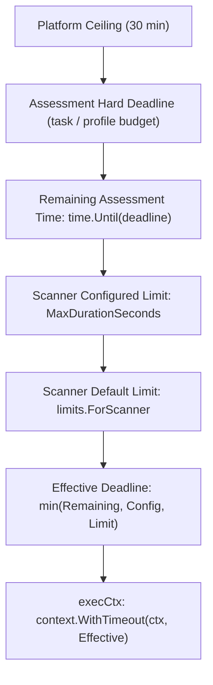
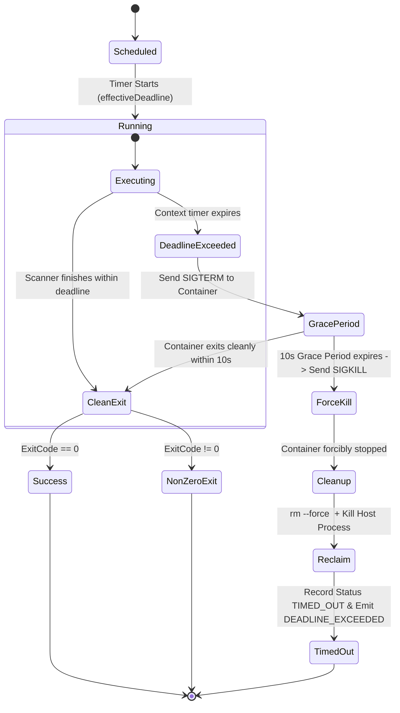

# Scanner Execution Deadlines & Termination Management

## 1. Executive Summary

In accordance with ADR-0005 (Execution Isolation) and the worker lifecycle specification (Issue P2-25), every scanner execution in Kelvin is strictly bounded by deterministic, hierarchically enforced execution deadlines. Runaway or hanging scanner processes cannot monopolize worker capacity or linger indefinitely.

This document details the multi-tiered deadline hierarchy, graceful container termination workflow, process cleanup guarantees (zero orphaned processes), distinction between execution and connection timeouts, and auditable metrics recording.

---

## 2. Deadline Hierarchy & Calculation

Scanner execution deadlines operate in a strict, bounded hierarchy where downstream deadlines can only narrow, never expand, upstream constraints:



### Hierarchy Rules:
1. **Platform Ceiling**: No execution may exceed `limits.PlatformCeiling.HardDeadline` (30 minutes).
2. **Assessment-Level Deadline**: Governs the entire multi-phase assessment pipeline (`task.HardDeadline` or `profile.Budget.MaxDuration`).
3. **Assessment Remaining Time**: As pipeline phases progress, remaining assessment time is dynamically calculated: `remaining := time.Until(started.Add(assessmentDeadline))`. If `remaining <= 0`, further phases and scanners are aborted immediately.
4. **Scanner-Level Deadline**: Derived from `min(scannerConfiguredDuration, scannerDefaultLimit, remainingAssessmentTime)`.
5. **Effective Deadline Ceiling**: A scanner cannot run longer than the remaining time in its parent assessment:
   $$\text{effectiveDeadline} = \min(\text{remainingAssessment}, \text{scannerConfigured}, \text{scannerCeiling})$$

---

## 3. Scanner Lifecycle & Graceful Termination

When a scanner reaches its deadline, Kelvin initiates a two-stage graceful termination sequence to prevent orphaned containers or dangling background processes.



### Termination Protocol:
1. **SIGTERM (10-second Grace Period)**:
   The supervisor issues `podman/docker stop --time=10 <container>`. This delivers a `SIGTERM` signal to PID 1 inside the container, granting 10 seconds to flush logs, close sockets, and gracefully shut down.
2. **SIGKILL (Forced Termination)**:
   If the container process has not exited when the 10-second grace period elapses, the OCI runtime automatically issues `SIGKILL` (signal 9) to forcefully terminate all processes in the container's PID namespace.
3. **Forced Cleanup (`rm --force`)**:
   `OCIExecutor.removeContainer(name)` executes `rm --force <container>` to remove container state, unmount volumes, and release rootless cgroups v2 slices.
4. **Host Process Reclamation**:
   If the local invocation command handle (`cmd.Process`) remains active, `cmd.Process.Kill()` is invoked, followed by draining the command exit channel (`<-done`), guaranteeing zero zombie or orphaned processes on the worker node.

---

## 4. Execution Timeout vs Connection Timeout

Kelvin rigorously distinguishes between execution deadline exhaustion and network connection timeouts:

| Attribute | Execution Timeout (`EXECUTION_DEADLINE`) | Connection Timeout (`CONNECTION_TIMEOUT`) |
| :--- | :--- | :--- |
| **Trigger Cause** | Scanner wall-clock time exceeded `task.HardDeadline` / `effectiveDeadline` | Network dial, TCP handshake, or HTTP response read timed out against target |
| **Governing Parameter** | `max_duration_seconds` / `hard_deadline` | `request_timeout_seconds` (1–30s) |
| **Worker Action** | Container terminated via SIGTERM (10s) -> SIGKILL -> `rm -f` | Network request fails; scanner continues or records observation |
| **Result Envelope Status** | `TIMED_OUT` | `COMPLETED_WITH_WARNINGS` or `FAILED` |
| **Diagnostic Code** | `DEADLINE_EXCEEDED` (Level: `error`) | `CONNECTION_TIMEOUT` / `TARGET_UNREACHABLE` (Level: `warning`) |
| **Resource Violation Metric** | `ViolationDeadline` incremented; `CauseDeadline` recorded | None (reachability observation, not worker resource violation) |
| **Pipeline Impact** | Assessment phase halted; remaining phases aborted | Phase evaluates target reachability; may continue or fail based on policy |

The worker provides classification helper `ClassifyTimeout(err, result)` to deterministically categorize failures.

---

## 5. Auditability & Structured Output Envelope

When an execution timeout occurs, the worker synthesizes a valid Canonical Finding Envelope (`adapters.ScannerOutputEnvelope`) reflecting the timeout state:

```json
{
  "schema_version": "1.0",
  "metadata": {
    "assessment_id": "33333333-3333-3333-3333-333333333333",
    "scanner_id": "nuclei",
    "scanner_version": "3.3.0",
    "adapter_version": "1.0.0",
    "run_id": "22222222-2222-2222-2222-222222222222",
    "started_at": "2026-11-01T23:00:00Z",
    "completed_at": "2026-11-01T23:10:00Z",
    "correlation_id": "corr-uuid"
  },
  "status": "TIMED_OUT",
  "exit_code": -1,
  "duration_ms": 600000,
  "findings": [],
  "diagnostics": [
    {
      "level": "error",
      "code": "DEADLINE_EXCEEDED",
      "message": "scanner \"nuclei\" execution exceeded hard execution deadline of 10m0s"
    }
  ]
}
```

### Metrics Broadcaster:
- Counter `worker_resource_violations_total{type="deadline_exceeded"}` (`metrics.ViolationDeadline`) is incremented.
- Counter `worker_job_terminations_total{cause="deadline_exceeded"}` (`metrics.CauseDeadline`) is incremented.
