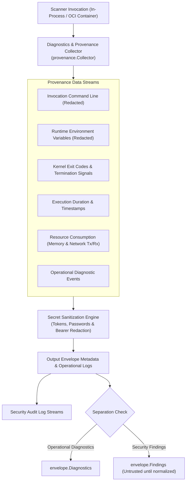

# Scanner Execution Provenance and Diagnostics

This document specifies the architecture, data schemas, secret sanitization, and operational diagnostic contracts for scanner execution provenance in Kelvin, fulfilling requirement **P2-36** (Issue #112).

---

## 1. Overview & Objective

During security assessment workflows, scanners execute across distributed worker containers and in-process adapters. When assessments produce unexpected outcomes, time out, encounter network faults, or exit with nonzero status codes, security teams and platform operators need high-fidelity operational provenance to understand:
- The exact (sanitized) command-line arguments and runtime environment used.
- Execution duration, timestamp boundaries, and process exit status.
- Resource utilization metrics (peak memory, cgroup limits, network throughput).
- Correlation IDs tying worker activities back to parent assessment requests.
- Detailed diagnostic timelines without polluting canonical vulnerability findings.

---

## 2. Architecture & Data Flow



---

## 3. Core Components

### 3.1 `ExecutionProvenance` (`apps/worker/internal/provenance`)

Tracks complete invocation provenance and diagnostic logs:
```go
type ExecutionProvenance struct {
    AssessmentID    string            `json:"assessment_id"`
    TenantID        string            `json:"tenant_id"`
    RunID           string            `json:"run_id"`
    ScannerID       string            `json:"scanner_id"`
    CorrelationID   string            `json:"correlation_id,omitempty"`
    Attempt         int               `json:"attempt"`
    CommandLine     []string          `json:"command_line"`
    Environment     []string          `json:"environment"`
    StartedAt       time.Time         `json:"started_at"`
    CompletedAt     time.Time         `json:"completed_at"`
    DurationMS      int64             `json:"duration_ms"`
    ExitCode        int               `json:"exit_code"`
    PeakMemoryBytes int64             `json:"peak_memory_bytes,omitempty"`
    NetworkTxBytes  int64             `json:"network_tx_bytes,omitempty"`
    NetworkRxBytes  int64             `json:"network_rx_bytes,omitempty"`
    Diagnostics     []DiagnosticEvent `json:"diagnostics"`
}
```

### 3.2 Secret Scrubbing Engine

All command line parameters, environment variables, and diagnostic log messages are passed through `RedactCommandLine`, `RedactEnvironment`, and `RedactString`:
- Sensitive flags such as `-H`, `--header`, `--token`, `--key`, and `-auth` have their values replaced with `[REDACTED]`.
- Regex matching masks `api_key=...`, `token=...`, `password=...`, and `Bearer <token>` strings.
- Environment variables matching sensitive keywords (`TOKEN`, `SECRET`, `KEY`, `AUTH`, `PASSWORD`) have their values scrubbed before storage or logging.

### 3.3 Separation of Operational Diagnostics and Security Findings

Kelvin enforces a strict separation invariant between operational logs and vulnerability findings:
- Operational events (e.g. `SLOW_TARGET`, `PREFLIGHT_FAILED`, `OUTPUT_TRUNCATED`) are cataloged in `envelope.Diagnostics`.
- Vulnerability findings are normalized exclusively into the Canonical Finding Schema (`finding.v1.json`, ADR-0002) in `envelope.Findings`.
- Diagnostics never mutate or fabricate security findings.

---

## 4. Verification & Testing

Validated in `apps/worker/internal/provenance/provenance_test.go`:
- `TestCollectorProvenanceLifecycle`: Verifies start, diagnostic logging, completion events, and resource metrics.
- `TestRedactCommandLineFlags`: Verifies argument scrubbing across `-H`, `--token`, and query parameters.
- `TestRedactEnvironment`: Verifies sensitive environment variables are masked while benign configuration values (`PUBLIC_HOST`) are preserved.
