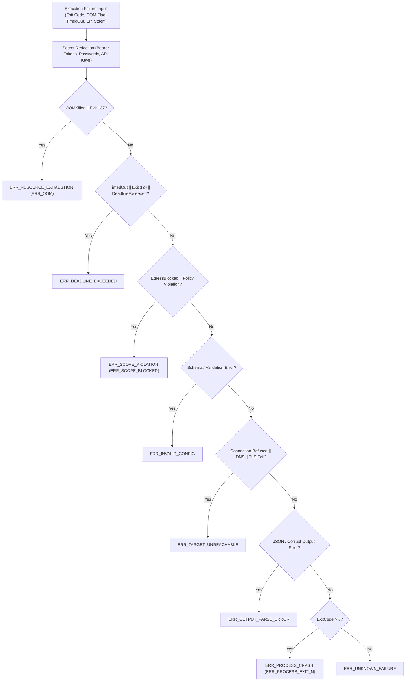

# Architecture Guide: Scanner Failure Classification (P2-30)

## 1. Overview & Purpose

Automated vulnerability scanners and network probes operate in hostile, unpredictable network and target environments. During an assessment run, failures can originate from multiple independent layers:
1. Target infrastructure faults (target down, DNS failure, connection drops).
2. Worker runtime boundary violations (OOM kills, hard deadline timeouts, SSRF egress blocks).
3. Scanner software faults (unhandled binary panics, segmentation faults, corrupt output formatting).
4. Operator configuration mistakes (schema validation failures, unsupported options).

The Kelvin **Failure Classification Engine** (`apps/worker/internal/classification`) translates heterogeneous exit codes, container signals, network exceptions, and error strings into a standardized, deterministic failure taxonomy. This enables the worker orchestrator to make safe decisions about retries, alerts, and customer-facing diagnostic reports.

---

## 2. Standardized Failure Taxonomy

Kelvin categorizes all scanner execution faults into ten canonical categories:

| Category Code | Description | Example Triggers | Retryable |
| :--- | :--- | :--- | :--- |
| `ERR_INVALID_CONFIG` | Invalid, unparsable, or disallowed scanner options | Schema validation error, unknown field, illegal flag | **No** (Terminal) |
| `ERR_UNSUPPORTED_VERSION` | Scanner runtime binary or image compatibility mismatch | Minimum version check failed, binary missing | **No** (Terminal) |
| `ERR_TARGET_UNREACHABLE` | Target connection refused, host down, or DNS resolution failure | `dial: connection refused`, `no such host`, `TLS handshake failure` | **Yes** (Transient) |
| `ERR_SCOPE_VIOLATION` | Target is out of scope or blocked by anti-SSRF policy | Egress proxy blocked private IP, cloud metadata hit | **No** (Terminal) |
| `ERR_PROCESS_CRASH` | Binary terminated abnormally with non-zero exit | Segmentation fault, unhandled binary exception, panic | **No** (Terminal) |
| `ERR_DEADLINE_EXCEEDED` | Scanner exceeded hard execution deadline | Exit code 124, `context.DeadlineExceeded`, timeout | **Yes** (With Backoff) |
| `ERR_RESOURCE_EXHAUSTION` | Out-of-memory (OOM) or CPU throttling ceiling hit | Exit code 137, Linux OOM killer invocation | **No** (Terminal) |
| `ERR_OUTPUT_PARSE_ERROR` | Scanner produced unparsable or truncated JSON output | Unexpected EOF in JSON, missing envelope structure | **No** (Terminal) |
| `ERR_INFRASTRUCTURE_FAULT` | Worker daemon, workspace mount, or container daemon failure | Workspace creation I/O failure, Docker socket failure | **Yes** (Worker Error) |
| `ERR_UNKNOWN_FAILURE` | Unclassified, unmapped failure | Fallback unhandled error | **No** (Terminal) |

---

## 3. Classification Workflow & Decision Engine

The classification engine analyzes structured runtime signals before inspecting free-text stderr logs:

---

## 4. Secret & Credential Redaction

Scanner diagnostic logs, stderr outputs, and command-line execution errors often capture sensitive parameters, tokens, or basic authentication credentials.

Prior to storing or logging any classified failure, the engine applies automated redaction:
- `Bearer [a-zA-Z0-9_\-\.]+` $\rightarrow$ `Bearer [REDACTED]`
- `(token|password|secret|apikey|api_key)=<value>` $\rightarrow$ `$1=[REDACTED]`

This guarantees that diagnostic telemetry and failure reports emitted to Redis, PostgreSQL, or web UI views never leak target authorization secrets.

---

## 5. Integration with Worker Orchestration

In `apps/worker/internal/daemon/orchestrator.go`, whenever a scanner job completes with an error or non-zero exit code:
1. `classification.Classify(...)` is called with execution context, exit code, and captured streams.
2. The classified category (`Category`) and code (`Code`) are logged as structured attributes.
3. Downstream retry controllers (`P2-31`) inspect `ClassifiedFailure.Retryable` to decide whether to reschedule the task with backoff or mark the job permanently failed.
