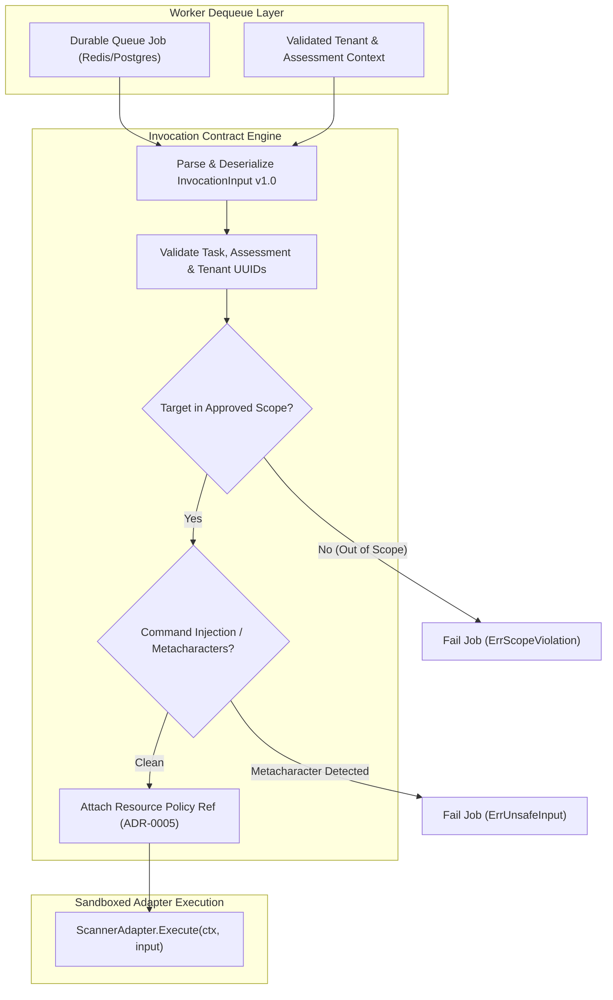

# Kelvin — Scanner Invocation Input Contract Specification

**Document Control**

| Field | Value |
| :--- | :--- |
| **Status** | Phase 2 Baseline |
| **Milestone** | Phase 2 — Assessment Engine & Scanner Integrations (`P2-03`) |
| **Owner** | Platform Engineering / Assessment Engine |
| **Related decisions** | `ADR-0002` (Canonical Finding Schema), `ADR-0005` (Execution Sandboxing) |
| **Related specifications** | `SCAN_PROFILES.md`, `TARGET_SCOPE_ENFORCEMENT.md`, `EXECUTION_ISOLATION.md` |

---

## 1. Overview & Purpose

The Scanner Invocation Input Contract defines the authoritative schema and data payload supplied to any security scanner adapter when an assessment task is dispatched. 

To maintain strict multi-tenant boundary isolation and prevent privilege escalation or unauthorized network traversal, the invocation contract enforces that all targets and operational profiles originate exclusively from validated Phase 1 domain context. Arbitrary user-defined command-line flags or untrusted execution parameters are strictly prohibited from crossing this boundary.

---

## 2. Ingestion & Validation Pipeline Diagram

---

## 3. Schema & Field Definitions

The contract is versioned (`1.0`) and defined in Go under `apps/worker/internal/adapter/input.go`.

### Contract Specification

| Field Path | Type | Obligation | Purpose / Constraint |
| :--- | :--- | :--- | :--- |
| `schema_version` | String | Required | Must strictly match `"1.0"`. Fail-closed on mismatch. |
| `task_id` | UUID | Required | Unique task execution identifier for distributed tracing. |
| `assessment_id` | UUID | Required | Owning assessment entity identifier. |
| `tenant_id` | UUID | Required | Multi-tenant tenant boundary identifier. |
| `correlation_id` | String | Optional | Request correlation identifier for observability logs. |
| `target.raw` | String | Required | Full canonical target URL or hostname (e.g. `https://example.com/api`). |
| `target.scheme` | String | Optional | `http` or `https`. |
| `target.host` | String | Required | FQDN or IP address under assessment. |
| `target.port` | Integer | Required | Network destination port (`1..65535`). |
| `scope.scope_id` | String | Required | Identifier for the approved authorization scope context. |
| `scope.allowed_hosts` | Array[String]| Required | Whitelist of permitted hostnames and wildcards. |
| `profile.profile_id` | String | Required | Associated scan profile identifier. |
| `profile.hard_deadline`| Duration | Required | Hard execution timeout beyond which worker terminates container. |
| `profile.max_request_rate`| Integer | Required | Ceiling on outgoing HTTP requests per second. |
| `resource_policy` | Object | Required | ADR-0005 sandbox limits (memory, CPU cores, read-only rootfs). |
| `scanner.engine` | String | Required | Canonical scanner engine name (`preflight`, `tls`, `zap`, `nuclei`). |
| `scanner.safe_flags` | Map[Str, Str]| Optional | Vetted configuration options with strict character whitelisting. |

---

## 4. Security & Isolation Invariants

1. **Strict Scope Validation:** The target must match an entry in `scope.allowed_hosts` (supporting explicit FQDN and wildcard subdomain matching). Any request targeting an unapproved asset fails immediately prior to process spawning.
2. **Zero Shell Metacharacters:** Inputs are validated against `^[a-zA-Z0-9\.\-\_\:\/]+$`. Strings containing shell delimiters (`;`, `|`, `&`, `$`, `` ` ``, `\n`) are rejected with `ErrUnsafeInput`.
3. **No Dynamic CLI Flag Ingestion:** User inputs cannot pass raw flags (e.g. `--target` or `-X`) directly into subprocess arguments. All flags are parsed into typed parameters and mapped deterministically by adapters.
4. **Deterministic Deadlines:** The `execution_deadline` field is validated to ensure it is positive and strictly bounded by the scan profile's hard execution limit.

---

## 5. Traceability

| Requirement | Artifact |
| :--- | :--- |
| Input Contract Definition | `apps/worker/internal/adapter/input.go` |
| Input Contract Test Suite | `apps/worker/internal/adapter/input_test.go` |
| Tracking Issue | `.github/issues/phase-2/P2-03_DEFINE_SCANNER_INVOCATION_INPUT_CONTRACT.md` |
