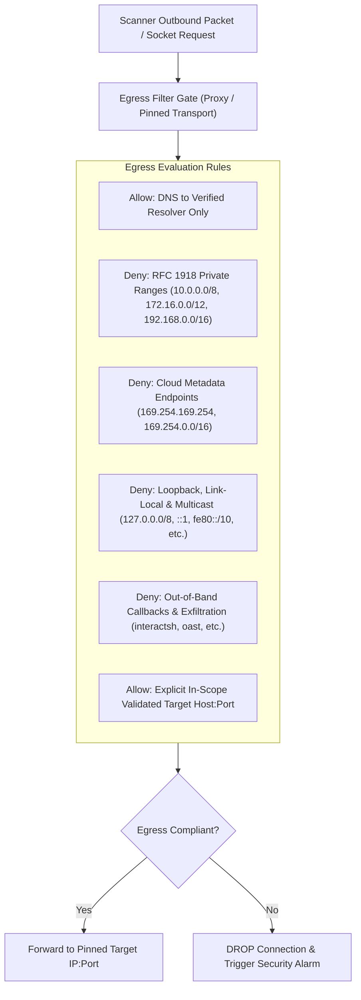

# Scanner-Specific Network Egress Policies

## 1. Executive Summary

In accordance with ADR-0005 and Kelvin's Execution Isolation Architecture (`docs/architecture/EXECUTION_ISOLATION.md`), all scanner executions operate under a strict **default-deny** network posture. Untrusted scanner processes (whether containerized binaries like Nuclei and ZAP or built-in in-process assessors) are never granted unfettered network access.

This specification details the architecture, policy evaluation rules, anti-SSRF egress proxy, and observable alarming controls implemented in `apps/worker/internal/egress`.

---

## 2. Egress Evaluation Architecture



---

## 3. Scanner Policy Matrix

| Scanner | Type | Allowed Protocols | Allowed Ports | Callback Channels | Proxy Enforced | Deny List Applied |
| :--- | :--- | :--- | :--- | :--- | :--- | :--- |
| **`http_preflight`** | In-Process | `http`, `https` | Target port, 80, 443 | Forbidden (`false`) | No (Direct Pinned Dialer) | RFC 1918, metadata, loopback |
| **`http_security_headers`** | In-Process | `http`, `https` | Target port, 80, 443 | Forbidden (`false`) | No (Direct Pinned Dialer) | RFC 1918, metadata, loopback |
| **`tls_assessment`** | In-Process | `tls`, `tcp`, `https` | Target port, 443 | Forbidden (`false`) | No (Direct Pinned Dialer) | RFC 1918, metadata, loopback |
| **`zap_baseline`** | Containerized (OCI) | `http`, `https` | Target port, 80, 443 | Forbidden (`false`) | Yes (Local Anti-SSRF Proxy) | RFC 1918, metadata, loopback |
| **`nuclei`** | Containerized (OCI) | `http`, `https` | Target port, 80, 443 | Forbidden (`false`) | Yes (Local Anti-SSRF Proxy) | RFC 1918, metadata, loopback |

---

## 4. Key Security Invariants

### 4.1 DNS Pinning & Anti-Rebinding
1. Destination hostnames are resolved exclusively via the trusted Phase 1 scope resolver (`ScopePolicy.Resolver`).
2. Every returned IP address is checked before connection:
   - If **any** address falls within prohibited ranges (RFC 1918, 169.254.0.0/16, loopback, multicast), the connection is immediately aborted (`ErrProhibitedAddress`).
3. Outbound sockets connect directly to the verified numeric IP address (`net.JoinHostPort(ip.String(), port)`), eliminating Time-of-Check to Time-of-Use (TOCTOU) DNS rebinding vulnerabilities.

### 4.2 Prohibited Destination Deny-List
- **RFC 1918 Private Ranges**: `10.0.0.0/8`, `172.16.0.0/12`, `192.168.0.0/16`
- **Cloud Instance Metadata Service (IMDS)**: `169.254.0.0/16` (including `169.254.169.254`) - blocked unconditionally even in lab mode.
- **Loopback & Unspecified**: `127.0.0.0/8`, `::1/128`, `0.0.0.0/8`, `::/128`
- **Link-Local & Multicast**: `fe80::/10`, `224.0.0.0/4`, `ff00::/8`
- **Carrier-Grade NAT & Benchmarking**: `100.64.0.0/10`, `198.18.0.0/15`, `198.51.100.0/24`, `203.0.113.0/24`

### 4.3 Callback Channel Blocking
Out-of-band application security testing (OAST) services and unexpected outbound callbacks (e.g. `*.interactsh.com`, `*.oast.fun`, `*.canarytokens.org`, `*.burpcollaborator.net`) are explicitly forbidden. Any attempt by templates or scanners to reach these destinations triggers `ErrCallbackProhibited` and a security alarm.

### 4.4 Tamper-Proof Configuration
Scanner configuration parameters (`ScannerConfigV1`) are strictly validated against policy tampering. Attempts to pass `--no-proxy`, `--interactsh-server`, custom metadata IPs, or override egress routes are rejected fail-closed with `ErrPolicyTampering`.

---

## 5. Observability & Security Alarms

When an unauthorized egress attempt is blocked:
1. **Security Alarm Log**: Emits a structured log at `Warn` level:
   ```json
   {
     "level": "warn",
     "msg": "SECURITY ALARM: egress policy violation blocked",
     "scanner": "nuclei",
     "target": "https://example.com",
     "requested_destination": "169.254.169.254",
     "port": 80,
     "protocol": "http",
     "reason": "destination resolved to prohibited address"
   }
   ```
2. **Prometheus Metrics**:
   - Increments `ViolationNetwork` (`metrics.ViolationType("egress_blocked")`).
   - Increments `CauseNetwork` on task termination (`metrics.TerminationCause("egress_blocked")`).
3. **HTTP Response**:
   - Injected proxy responds with `HTTP 403 Forbidden` and header `X-Kelvin-Egress-Blocked: true`.
