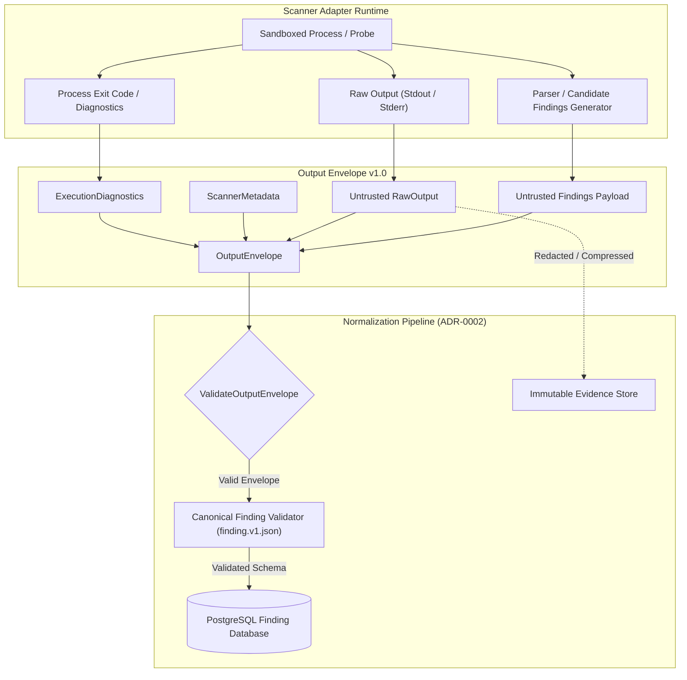
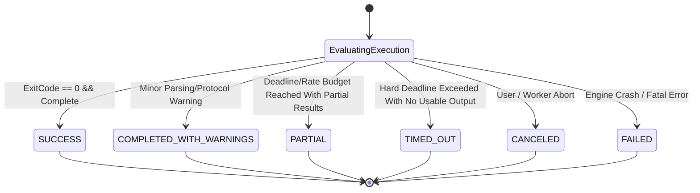

# Kelvin — Scanner Output Envelope Specification

**Document Control**

| Field | Value |
| :--- | :--- |
| **Status** | Phase 2 Baseline |
| **Milestone** | Phase 2 — Assessment Engine & Scanner Integrations (`P2-04`) |
| **Owner** | Platform Engineering / Data & Normalization |
| **Related decisions** | `ADR-0002` (Canonical Finding Schema), `ADR-0005` (Execution Sandboxing) |
| **Related specifications** | `FINDING_SCHEMA.md`, `EXECUTION_ISOLATION.md`, `OBSERVABILITY.md` |

---

## 1. Overview & Purpose

The Scanner Output Envelope establishes the uniform, versioned container returned by all scanner adapters to the assessment worker upon task completion, timeout, cancellation, or error.

A critical security principle is the **absolute separation of raw scanner output from normalized findings**. Raw stdout, stderr, process logs, and unparsed diagnostic dumps are untrusted and must never be stored directly in findings collections or exposed directly to tenant end-users. The envelope encapsulates raw diagnostic output alongside candidate findings and execution telemetry.

---

## 2. Envelope Architecture & Normalization Flow

---

## 3. Execution Status State Diagram

The output envelope explicitly distinguishes between full success, warnings, partial completions, process crashes, and supervisor cancellations.

---

## 4. Contract Schema Definition

The envelope structure is defined in `apps/worker/internal/adapter/output.go`.

| Field Path | Type | Obligation | Description |
| :--- | :--- | :--- | :--- |
| `schema_version` | String | Required | Envelope version (`"1.0"`). |
| `assessment_id` | UUID | Required | Assessment entity identifier. |
| `task_id` | UUID | Required | Task execution identifier. |
| `tenant_id` | UUID | Required | Owning tenant identifier. |
| `status` | String | Required | One of `SUCCESS`, `COMPLETED_WITH_WARNINGS`, `PARTIAL`, `FAILED`, `CANCELED`, `TIMED_OUT`. |
| `started_at` | RFC3339 | Required | UTC timestamp of task start. |
| `completed_at` | RFC3339 | Required | UTC timestamp of task end (`completed_at >= started_at`). |
| `duration` | Duration | Required | Wall-clock execution duration. |
| `is_partial` | Boolean | Required | True if scan was terminated before full completion. |
| `partial_reason` | String | Conditional| Required if `is_partial == true` (e.g. `DEADLINE_EXCEEDED`). |
| `raw_output` | Bytes | Optional | Untrusted stdout/stderr captured during execution. |
| `findings` | JSON Raw | Optional | Untrusted candidate findings payload for canonical validation. |
| `diagnostics` | Object | Required | Exit code, CPU, memory metrics, stdout/stderr byte sizes. |
| `scanner` | Object | Required | Scanner name, adapter version, engine version, template set. |

---

## 5. Security & Isolation Invariants

1. **Strict Data Segregation:** Raw scanner output (`raw_output`) and findings (`findings`) occupy discrete fields in the envelope. Raw streams are never injected directly into API responses without sanitization and access-controlled evidence download policies.
2. **Mandatory Partial Attribution:** If `is_partial` is set, `partial_reason` must be provided, ensuring downstream reporting tools can clearly disclose incomplete scan coverage to operators.
3. **Fail-Closed Diagnostics:** If an adapter terminates abnormally (SIGSEGV, OOM, or non-zero exit code), the envelope status is marked `FAILED` or `PARTIAL`, preserving stderr in `diagnostics.error_message`.

---

## 6. Traceability

| Requirement | Artifact |
| :--- | :--- |
| Output Envelope Definition | `apps/worker/internal/adapter/output.go` |
| Output Envelope Test Suite | `apps/worker/internal/adapter/output_test.go` |
| Tracking Issue | `.github/issues/phase-2/P2-04_DEFINE_SCANNER_OUTPUT_ENVELOPE.md` |
