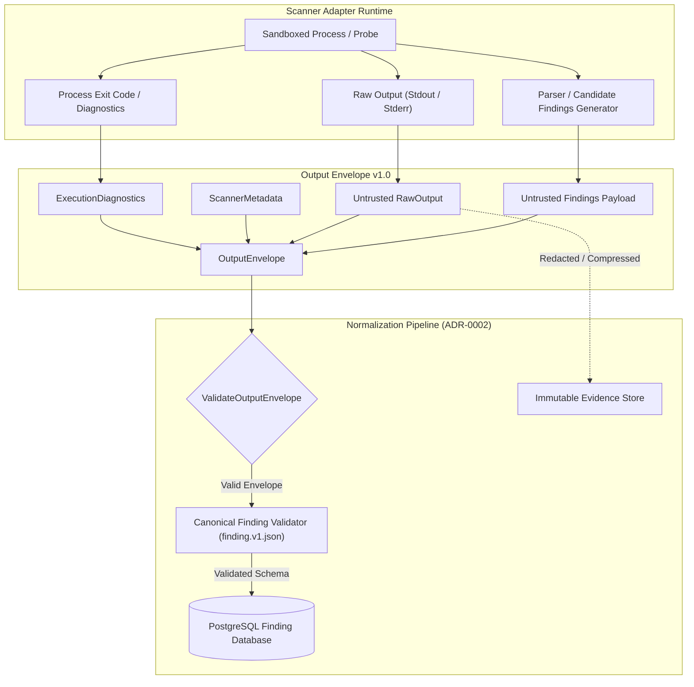
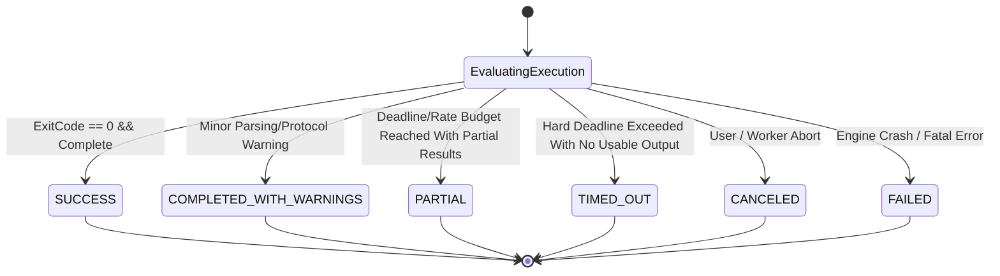

# Kelvin — Scanner Output Envelope Specification
# Kelvin — Scanner Output Envelope

**Document Control**

| Field | Value |
| :--- | :--- |
| **Status** | Phase 2 Baseline |
| **Milestone** | Phase 2 — Assessment Engine & Scanner Integrations (`P2-04`) |
| **Owner** | Platform Engineering / Data & Normalization |
| **Related decisions** | `ADR-0002` (Canonical Finding Schema), `ADR-0005` (Execution Sandboxing) |
| **Related specifications** | `FINDING_SCHEMA.md`, `EXECUTION_ISOLATION.md`, `OBSERVABILITY.md` |

---

## 1. Overview & Purpose

The Scanner Output Envelope establishes the uniform, versioned container returned by all scanner adapters to the assessment worker upon task completion, timeout, cancellation, or error.

A critical security principle is the **absolute separation of raw scanner output from normalized findings**. Raw stdout, stderr, process logs, and unparsed diagnostic dumps are untrusted and must never be stored directly in findings collections or exposed directly to tenant end-users. The envelope encapsulates raw diagnostic output alongside candidate findings and execution telemetry.

---

## 2. Envelope Architecture & Normalization Flow



---

## 3. Execution Status State Diagram

The output envelope explicitly distinguishes between full success, warnings, partial completions, process crashes, and supervisor cancellations.



---

## 4. Contract Schema Definition

The envelope structure is defined in `apps/worker/internal/adapter/output.go`.

| Field Path | Type | Obligation | Description |
| :--- | :--- | :--- | :--- |
| `schema_version` | String | Required | Envelope version (`"1.0"`). |
| `assessment_id` | UUID | Required | Assessment entity identifier. |
| `task_id` | UUID | Required | Task execution identifier. |
| `tenant_id` | UUID | Required | Owning tenant identifier. |
| `status` | String | Required | One of `SUCCESS`, `COMPLETED_WITH_WARNINGS`, `PARTIAL`, `FAILED`, `CANCELED`, `TIMED_OUT`. |
| `started_at` | RFC3339 | Required | UTC timestamp of task start. |
| `completed_at` | RFC3339 | Required | UTC timestamp of task end (`completed_at >= started_at`). |
| `duration` | Duration | Required | Wall-clock execution duration. |
| `is_partial` | Boolean | Required | True if scan was terminated before full completion. |
| `partial_reason` | String | Conditional| Required if `is_partial == true` (e.g. `DEADLINE_EXCEEDED`). |
| `raw_output` | Bytes | Optional | Untrusted stdout/stderr captured during execution. |
| `findings` | JSON Raw | Optional | Untrusted candidate findings payload for canonical validation. |
| `diagnostics` | Object | Required | Exit code, CPU, memory metrics, stdout/stderr byte sizes. |
| `scanner` | Object | Required | Scanner name, adapter version, engine version, template set. |

---

## 5. Security & Isolation Invariants

1. **Strict Data Segregation:** Raw scanner output (`raw_output`) and findings (`findings`) occupy discrete fields in the envelope. Raw streams are never injected directly into API responses without sanitization and access-controlled evidence download policies.
2. **Mandatory Partial Attribution:** If `is_partial` is set, `partial_reason` must be provided, ensuring downstream reporting tools can clearly disclose incomplete scan coverage to operators.
3. **Fail-Closed Diagnostics:** If an adapter terminates abnormally (SIGSEGV, OOM, or non-zero exit code), the envelope status is marked `FAILED` or `PARTIAL`, preserving stderr in `diagnostics.error_message`.

---

## 6. Traceability

| Requirement | Artifact |
| :--- | :--- |
| Output Envelope Definition | `apps/worker/internal/adapter/output.go` |
| Output Envelope Test Suite | `apps/worker/internal/adapter/output_test.go` |
| Tracking Issue | `.github/issues/phase-2/P2-04_DEFINE_SCANNER_OUTPUT_ENVELOPE.md` |
| **Status** | Phase 2 contract (`P2-04`) |
| **Contract version** | `scanner-output.v1` (`schema_version: 1.0`) |
| **Go implementation** | `apps/worker/internal/adapters/output.go` |
| **JSON Schema** | `packages/schemas/scanner-output.v1.json` |
| **Related** | `SCANNER_ADAPTER_CONTRACT.md`, `SCANNER_INVOCATION_INPUT.md`, `FINDING_SCHEMA.md`, `EXECUTION_ISOLATION.md` |

## Contract

Every adapter returns `adapters.ScannerOutputEnvelope` (aliased as `adapters.Result` for the adapter lifecycle API). The output is versioned and carries assessment/scanner/run identity, engine and adapter versions, correlation ID, start/end timestamps, status, exit code, duration, normalized findings, diagnostics, scanner-specific metadata, partial-result state, and references to separately stored stdout/stderr artifacts.

`findings` contains only records that already conform to `finding.v1.json`. Raw scanner output is never placed in `findings`; bounded raw content belongs in `raw_payload`, and larger stdout/stderr data belongs in opaque `artifact://<uuid>` references. Both raw channels are untrusted and must be redacted before persistence and escaped before display. Artifact references cannot point to external URLs.

## Status semantics

| Status | Meaning | Required consistency |
| :--- | :--- | :--- |
| `COMPLETED` | Scanner exited successfully with no warnings and all planned work completed. | Exit code is `0`; `partial` is false; no warning/error diagnostics. |
| `COMPLETED_WITH_WARNINGS` | Scanner completed successfully but reports non-fatal skipped/degraded checks. | Exit code is `0`; `partial` is false; at least one warning diagnostic and no error diagnostic. |
| `PARTIAL` | Some usable normalized findings were produced, but planned work did not complete. | `partial` is true; at least one finding and warning diagnostic. Include a reason code such as `DEADLINE_NEAR`, `TARGET_UNAVAILABLE`, or `OUTPUT_TRUNCATED`. |
| `FAILED` | Execution or parsing failed; the result is not a successful complete scan. | `partial` is false; an error diagnostic is required. Include the process exit code when one exists. Malformed raw output is retained only as bounded untrusted diagnostics/artifact, never as a finding. |
| `TIMED_OUT` | Worker deadline stopped execution. | `DEADLINE_EXCEEDED` diagnostic required. If usable partial findings are retained, set `partial: true`; otherwise false. |
| `CANCELLED` | Explicit job cancellation stopped execution. | `CANCELLED` diagnostic required. If usable partial findings are retained, set `partial: true`; otherwise false. |

`exit_code` is optional for built-in checks that do not have a process exit code; external process results should include it. A non-zero process exit is never silently interpreted as `COMPLETED`. Diagnostics use `info`, `warning`, or `error`, a stable machine code, and a sanitized human-readable message. Do not put credentials, tokens, or unredacted target response content in diagnostic messages.

## Validation and failure handling

`EncodeOutputEnvelope` and `DecodeOutputEnvelope` validate the status rules, required metadata, timestamps, finding schema, bounded raw payload, and opaque artifact references. Decode rejects unknown fields and trailing JSON. An invalid envelope, malformed finding, or scanner crash fails the job; raw output remains separate and is not promoted to normalized findings. The worker must validate each finding again at ingestion and apply canonical redaction and server-assigned fields per `FINDING_SCHEMA.md`.

The envelope schema references `finding.v1.json` for each finding. The Go validator performs structural checks; the ingestion service remains responsible for full JSON Schema validation, secret redaction, canonicalization, and persistence. Scanner metadata is untrusted and may not override envelope metadata or server-owned finding fields.

## Example

```json
{
  "schema_version": "1.0",
  "metadata": {
    "assessment_id": "22222222-2222-2222-2222-222222222222",
    "scanner_id": "zap",
    "scanner_version": "2.16.1",
    "adapter_version": "1.0.0",
    "run_id": "11111111-1111-1111-1111-111111111111",
    "started_at": "2026-11-01T00:00:00Z",
    "completed_at": "2026-11-01T00:00:02Z",
    "correlation_id": "request-abc"
  },
  "status": "COMPLETED_WITH_WARNINGS",
  "exit_code": 0,
  "duration_ms": 2000,
  "findings": [],
  "diagnostics": [{ "level": "warning", "code": "RULE_SKIPPED", "message": "An optional passive rule was unavailable" }],
  "partial": false,
  "raw_artifacts": { "stdout_ref": "artifact://aaaaaaaa-aaaa-aaaa-aaaa-aaaaaaaaaaaa/stdout" },
  "raw_payload": { "format": "text", "content": "bounded raw scanner output" }
}
```
