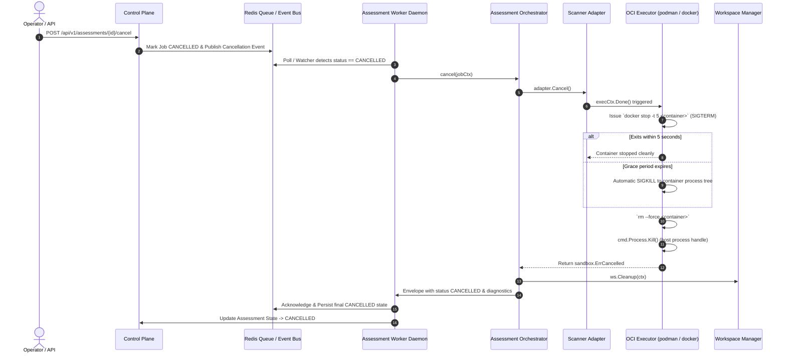

# Scanner Process Cancellation & Process Tree Termination

## 1. Executive Summary

In accordance with ADR-0005 (Execution Isolation) and Issue P2-26, Kelvin guarantees immediate, clean, and reliable termination of scanner executions whenever an assessment is cancelled. 

When a user or control plane initiates a cancellation, the worker must:
1. Halt execution immediately across all phases and active scanners.
2. Terminate the entire process tree and OCI container, leaving zero orphaned processes or lingering background jobs.
3. Stop ingesting additional scanner output while preserving all previously collected valid diagnostics and observations.
4. Synthesize an auditable Canonical Finding Envelope with status `CANCELLED` and diagnostic code `CANCELLED`.
5. Provide strict idempotency and concurrency safety against repeated or concurrent cancellation requests.
6. Cleanly differentiate user cancellation from execution deadlines, connection timeouts, and infrastructure failures.

---

## 2. Cancellation Lifecycle & Architecture

The cancellation signal flows end-to-end from the Control Plane API down to the containerized scanner process and workspace cleaner:



---

## 3. Signal Propagation & Worker Queue Watcher

Kelvin employs a dual-channel cancellation propagation system:

### 3.1 Background Cancellation Watcher
While an assessment job executes in `daemon.executeJob(ctx, job)`, a dedicated watcher goroutine periodically inspects the queue or event stream for cancellation signals:
```go
watcherCtx, cancelWatcher := context.WithCancel(ctx)
defer cancelWatcher()

go func() {
    ticker := time.NewTicker(500 * time.Millisecond)
    defer ticker.Stop()
    for {
        select {
        case <-watcherCtx.Done():
            return
        case <-ticker.C:
            if status, err := d.queue.GetStatus(watcherCtx, job.ID); err == nil && status == queue.StatusCancelled {
                jobCancel() // Cancels job execution context immediately
                return
            }
        }
    }
}()
```

### 3.2 Context & Adapter Notification
When `jobCancel()` is invoked:
1. `jobCtx.Done()` closes, which immediately interrupts blocking calls in the orchestrator.
2. `adapter.Cancel()` is called on the active scanner adapter, allowing it to perform adapter-specific abort logic.
3. The underlying OCI executor detects context closure and initiates the container termination procedure.

---

## 4. Process Tree Termination & Orphan Prevention

External scanner binaries (such as Nuclei, Nmap, or custom tools) often spawn child worker processes, helper utilities, or DNS resolver threads. Simply killing the top-level CLI runner on the host can leave background scanners running unmanaged.

To guarantee zero orphaned processes:

### 4.1 OCI Container Boundary (ADR-0005)
All scanner executions occur inside ephemeral rootless OCI containers with dedicated PID namespaces:
- When the container is stopped via `docker stop --time=5 <container>`, `SIGTERM` is delivered to PID 1 inside the container namespace.
- If PID 1 or any child process does not exit within the 5-second grace period, the OCI runtime sends `SIGKILL` (signal 9) to all processes in the container PID namespace.
- After container termination, `docker rm --force <container>` removes all container metadata, ephemeral filesystems, and rootless cgroups slices.

### 4.2 Local Host Process Reclamation
On the worker node, `OCIExecutor.Execute` monitors the host process executing the container CLI:
```go
select {
case err := <-done:
    return res, err
case <-ctx.Done():
    // User cancellation or deadline expiry
    _ = e.stopContainer(containerName, stopGraceSeconds)
    _ = e.removeContainer(containerName)
    if cmd.Process != nil {
        _ = cmd.Process.Kill()
    }
    <-done
    if errors.Is(ctx.Err(), context.Canceled) {
        return res, ErrCancelled
    }
    return res, ErrTimeout
}
```
Waiting on `<-done` after killing the process guarantees no zombie processes remain in the worker process table.

---

## 5. Preservation of Diagnostics & Envelope Synthesis

Cancellation must not destroy legitimate work or diagnostics already captured prior to the abort signal:

1. **Diagnostic Preservation**: All findings, target observations, and runtime logs captured prior to cancellation are preserved and merged into the final envelope.
2. **Cancellation Diagnostic**: A formal diagnostic entry is appended to record the cancellation event:
   ```json
   {
     "code": "CANCELLED",
     "level": "error",
     "message": "execution was cancelled by operator request",
     "source": "orchestrator"
   }
   ```
3. **Canonical Output Envelope**:
   ```json
   {
     "schema_version": "1.0.0",
     "envelope_version": "1.0.0",
     "scan_id": "scan-12345",
     "scanner_name": "nuclei",
     "status": "CANCELLED",
     "findings": [...],
     "diagnostics": [
       {
         "code": "CANCELLED",
         "level": "error",
         "message": "execution was cancelled by operator request",
         "source": "orchestrator"
       }
     ]
   }
   ```
4. **Pipeline Interruption**: Multi-phase assessment pipelines halt immediately upon cancellation. No subsequent scanner phases or post-processing stages are executed.

---

## 6. Distinguishing Cancellation from Timeouts and Failures

Kelvin strictly distinguishes between operator cancellation, execution deadlines, and network timeouts:

| State | Error / Signal | Final Envelope Status | Diagnostic Code | Resource Metric |
| :--- | :--- | :--- | :--- | :--- |
| **Operator Cancellation** | `context.Canceled` / `ErrCancelled` | `CANCELLED` | `CANCELLED` | `CauseCancelled` |
| **Execution Deadline Exceeded** | `context.DeadlineExceeded` / `ErrTimeout` | `TIMED_OUT` | `DEADLINE_EXCEEDED` | `CauseDeadline`, `ViolationDeadline` |
| **Target Connection Timeout** | Network Dial / Read Timeout | `COMPLETED_WITH_WARNINGS` | `CONNECTION_TIMEOUT` | None |
| **Process Crash / Runtime Error** | Non-zero exit code / panic | `FAILED` | `EXECUTION_FAILED` | `CauseError` |

---

## 7. Idempotency & Concurrency Guarantees

Cancellation requests may be sent multiple times due to operator retries, UI double-clicks, or distributed queue redeliveries:
- **`adapter.Cancel()`**: Safely designed to be callable multiple times concurrently or sequentially without panic or state corruption.
- **`context.CancelFunc`**: Go's native cancel functions are idempotent and thread-safe.
- **Queue Status**: Once a job is marked `CANCELLED`, subsequent cancel operations are no-ops that return `StatusCancelled`.
- **Cleanup**: Workspace cleanup (`ws.Cleanup(ctx)`) uses idempotent path removals (`os.RemoveAll`) and checks whether directories exist before unmounting.

---

## 8. Verification & Test Coverage

Process cancellation is verified through automated unit and integration tests:

1. **`TestExecuteScannerHandlesCancellation`**: Verifies that when context is cancelled during execution, the orchestrator returns `sandbox.ErrCancelled`, sets status to `CANCELLED`, records the `CANCELLED` diagnostic, and prevents further work.
2. **`TestExecutePipelineHaltsImmediatelyOnCancellation`**: Verifies that a multi-phase pipeline halts at phase 1 upon cancellation, leaving subsequent phases unexecuted while preserving phase 1 diagnostics.
3. **`TestRepeatedCancellationIsIdempotent`**: Verifies that invoking `adapter.Cancel()` repeatedly in rapid succession causes no errors or panics.
4. **`TestDaemonCancelsRunningJobViaQueueStatus`**: Verifies that the worker daemon's background watcher detects an external cancellation in the queue, aborts the active runner, and records a `CANCELLED` final state.
