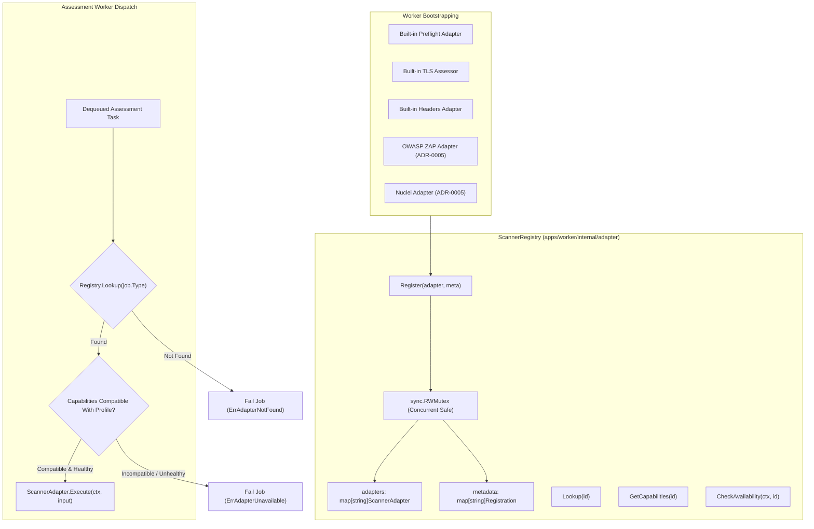

# Kelvin — Scanner Registry & Capability Discovery Specification

**Document Control**

| Field | Value |
| :--- | :--- |
| **Status** | Phase 2 Baseline |
| **Milestone** | Phase 2 — Assessment Engine & Scanner Integrations (`P2-06`) |
| **Owner** | Platform Engineering / Assessment Engine |
| **Related decisions** | `ADR-0005` (Execution Sandboxing), `MVP_SCANNER_SELECTION.md` |
| **Related specifications** | `SCANNER_ADAPTER_INTERFACE.md`, `SCAN_PROFILES.md`, `FINDING_SCHEMA.md` |

---

## 1. Overview & Purpose

The Scanner Registry provides centralized adapter discovery, registration, and health monitoring for KELVIN Phase 2 assessment engines. 

Rather than hardcoding scanner invocations in worker daemons, the assessment engine queries the registry at runtime to resolve adapters by identifier, discover supported capabilities (such as passive vs. active scanning and protocol support), inspect availability status, and ensure duplicate adapters cannot be registered.

---

## 2. Architecture & Discovery Flowchart



---

## 3. Registration Metadata Schema

Each scanner adapter registers with the following metadata structure (`apps/worker/internal/adapter/registry.go`):

```go
type Registration struct {
    ID                   string       `json:"id"`
    DisplayName          string       `json:"display_name"`
    Version              string       `json:"version"`
    SupportedTargetTypes []string     `json:"supported_target_types"`
    Capabilities         Capabilities `json:"capabilities"`
    ConfigVersion        string       `json:"config_version"`
    Availability         HealthState  `json:"availability"`
    RegisteredAt         time.Time    `json:"registered_at"`
}
```

### Discovery Capabilities

| Capability Field | Type | Description |
| :--- | :--- | :--- |
| `passive_only` | Boolean | True if the adapter only inspects existing traffic / headers. |
| `active_scanning` | Boolean | True if the adapter generates probe requests. |
| `supported_protocols` | Array[String] | Protocols handled (e.g. `["http", "https"]`). |
| `supported_target_types` | Array[String] | Allowed target kinds (e.g. `["hostname", "ipv4", "url"]`). |
| `max_concurrency` | Integer | Maximum concurrent worker tasks supported by engine. |
| `supports_cancellation` | Boolean | Confirms adapter terminates subprocess immediately on cancel. |
| `requires_sandbox` | Boolean | True for external CLI binaries (ZAP, Nuclei) under ADR-0005. |

---

## 4. Security & Isolation Invariants

1. **Deterministic Unique Identification:** Duplicate adapter names fail fast at startup (`ErrAdapterAlreadyRegistered`). Dynamic reassignment of engine IDs is prohibited.
2. **Read/Write Isolation:** Registry reads are protected via `sync.RWMutex`, allowing high-throughput concurrent lookups during distributed worker operations without lock contention.
3. **Decoupled Execution Telemetry:** Registry metadata records only engine capabilities and health. Assessment-specific metrics, findings, and logs are kept strictly isolated in execution envelopes.

---

## 5. Traceability

| Requirement | Artifact |
| :--- | :--- |
| Scanner Registry Implementation | `apps/worker/internal/adapter/registry.go` |
| Registry Test Suite | `apps/worker/internal/adapter/registry_test.go` |
| Tracking Issue | `.github/issues/phase-2/P2-06_IMPLEMENT_SCANNER_REGISTRY_AND_CAPABILITY_DISCOVERY.md` |
