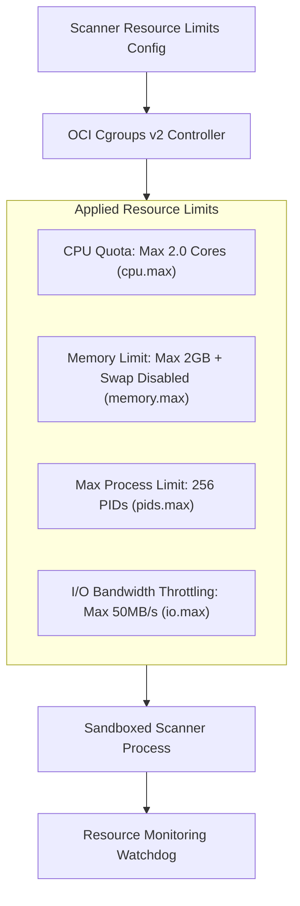

# Scanner-Specific Resource Limits

## 1. Executive Summary

In accordance with ADR-0005 (Execution Isolation) and the Resource Control Model (`docs/architecture/EXECUTION_ISOLATION.md` §3.5), all scanner executions operate under explicit cgroups v2 resource ceilings. No scanner is allowed to consume unbounded CPU, memory, PIDs, or ephemeral disk space.

This specification documents the per-scanner resource allocations, platform ceilings, enforcement mechanisms, and structured failure reporting implemented in `apps/worker/internal/limits`.

---

## 2. Architecture & Enforcement Workflow



---

## 3. Approved Scanner Resource Matrix

| Scanner ID | Runtime | CPU Quota (`--cpus`) | Memory Ceiling (`--memory`) | Swap Policy (`--memory-swap`) | Max PIDs (`--pids-limit`) | Ephemeral Scratch (`tmpfs`) | Default Hard Deadline | Max Connections |
| :--- | :--- | :--- | :--- | :--- | :--- | :--- | :--- | :--- |
| **`http_preflight`** | In-Process | `0.5` | `128m` | N/A (Host process) | 16 | `64m` | 2 minutes | 2 |
| **`http_security_headers`** | In-Process | `0.5` | `128m` | N/A (Host process) | 16 | `64m` | 2 minutes | 2 |
| **`tls_assessment`** | In-Process | `0.5` | `256m` | N/A (Host process) | 16 | `64m` | 3 minutes | 2 |
| **`zap_baseline`** | Rootless OCI (JVM/Python) | `2.0` | `1536m` (1.5GB) | Disabled (`--memory-swap=1536m`) | 128 | `512m` | 10 minutes | 10 |
| **`nuclei`** | Rootless OCI (Go binary) | `2.0` | `1024m` (1.0GB) | Disabled (`--memory-swap=1024m`) | 64 | `256m` | 10 minutes | 25 |

---

## 4. Platform Ceilings & Tamper-Proofing

To prevent multi-tenant noisy neighbor scenarios or rogue scanner configurations from monopolizing node resources, Kelvin enforces a strict **Platform Ceiling** (`limits.PlatformCeiling`):

```go
var PlatformCeiling = Limits{
    CPUQuota:             "2.0",
    MemoryLimit:          "2g",
    DiskLimit:            "2g",
    MaxPIDs:              256,
    MaxConcurrentConns:   50,
    MaxRequestsPerTarget: 50000,
    HardDeadline:         30 * time.Minute,
}
```

### Invariants:
1. **Ceiling Inviolability**: `limits.ValidateAgainstCeiling(requested, ceiling)` fails closed (`ErrExceedsCeiling`) if any profile or operator override attempts to surpass platform maximums.
2. **Swap Disabled**: For containerized runtimes, `--memory-swap` is set equal to `--memory`. This prevents processes from thrashing node swap space or evading memory limits.
3. **PID Caps**: Fork bombs and runaway sub-process creation are prevented via cgroup `pids.max` (max 256 system ceiling, 128 for ZAP, 64 for Nuclei, 16 for in-process).

---

## 5. Structured Failure Reporting & Observability

When a scanner exceeds its resource allocation, the failure is deterministically captured, classified, and published:

1. **Out of Memory (OOM)**:
   - Cgroups sends `SIGKILL` (exit code `137`).
   - Supervisor sets `Result.OOMKilled = true`.
   - Metrics incremented: `metrics.ViolationOOM` and `metrics.CauseOOM`.
   - Diagnostic emitted:
     ```json
     {
       "level": "error",
       "code": "RESOURCE_EXHAUSTED_OOM",
       "message": "scanner execution terminated due to out-of-memory (OOM)"
     }
     ```
2. **Hard Deadline Exceeded**:
   - Process supervisor kills container process tree (`SIGTERM`, followed by `SIGKILL` after grace period).
   - Supervisor sets `Result.DeadlineExceeded = true`.
   - Metrics incremented: `metrics.ViolationDeadline` and `metrics.CauseDeadline`.
   - Diagnostic emitted:
     ```json
     {
       "level": "error",
       "code": "RESOURCE_EXHAUSTED_DEADLINE",
       "message": "scanner execution exceeded hard execution deadline"
     }
     ```
