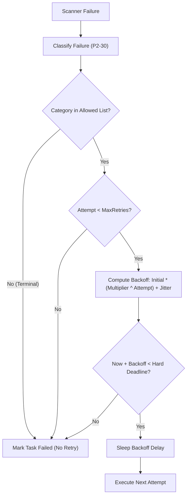

# Architecture Guide: Safe Scanner Retry Policies (P2-31)

## 1. Overview & Purpose

Automated vulnerability scanners interact with external networks and target servers subject to transient fluctuations: momentary network dropouts, transient DNS resolution delays, connection resets, and intermediate firewall rate spikes.

Retrying transient failures improves scan completion rates and operator reliability. However, naive retries against unreachable or protected systems risk:
1. Creating uncontrolled, repeated scanning floods that overwhelm targets.
2. Generating duplicate finding envelopes and inconsistent assessment reports.
3. Violating tenant hard execution deadlines or resource quotas.
4. Masking permanent security denials (scope violations, invalid credentials, SSRF egress blocks).

The Kelvin **Scanner Retry Policy Engine** (`apps/worker/internal/retry`) enforces bounded, exponential backoff retries strictly limited to transient failure classes while treating policy, configuration, and resource failures as immediately terminal.

---

## 2. Retry Decision Matrix & Failure Category Rules

| Failure Category (`apps/worker/internal/classification`) | Retry Decision | Max Retries | Backoff Strategy | Rationale |
| :--- | :--- | :--- | :--- | :--- |
| `ERR_TARGET_UNREACHABLE` | **Retryable** | 1–2 | Exponential + Jitter | Transient network blip or temporary connection reset |
| `ERR_DEADLINE_EXCEEDED` | **Conditional** | 0 | None | Execution deadline expired; retrying without deadline extension would fail |
| `ERR_INFRASTRUCTURE_FAULT` | **Retryable** | 1 | 2s Fixed Backoff | Ephemeral worker daemon or container runtime glitch |
| `ERR_SCOPE_VIOLATION` | **Terminal** | 0 | Abort Immediately | Security policy violation; destination is strictly out of scope |
| `ERR_INVALID_CONFIG` | **Terminal** | 0 | Abort Immediately | Schema or parameter failure; cannot succeed on retry |
| `ERR_UNSUPPORTED_VERSION` | **Terminal** | 0 | Abort Immediately | Binary version incompatible with catalog baseline |
| `ERR_RESOURCE_EXHAUSTION` (OOM) | **Terminal** | 0 | Abort Immediately | Container exceeded memory limits; repeating will re-trigger OOM |
| `ERR_OUTPUT_PARSE_ERROR` | **Terminal** | 0 | Abort Immediately | Corrupt report artifacts generated by scanner |
| `ERR_PROCESS_CRASH` | **Terminal** | 0 | Abort Immediately | Process crashed unexpectedly (segfault, core dump) |

---

## 3. Scanner-Specific Policies & Backoff Curves

To balance assessment speed and target protection, retry policies are tailored by scanner weight:

### Scanner Profiles

1. **Lightweight In-Process Checks (`http_preflight`, `http_security_headers`, `tls_assessor`)**:
   - `MaxRetries`: 2 (up to 3 total attempts).
   - `InitialBackoff`: 500ms.
   - `BackoffMultiplier`: 2.0.
   - `MaxBackoff`: 3s.
2. **Heavy Containerized Scanners (`zap`, `nuclei`)**:
   - `MaxRetries`: 1 (up to 2 total attempts).
   - `InitialBackoff`: 2s.
   - `BackoffMultiplier`: 2.0.
   - `MaxBackoff`: 10s.

---

## 4. Assessment Deadline Guard

Before scheduling any retry, the engine evaluates the remaining assessment execution deadline:
$$\text{now} + \text{backoff} + \text{executionDuration} \le \text{HardDeadline}$$

If sleeping through the backoff would cause the subsequent attempt to start with an expired deadline, the retry is aborted immediately, preventing unnecessary delay and worker slot starvation.

---

## 5. Queue Idempotency & Re-delivery Protection

1. **Attempt Tracking**: The worker tracks execution attempt counters per job ID.
2. **Single In-Flight Execution**: Retry loops execute within the worker task boundary before acknowledging or failing the message in Redis/RabbitMQ.
3. **Poison Pill Elimination**: If a message is redelivered via queue acknowledgment timeout, the orchestrator detects previous attempt history and prevents duplicate scanner executions.
