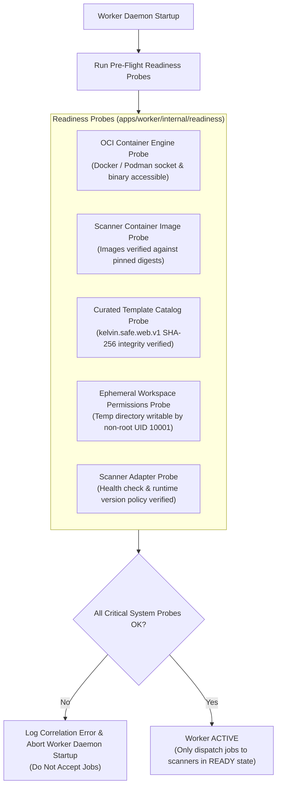

# Scanner Runtime Readiness and Health Verification (P2-20)

## 1. Executive Summary & Purpose

The Kelvin Assessment Engine requires deterministic guarantees that required scanner runtimes, container engines, and template catalogs are fully functional before dispatching jobs. As mandated by ADR-0005 and ADR-0002, scanners must never fail silently during execution due to unpulled container images, corrupted template catalogs, or inaccessible OCI runtimes.

This specification documents the implementation of the Scanner Availability and Runtime Readiness Framework delivered under **P2-20** in `apps/worker/internal/readiness`.

---

## 2. Architecture & Readiness Lifecycle



---

## 3. Core Readiness Probes

The framework defines individual, decoupled probes implementing the `Probe` interface:

```go
type Probe interface {
    Name() string
    Target() string
    Check(ctx context.Context) ProbeResult
}
```

### 3.1 OCI Container Engine Probe (`OCIEngineProbe`)
- Verifies that a rootless OCI runtime (`podman` or `docker`) exists in the system `PATH` and responds to execution.
- If missing, marks the system as `UNAVAILABLE`, aborting worker registration.

### 3.2 Ephemeral Workspace Permissions Probe (`WorkspacePermissionsProbe`)
- Validates that the sandbox workspace (e.g. `/tmp` or configured directory) exists and permits writing and removing temporary test files under unprivileged worker permissions (`UID 10001`).
- Fails closed if the filesystem is read-only or permission-denied.

### 3.3 Curated Template Catalog Probe (`TemplateCatalogProbe`)
- Validates that the curated Nuclei template catalog (`kelvin.safe.web.v1`) exists at its declared path.
- Executes `adapters.LoadCuratedCatalog` to re-verify the manifest and SHA-256 integrity hashes for all templates before enabling Nuclei.

### 3.4 Container Image Probe (`ContainerImageProbe`)
- Verifies that external scanner container images (such as ZAP or Nuclei) are pulled and present in the local container store.
- Validates the image reference and pinned SHA-256 digest against `VersionPolicy`.

### 3.5 Scanner Adapter Probe (`ScannerAdapterProbe`)
- Wraps any registered `ScannerAdapter`.
- Calls `adapter.Health(ctx)` and `adapter.VerifyRuntimeVersion(ctx)` to ensure the scanner's in-process adapter and configuration are operational.

---

## 4. Application Health vs. Scanner Availability

The readiness engine strictly decouples **overall worker process health** from **individual scanner availability**:

```
+-----------------------------------------------------------------------------------+
|                               Health State Table                                  |
+--------------------------+-----------------------+--------------------------------+
| System Probes (OCI/Tmp)  | Scanner Probes        | Application Health Status      |
+--------------------------+-----------------------+--------------------------------+
| ALL PASS                 | ALL PASS              | StatusReady ("ok")             |
| ALL PASS                 | SOME PASS, SOME FAIL  | StatusReady / Degraded ("ok")  |
| ALL PASS                 | ALL FAIL              | StatusDegraded ("degraded")    |
| ANY FAIL                 | (ANY)                 | StatusUnavailable ("down")     |
+--------------------------+-----------------------+--------------------------------+
```

1. **Independent Evaluation:** Each scanner's readiness can be evaluated independently via `checker.CheckScanner(ctx, scannerID)`.
2. **Execution Guard:** The daemon worker dispatcher verifies `checker.IsScannerReady(ctx, job.Type)` before dequeuing or executing tasks. Unavailable scanners fail fast with an explicit error.
3. **Resilient Operation:** If an optional scanner (e.g. `nuclei`) is degraded due to a missing catalog or network pull failure, the worker remains online to process other scanners (`http_preflight`, `tls_assessor`, `http_security_headers`).

---

## 5. Public Health Endpoint Sanitization

To prevent information disclosure to unauthenticated network observers, the HTTP endpoints (`/healthz`, `/readyz`) serve a sanitized `PublicHealthSummary`:

```json
{
  "status": "ok",
  "ready_scanners": ["http_preflight", "http_security_headers", "tls_assessor", "zap"],
  "degraded_scanners": ["nuclei"],
  "checked_at": "2026-11-01T16:50:00Z"
}
```

### Privacy Guarantees:
- **No Path Disclosure:** Internal filesystem paths (`/tmp`, catalog file paths, binary locations) are strictly omitted.
- **No Cryptographic Hashes:** Catalog SHA-256 digests and image digests are excluded from public responses.
- **No Stack Traces or Errors:** Detailed OS error messages are withheld from public responses and logged strictly to internal structured logs with correlation identifiers.

Internal authenticated services can inspect full diagnostic details via `InternalDiagnosticsHandler`.

---

## 6. Correlated Structured Logging

Whenever a readiness probe encounters a failure or state degradation, the event is logged with structured correlation fields:

```json
{
  "level": "warn",
  "msg": "readiness probe failure detected",
  "probe_name": "nuclei_template_catalog",
  "target": "nuclei",
  "status": "UNAVAILABLE",
  "message": "curated catalog verification failed for /deploy/scanners/templates/catalog.json",
  "error": "template checksum mismatch",
  "duration_ms": 1.2
}
```

---

## 7. Security & Architectural Invariants

- **ADR-0005 Compliance:** Probes verify rootless execution requirements and dropped capabilities before allowing container execution.
- **Deterministic Startup:** Workers cannot join the active Redis consumer group if critical system probes fail.
- **Scope & Safety:** Scanners cannot be triggered until preflight reachability and readiness are validated.
