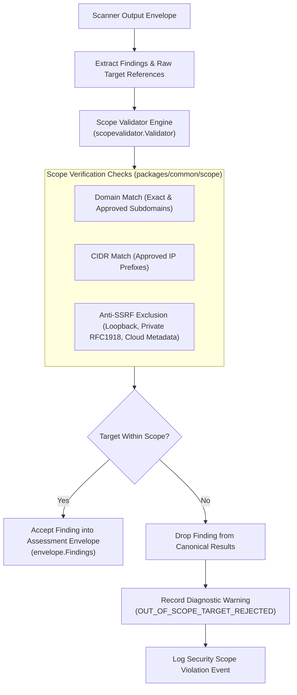

# Scanner Target Scope Validation

This document specifies Kelvin's architecture, validation rules, quarantine mechanics, and diagnostic telemetry for validating scanner-reported targets against authorized assessment scopes, fulfilling requirement **P2-37** (Issue #113).

---

## 1. Overview & Objective

External security scanners (e.g. Nuclei, OWASP ZAP, header checkers) actively crawl, parse redirects, discover external assets, and inspect linked resources. Scanners frequently discover and report findings referencing third-party CDNs, external identity providers, out-of-scope sibling domains, or internal private IP addresses (via SSRF vulnerability templates).

To guarantee strict compliance with authorization boundaries and prevent unauthorized cross-target probing:
1. **Independent Verification:** Findings reported by scanners are never accepted blindly; every target URL, hostname, and IP address embedded in finding records is independently verified against the assessment's approved scope policy (`packages/common/scope`).
2. **Quarantine & Dropping:** Findings that reference out-of-scope or prohibited targets are rejected and quarantined from the assessment's canonical findings.
3. **No Automatic Target Follow-Ups:** Out-of-scope target discoveries cannot trigger auxiliary scanner jobs, pipeline expansions, or unapproved network requests.
4. **Structured Diagnostic Traceability:** Dropped findings generate structured execution diagnostics (`OUT_OF_SCOPE_TARGET_REJECTED`) detailing the rejected target reference and violation reason.

---

## 2. Architecture & Enforcement Workflow

---

## 3. Core Components

### 3.1 `Validator` (`apps/worker/internal/scopevalidator`)

Leverages Phase 1 canonical scope policy (`packages/common/scope.Policy`):
- `ValidateTargetRef(ctx context.Context, targetRef string) error`: Normalizes URLs and hostnames, verifies inclusion in authorized domains or CIDRs, and rejects prohibited addresses (`127.0.0.1`, `10.0.0.0/8`, `169.254.169.254`).
- `FilterFindings(ctx context.Context, findings []json.RawMessage) ([]json.RawMessage, []ScopeViolation, error)`: Inspects each finding's `target.asset`, `target.url`, and `target.host` entries. Findings referencing unauthorized targets are stripped.
- `ToDiagnostics(violations []ScopeViolation) []adapters.ExecutionDiagnostic`: Emits traceable operational diagnostics without creating vulnerability findings.

### 3.2 Invariant Guarantees

- **Defense in Depth:** Even if a scanner's local configuration was misconfigured to follow third-party redirects, worker-level scope filtering ensures unauthorized targets never enter Kelvin's database.
- **SSRF Protection:** Scanner outputs attempting to report findings on internal infrastructure (`169.254.169.254`, `localhost`) are blocked.

---

## 4. Verification & Testing

Validated in `apps/worker/internal/scopevalidator/validator_test.go`:
- `TestFilterFindingsAcceptsInScope`: Verifies that findings on authorized targets (`https://example.com/api`) pass without modification.
- `TestFilterFindingsRejectsOutOfScope`: Verifies that third-party domains (`malicious-site.com`, `cdn.unauthorized-thirdparty.net`) are dropped and generate diagnostics.
- `TestFilterFindingsRejectsProhibitedInternalIPs`: Verifies that loopback (`127.0.0.1`), AWS metadata (`169.254.169.254`), and private IPs (`10.0.0.5`) are rejected.
- `TestFilterFindingsRejectsMissingTarget`: Verifies findings lacking target references are dropped safely.
