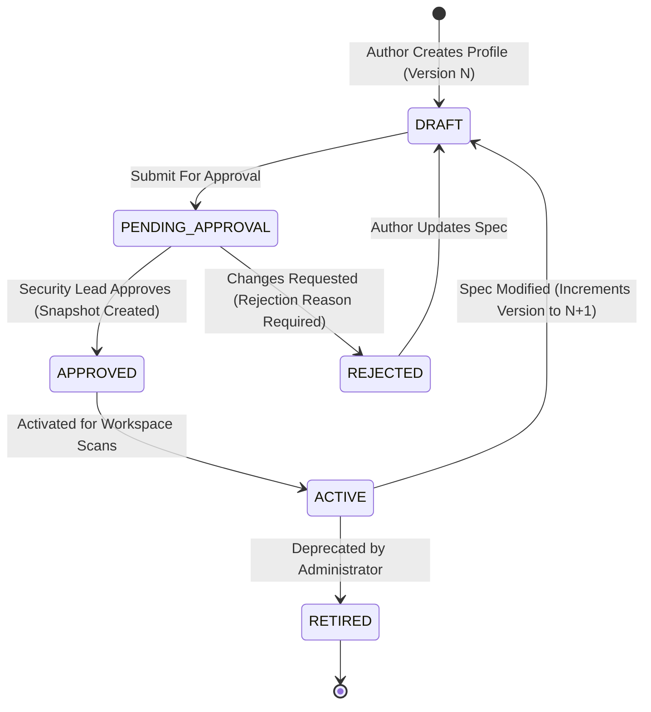

# Scan Profile Approval and Governance Architecture (P4-21)

## Executive Summary

Uncontrolled scan configurations can destabilize mission-critical production targets or violate regulatory scanning standards.

Issue **P4-21** implements an enterprise scan profile governance lifecycle featuring explicit states (`DRAFT`, `PENDING_APPROVAL`, `APPROVED`, `ACTIVE`, `REJECTED`, `RETIRED`), mandatory separation of duties (prohibiting self-approval), automatic approval enforcement for high-intensity scans (`AGGRESSIVE`, `INVASIVE`), and immutable version snapshots for deterministic auditability.

---

## 1. Lifecycle State Machine



---

## 2. Security Invariants & Defenses

### 2.1 Separation of Duties (Anti-Self-Approval)
- Security engineers creating custom scan configurations cannot authorize their own profiles into production (`ErrSelfApprovalProhibited`).
- An independent security administrator or SecOps director must review and approve the profile before it can be activated.

### 2.2 Mandatory Approval for High-Intensity Scans
- Profiles with intensity rated `AGGRESSIVE` or `INVASIVE` automatically mandate `requires_approval = true`.
- They cannot be activated directly from draft without passing through the formal review gate.

### 2.3 Immutable Version Snapshots
- When a profile is approved, an immutable snapshot (`scan_profile_snapshots`) is recorded capturing the exact tool list, parameters, and intensity level.
- If an author edits an approved profile, the system increments the `version` counter and places the update in `DRAFT`, preserving the historical snapshot so past and queued scans execute with full integrity.

### 2.4 Pre-Execution Usability Barrier
- Scanners invoke `ValidateProfileUsable` prior to job execution.
- Profiles in `DRAFT`, `PENDING_APPROVAL`, `REJECTED`, or `RETIRED` states are blocked from execution (`ErrProfileNotUsable` / `ErrProfileRetired`).

---

## 3. Database Schema

Managed in `scan_profiles` and `scan_profile_snapshots`:

```sql
CREATE TABLE IF NOT EXISTS scan_profiles (
  id                  UUID PRIMARY KEY DEFAULT gen_random_uuid(),
  organization_id     UUID NOT NULL REFERENCES organizations(id) ON DELETE CASCADE,
  name                VARCHAR(255) NOT NULL,
  slug                VARCHAR(100) NOT NULL,
  description         TEXT NOT NULL DEFAULT '',
  scanners            JSONB NOT NULL DEFAULT '[]'::jsonb,
  intensity           VARCHAR(50) NOT NULL DEFAULT 'NORMAL', -- PASSIVE, NORMAL, AGGRESSIVE, INVASIVE
  config              JSONB NOT NULL DEFAULT '{}'::jsonb,
  state               VARCHAR(50) NOT NULL DEFAULT 'DRAFT', -- DRAFT, PENDING_APPROVAL, APPROVED, ACTIVE, REJECTED, RETIRED
  version             INTEGER NOT NULL DEFAULT 1,
  requires_approval   BOOLEAN NOT NULL DEFAULT false,
  created_by_user_id  VARCHAR(255) NOT NULL,
  approved_by_user_id VARCHAR(255),
  approved_at         TIMESTAMPTZ,
  rejection_reason    TEXT NOT NULL DEFAULT '',
  created_at          TIMESTAMPTZ NOT NULL DEFAULT clock_timestamp(),
  updated_at          TIMESTAMPTZ NOT NULL DEFAULT clock_timestamp(),
  CONSTRAINT uq_scan_profile_org_slug_version UNIQUE (organization_id, slug, version)
);

CREATE TABLE IF NOT EXISTS scan_profile_snapshots (
  id         UUID PRIMARY KEY DEFAULT gen_random_uuid(),
  profile_id UUID NOT NULL REFERENCES scan_profiles(id) ON DELETE CASCADE,
  version    INTEGER NOT NULL,
  spec       JSONB NOT NULL,
  created_at TIMESTAMPTZ NOT NULL DEFAULT clock_timestamp(),
  CONSTRAINT uq_profile_version_snapshot UNIQUE (profile_id, version)
);
```

---

## 4. Acceptance Criteria & Test Verification

| Acceptance Criterion | Verification Method | Status |
| :--- | :--- | :--- |
| Complete lifecycle state machine | `TestScanProfileService_LifecycleAndApproval` | Verified |
| Separation of duties: self-approval rejection | `TestScanProfileService_LifecycleAndApproval/self-approval_defense:_author_cannot_approve_own_profile` | Verified |
| Mandatory approval for high-intensity scans | `TestScanProfileService_LifecycleAndApproval/profile_starts_in_DRAFT_and_aggressive_intensity_mandates_approval` | Verified |
| Immutable version snapshot generation | `TestScanProfileService_LifecycleAndApproval/approver_approves_profile_and_creates_immutable_snapshot` | Verified |
| Pre-execution usability barriers & retirement defense | `TestScanProfileService_LifecycleAndApproval/retiring_profile_blocks_future_use` | Verified |
