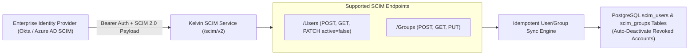

# SCIM 2.0 User and Group Provisioning Architecture (P4-16)

## Executive Summary

Enterprise Identity Providers (such as Okta, Microsoft Entra ID / Azure AD, PingIdentity, and CyberArk) utilize SCIM 2.0 (System for Cross-domain Identity Management, RFC 7643 / RFC 7644) to automate the lifecycle of enterprise accounts and team assignments.

Issue **P4-16** implements a fully standards-compliant SCIM 2.0 service provider for organization-scoped provisioning, deprovisioning, user updates, and group synchronization with strict least-privilege guards and audit logging.

---

## 1. SCIM Architecture & Synchronization Workflow



---

## 2. Security Invariants & Defenses

### 2.1 Scoped Bearer Token Authentication
- SCIM endpoints require authentication via high-entropy organization-scoped bearer tokens (`kelvin_scim_...`).
- Tokens are stored as SHA-256 hashes at rest in `scim_tokens`.
- Every incoming SCIM request is cryptographically resolved to its parent `organization_id`. Cross-organization access is structurally impossible.

### 2.2 Immediate Deprovisioning Enforcement
- When an employee departs an enterprise, the IdP issues `PATCH /scim/v2/Users/{id}` with `active = false`.
- The SCIM service immediately marks `active = false` and terminates active sessions, emitting an immutable audit event (`scim.user.deactivated`).

### 2.3 Least Privilege Group Mapping Defense
- External identity providers cannot grant platform-level superuser roles through SCIM group naming or synchronization.
- Any attempt to create or synchronize SCIM groups named after privileged roles (`ORG_OWNER`, `ORG_ADMIN`, `SECURITY_ADMIN`) is blocked with `ErrSCIMPrivilegedGroupForbidden`.

### 2.4 Idempotency & Conflict Handling
- Repeated user creation requests with the same `userName` and `externalId` return the existing user idempotently.
- Uniqueness conflicts (same `userName` with a different `externalId`) return an RFC 7644 compliant `409 Conflict` error (`ErrSCIMConflict`).

---

## 3. Database Schema

SCIM data is partitioned per organization:

```sql
CREATE TABLE IF NOT EXISTS scim_tokens (
  id              UUID PRIMARY KEY DEFAULT gen_random_uuid(),
  organization_id UUID NOT NULL REFERENCES organizations(id) ON DELETE CASCADE,
  token_hash      VARCHAR(64) NOT NULL,
  description     VARCHAR(255) NOT NULL DEFAULT 'SCIM Bearer Token',
  expires_at      TIMESTAMPTZ,
  revoked_at      TIMESTAMPTZ,
  created_at      TIMESTAMPTZ NOT NULL DEFAULT clock_timestamp(),
  CONSTRAINT uq_scim_token_hash UNIQUE (token_hash)
);

CREATE TABLE IF NOT EXISTS scim_users (
  id              UUID PRIMARY KEY DEFAULT gen_random_uuid(),
  organization_id UUID NOT NULL REFERENCES organizations(id) ON DELETE CASCADE,
  external_id     VARCHAR(255) NOT NULL,
  user_name       VARCHAR(255) NOT NULL,
  formatted_name  VARCHAR(255) NOT NULL DEFAULT '',
  given_name      VARCHAR(255) NOT NULL DEFAULT '',
  family_name     VARCHAR(255) NOT NULL DEFAULT '',
  active          BOOLEAN NOT NULL DEFAULT true,
  created_at      TIMESTAMPTZ NOT NULL DEFAULT clock_timestamp(),
  updated_at      TIMESTAMPTZ NOT NULL DEFAULT clock_timestamp(),
  CONSTRAINT uq_scim_user_org_external UNIQUE (organization_id, external_id),
  CONSTRAINT uq_scim_user_org_username UNIQUE (organization_id, user_name)
);

CREATE TABLE IF NOT EXISTS scim_groups (
  id              UUID PRIMARY KEY DEFAULT gen_random_uuid(),
  organization_id UUID NOT NULL REFERENCES organizations(id) ON DELETE CASCADE,
  display_name    VARCHAR(255) NOT NULL,
  external_id     VARCHAR(255) NOT NULL DEFAULT '',
  members         JSONB NOT NULL DEFAULT '[]'::jsonb,
  created_at      TIMESTAMPTZ NOT NULL DEFAULT clock_timestamp(),
  updated_at      TIMESTAMPTZ NOT NULL DEFAULT clock_timestamp(),
  CONSTRAINT uq_scim_group_org_name UNIQUE (organization_id, display_name)
);
```

---

## 4. Acceptance Criteria & Test Verification

| Acceptance Criterion | Verification Method | Status |
| :--- | :--- | :--- |
| Scoped bearer token authentication | `TestSCIMService_TokenAndAuth/generate_and_authenticate_SCIM_token` | Verified |
| Idempotent User creation & 409 conflict detection | `TestSCIMService_UserLifecycle/idempotent_create_on_repeated_request_with_same_externalID` | Verified |
| User deactivation via PATCH active=false | `TestSCIMService_UserLifecycle/deactivate_user_via_PATCH_active=false` | Verified |
| Least privilege defense: privileged group blocking | `TestSCIMService_GroupLifecycle/block_SCIM_group_trying_to_map_to_privileged_role` | Verified |
| Cross-tenant SCIM isolation | `TestSCIMService_UserLifecycle/cross-tenant_isolation:_user_not_visible_in_another_org` | Verified |
