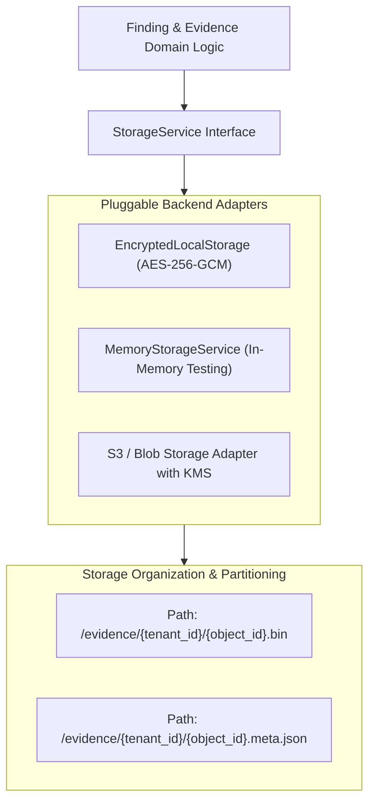

# Secure Evidence Storage Service

**Document ID:** KELVIN-ARCH-0046  
**Status:** Approved  
**Workstream:** Workstream D (Evidence Management & Auditability)  
**Issue Reference:** P3-28 (#181)  

---

## 1. Purpose & Overview

The Kelvin Secure Evidence Storage Service provides a decoupled, pluggable storage interface (`StorageService`) for managing immutable evidence artifacts and binary payloads. It isolates finding domain business logic from specific cloud or on-prem storage provider APIs while strictly enforcing encryption at rest (AES-256-GCM), tenant access boundaries, non-guessable object paths, and cryptographic integrity verification.

---

## 2. Storage Architecture & Pluggable Adapters



---

## 3. Storage Abstraction Contract

The `StorageService` interface isolates the domain from physical storage backends:

```go
type StorageService interface {
    PutObject(ctx context.Context, tenantID, objectID, contentType string, data []byte) (*ObjectMetadata, error)
    GetObject(ctx context.Context, tenantID, objectID string) ([]byte, *ObjectMetadata, error)
    GetMetadata(ctx context.Context, tenantID, objectID string) (*ObjectMetadata, error)
    DeleteObject(ctx context.Context, tenantID, objectID string) error
    SecurePurge(ctx context.Context, tenantID, objectID string) error
}
```

---

## 4. Encryption at Rest & Key Derivation

- **Authenticated Encryption:** All stored blobs are encrypted using authenticated `AES-256-GCM` (`EncryptAESGCM` / `DecryptAESGCM`).
- **Nonce Generation:** A fresh, cryptographically secure 12-byte random nonce is generated per object using `crypto/rand`.
- **Integrity Tagging:** Authenticated tag verification occurs automatically upon decryption; tampered or corrupted ciphertext returns `ErrCorruptedObject`.
- **Digest Matching:** Upon decryption, the recovered plaintext SHA-256 digest is re-computed and matched against `ObjectMetadata.ChecksumSHA256` to guard against bit flips or payload substitutions.

---

## 5. Security & Lifecycle Semantics

- **ADR-0002 Tenant Isolation:** Storage keys incorporate the tenant UUID (`evidence/{tenant_id}/{object_id}`). Cross-tenant access is rejected with `ErrTenantMismatch` or `ErrObjectNotFound`.
- **No Direct Public Access:** Buckets and storage directories are private (`0700` / `0600` permissions on disk). Access is exclusively mediated through authenticated application endpoints or Phase 1 signed URLs.
- **Secure Purge:** When purging expired evidence, `SecurePurge()` overwrites the file bytes with cryptographic random data prior to deletion, preventing residual block retrieval.
