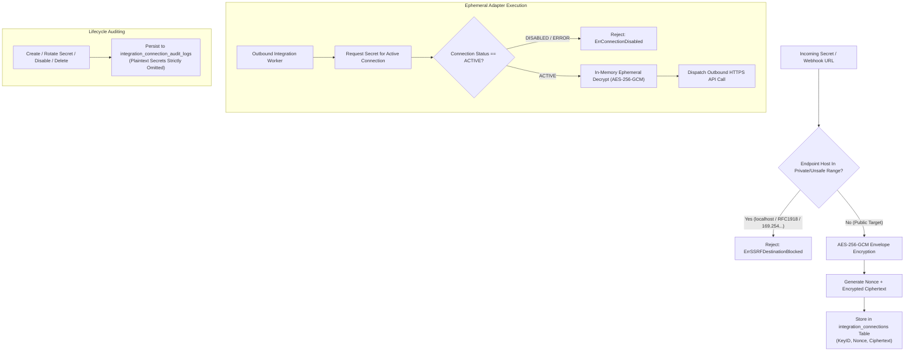

# Secure Integration Connection and Secret Management Architecture

## 1. Overview
The Secure Integration Connection and Secret Management subsystem provides tenant-isolated connection configurations for external enterprise tools (Slack, Jira, GitHub, PagerDuty, Webhooks). It enforces AES-256-GCM envelope encryption, prevents secret leakage in API responses, and strictly enforces anti-SSRF protections against private IP spaces and cloud metadata endpoints.

## 2. Integration Connection & Encryption Architecture

## 3. Key Architectural Guarantees
1. **AES-256-GCM Envelope Encryption**: Credentials (API tokens, private keys, client secrets, webhook URLs) are never stored in plaintext. They are encrypted using AES-GCM with a 96-bit cryptographic nonce and Key Encryption Key (KEK) management.
2. **Strict In-Memory Ephemeral Decryption**: Plaintext secrets are decrypted only within the memory scope of the executing adapter call and never exposed in API payloads, logs, or diagnostic traces.
3. **Defense-in-Depth Anti-SSRF Validation**: All outbound connection endpoint URLs are resolved and validated against loopback (`127.0.0.1`, `localhost`), link-local/cloud metadata (`169.254.169.254`), RFC 1918 private subnets (`10.0.0.0/8`, `172.16.0.0/12`, `192.168.0.0/16`), and carrier-grade NAT spaces.
4. **Tenant Isolation**: Connections are scoped to specific organizations and optional workspaces.
5. **Zero-Downtime Secret Rotation**: Secrets can be rotated in-place, generating new nonces and ciphertexts while preserving integration bindings and historical audit trails.
