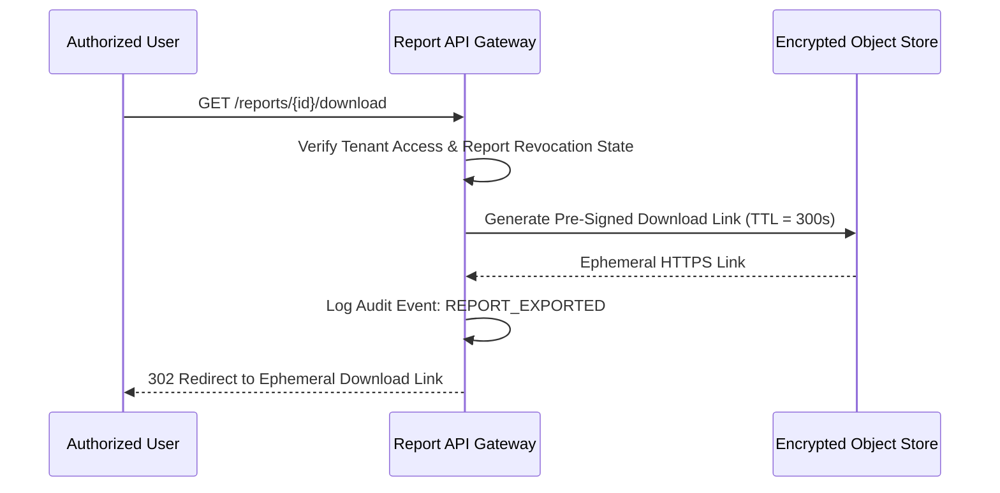

# Secure Report Storage, Export and Download

## 1. Overview & Purpose

The Secure Report Storage, Export and Download service enables controlled, authenticated, and auditable delivery of compiled assessment reports (HTML and PDF) without exposing report artifacts through public, unauthenticated, or predictable URLs.

---

## 2. Storage & Security Architecture

1. **Tenant-Isolated Storage Paths:**
   Report artifacts are partitioned under tenant-scoped paths:
   `reports/{tenant_id}/{report_id}/report.{html|pdf}`.
   Storage paths and storage credentials are never exposed to clients.
2. **Ephemeral HMAC Pre-Signed Download Links:**
   Downloads require an ephemeral, cryptographically signed token generated via HMAC-SHA256 (`ReportURLSigner`). Links default to a 300-second (5 minute) TTL and are strictly bound to the target `tenant_id`, `report_id`, and `format`.
3. **Revocation & Retention Expiration:**
   If a report is revoked (`RevokeReport`) due to inaccurate findings, premature delivery, or policy changes, both subsequent token generation and direct downloads are rejected (`ErrReportRevoked`). Artifacts whose retention expiry has elapsed are rejected (`ErrReportExpired`).
4. **On-Download Integrity Verification:**
   Upon download, the binary content is hashed with SHA-256 and matched against the registered checksum (`SHA256Checksum`) to guarantee end-to-end data integrity.
5. **Regeneration on Demand:**
   If a physical artifact is removed per retention policies but the immutable `report_snapshots` record remains, the report can be deterministically re-rendered (`RegenerateArtifact`) without compromising historical data.
