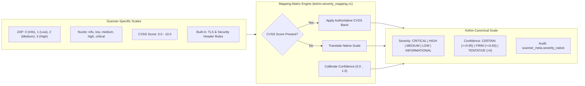

# Severity and Confidence Mapping Specification

This document defines Kelvin's architecture, translation matrices, precedence rules, and confidence calibrations for mapping scanner-specific outputs into the unified classification model, fulfilling requirement **P2-43** (Issue #119).

---

## 1. Overview & Objective

Heterogeneous scanners utilize incompatible severity taxonomies (e.g., ZAP's integer risk codes `0..3`, Nuclei's string levels `info..critical`, and CVSS numerical scores `0.0..10.0`). The **Severity and Confidence Mapping Engine** (`apps/worker/internal/normalization`) deterministically standardizes these values into Kelvin's canonical severity scale while preserving the original engine values for auditing.

Key Invariants:
1. **Canonical Severity Enum**: `CRITICAL`, `HIGH`, `MEDIUM`, `LOW`, `INFORMATIONAL` (ADR-0002).
2. **Authoritative CVSS Banding**: CVSS v3.x/v4.0 scores override subjective native levels when present.
3. **Auditable Traceability**: The raw engine severity is preserved in `scanner_meta["<ns>.severity_native"]`.
4. **Calibrated Confidence**: Confidence is mapped to calibrated floats `0.0..1.0` and qualitative bands (`CERTAIN`, `FIRM`, `TENTATIVE`). Confidence is never fabricated or defaulted to 1.0 without evidence.

---

## 2. Architecture & Translation Flow

---

## 3. Mapping Matrices

### 3.1 CVSS Score Bands (Authoritative)
| CVSS Score Band | Canonical Severity |
|---|---|
| `9.0 – 10.0` | `CRITICAL` |
| `7.0 – 8.9` | `HIGH` |
| `4.0 – 6.9` | `MEDIUM` |
| `0.1 – 3.9` | `LOW` |
| `0.0` | `INFORMATIONAL` |

### 3.2 OWASP ZAP Baseline
| ZAP Risk Code | ZAP Label | Canonical Severity | ZAP Confidence | Kelvin Confidence Float |
|---|---|---|---|---|
| `3` | High | `HIGH` | `4` (Confirmed) | `1.0` |
| `2` | Medium | `MEDIUM` | `3` (High) | `0.9` |
| `1` | Low | `LOW` | `2` (Medium) | `0.7` |
| `0` | Informational | `INFORMATIONAL` | `1` (Low) | `0.5` |
| - | - | - | `0` (False Positive) | `0.2` |

### 3.3 ProjectDiscovery Nuclei
| Nuclei Native Severity | Default Canonical Severity | Default Calibrated Confidence |
|---|---|---|
| `critical` | `CRITICAL` | `0.95` |
| `high` | `HIGH` | `0.85` |
| `medium` | `MEDIUM` | `0.70` |
| `low` | `LOW` | `0.60` |
| `info` / `informational` | `INFORMATIONAL` | `0.50` |
| `unknown` / unspecified | `INFORMATIONAL` | `0.50` |

### 3.4 Qualitative Confidence Levels
| Float Range | Qualitative Level | Semantic Interpretation |
|---|---|---|
| `0.95 – 1.00` | `CERTAIN` | Confirmed by direct probe or cryptographic proof |
| `0.65 – 0.94` | `FIRM` | High probability match with active matcher verification |
| `0.01 – 0.64` | `TENTATIVE` | Heuristic match or potential false-positive prone pattern |
| `0.00` | `UNKNOWN` | Unspecified or uncalibrated |
