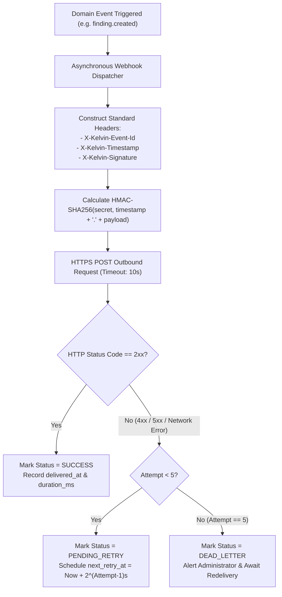

# Signed Webhook Delivery, Retry and Replay Protection Architecture

## 1. Overview
The Signed Webhook Delivery, Retry and Replay Protection subsystem dispatches outbound events reliably to customer-configured endpoints. It signs event payloads using HMAC-SHA256, enforces a 5-minute replay tolerance window, executes bounded exponential backoff retries with dead-letter isolation, and provides manual redelivery capabilities.

## 2. Dispatch Pipeline & Verification Flow



## 3. Webhook Consumer Verification Specification
Receiving systems verify webhook integrity and authenticity using the following standard verification algorithm:

```
1. Extract 'X-Kelvin-Timestamp' (t) and 'X-Kelvin-Signature' (v1).
2. Validate replay window: ensure |currentTime - t| <= 300 seconds (5 minutes).
3. Prepare signature input: t + "." + rawBodyBytes.
4. Calculate expected signature: HMAC_SHA256(shared_secret, signature_input).
5. Compare expected signature against v1 using constant-time comparison (crypto/subtle).
```

## 4. Key Architectural Guarantees
1. **Tamper-Proof HMAC-SHA256 Signatures**: All outgoing payloads are cryptographically signed with the subscriber's shared secret.
2. **Replay Protection**: Timestamps embedded within the signed header strictly reject replays older than 5 minutes or originating from future clock drift.
3. **Bounded Retries with Exponential Backoff**: Failures are retried up to 5 times (`1s, 2s, 4s, 8s, 16s`) before being quarantined to `DEAD_LETTER` status.
4. **Non-Blocking Fault Isolation**: Webhook delivery runs asynchronously with a 10-second request timeout and 64KB response snippet cap, ensuring slow or unreachable endpoints cannot degrade core scanner operations.
5. **Operator-Controlled Redelivery**: Dead-lettered deliveries can be manually redelivered via `Redeliver`, resuming delivery without generating duplicate event IDs.
