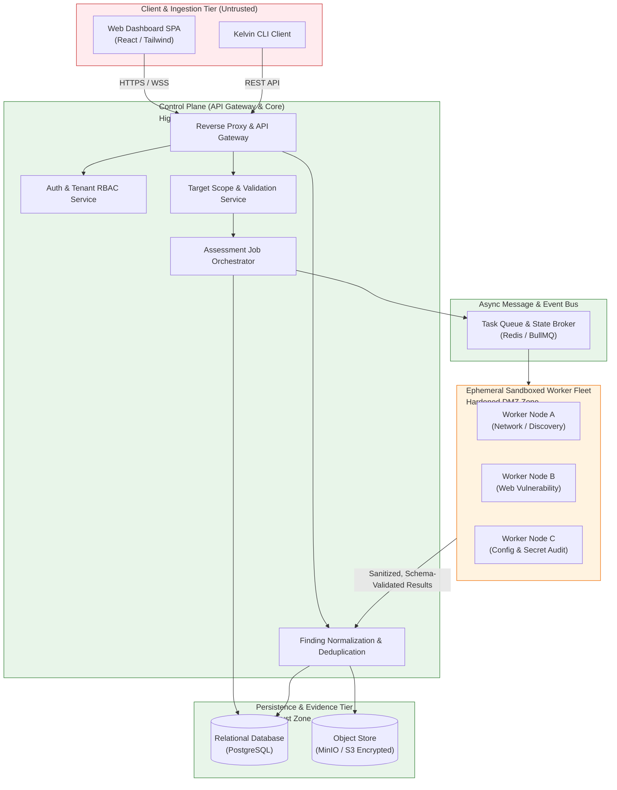
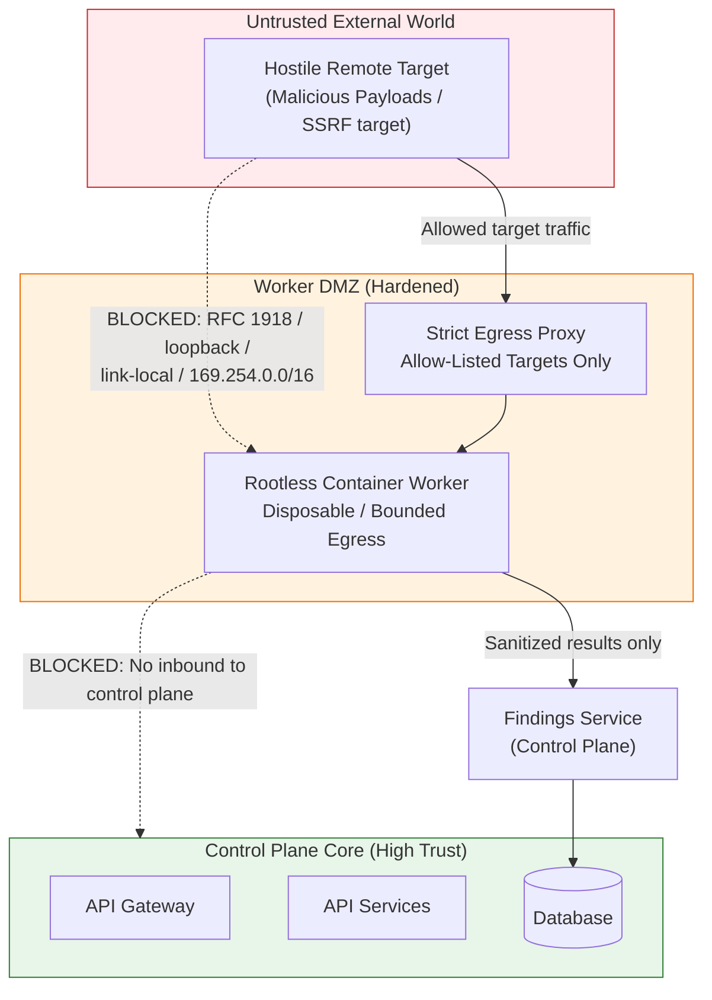
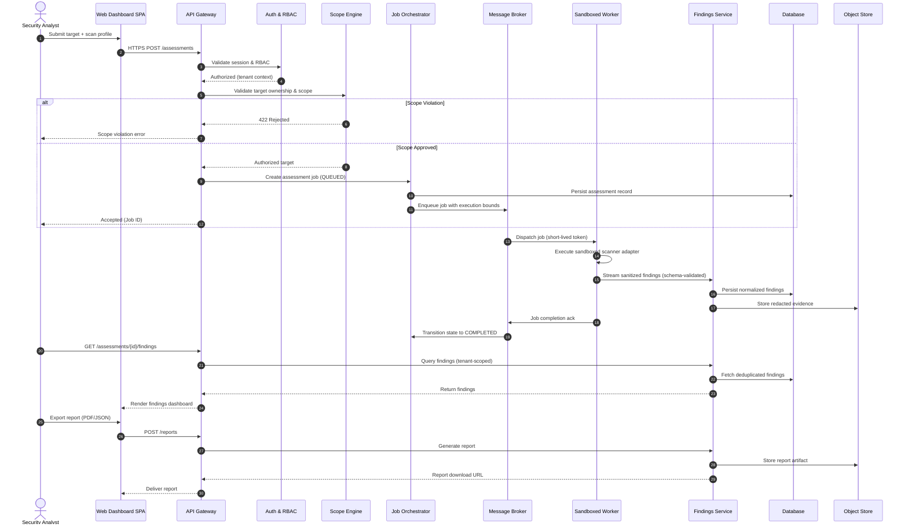

# Kelvin Security Platform — System Architecture

**Document Control**

| Field | Value |
| :--- | :--- |
| **Status** | Baseline — Peer-Reviewed |
| **Milestone** | Phase 1 — Foundation & Core Architecture (`P1-06`) |
| **Depends On** | `docs/PRODUCT_VISION.md` (`P1-01`), `docs/security/THREAT_MODEL.md` (`P1-03`) |
| **Owner** | Platform Engineering / Architecture |
| **Review Cadence** | Quarterly, and on any tier or trust-boundary change |
| **Related Docs** | `docs/PRODUCT_VISION.md`, `docs/security/THREAT_MODEL.md`, `docs/security/ACCEPTABLE_USE.md`, `docs/architecture/SCAN_PROFILES.md`, `docs/ARCHITECTURE_AND_FEATURES.md`, `docs/MVP_AND_PHASE_BIFURCATION.md`, `docs/product/PERSONAS.md` |
| **Classification** | Internal — Engineering Specification |

---

## 1. Executive Summary

Kelvin is architected as a **decoupled, event-driven micro-modular platform** in which the user-facing web dashboard, API control plane, message/task broker, sandboxed worker fleet, and persistence/evidence storage tiers operate in strictly segregated security and compute zones.

The central design problem this architecture solves is the **tight coupling of UI rendering, HTTP routing, database queries, and raw scanner CLI execution into a single application process**. In a monolithic design, a scanner binary consuming 100% CPU or suffering an Out-Of-Memory (OOM) crash brings down the entire platform; horizontal scaling requires duplicating the whole web application and database; and the web server and database share a network namespace with scanner workers that communicate directly with potentially hostile target hosts.

Kelvin eliminates these failure modes by:

* **Decoupling** the control plane from worker execution via an asynchronous message broker.
* **Isolating** scanner workers in disposable, rootless containers with bounded egress — never sharing a network namespace with the API or database.
* **Scaling** worker nodes independently of the control plane to handle concurrent enterprise scans.
* **Streaming** sanitized, schema-validated results from workers to the findings service, never raw hostile payloads.

This document is the architectural blueprint against which all subsequent engineering issues must be traceable.

---

## 2. System Topology

The platform is organized into six tiers, each with a distinct security zone, compute responsibility, and trust boundary:

### 2.1 Tier Responsibilities

| Tier | Zone | Trust Level | Responsibility |
| :--- | :--- | :--- | :--- |
| **Client & Ingestion** | Untrusted | Zero trust | User interaction (SPA/CLI); submits targets, jobs, and report requests. Never touches the database directly. |
| **Control Plane** | High trust | Authenticated | API gateway, auth/RBAC, scope validation, job orchestration, finding normalization. The policy and decision layer. |
| **Message & Event Bus** | High trust | Authenticated | Durable task queue, job state broker, publish-subscribe for status streaming. Buffer between control plane and workers. |
| **Worker Fleet** | Hardened DMZ | Untrusted input | Ephemeral rootless containers running scanner adapters. Executes network traffic against targets. Never initiates contact with control plane internals. |
| **Persistence & Evidence** | High trust | Authenticated | Relational database (core entities) and encrypted object store (raw evidence, redacted payloads). |

---

## 3. Communication Protocols

Kelvin uses **synchronous** protocols for control-plane/client interactions and **asynchronous** protocols for worker execution, keeping the two paths strictly separated.

### 3.1 Synchronous (Client ↔ Control Plane)

| Path | Protocol | Direction | Purpose | AuthZ |
| :--- | :--- | :--- | :--- | :--- |
| UI → Gateway | HTTPS (TLS 1.3) + WSS | Bidirectional | Dashboard rendering, real-time job status via WebSocket | Session cookie / OIDC token |
| CLI → Gateway | REST API (HTTPS) | Bidirectional | Programmatic assessment submission, report export | API key / mTLS client cert |
| Gateway → AuthSvc | gRPC / HTTP | Internal | Authentication, token validation, RBAC lookup | Service identity |
| Gateway → ScopeEngine | gRPC / HTTP | Internal | Target scope validation before job creation | Service identity |
| Gateway → FindingsSvc | gRPC / HTTP | Internal | Findings query, report generation requests | Service identity + tenant context |

### 3.2 Asynchronous (Control Plane ↔ Workers)

| Path | Protocol | Direction | Purpose | AuthZ |
| :--- | :--- | :--- | :--- | :--- |
| JobOrchestrator → Queue | Message queue (Redis/BullMQ) | Outbound | Enqueue assessment jobs with execution bounds | Service identity |
| Queue → Worker | Message queue (pull) | Outbound | Dispatch job to available sandboxed node | Short-lived worker token |
| Worker → FindingsSvc | Streaming (HTTPS/gRPC) | Inbound | Sanitized, schema-validated findings | Worker identity + job-scoped token |
| Worker → Queue | Message queue | Outbound | Job state transitions, heartbeats, completion ack | Worker identity |

**Critical boundary rule:** Workers **never** initiate connections to the API gateway, auth service, or database. Workers connect only to the message broker (to receive jobs and send heartbeats) and the findings service (to stream sanitized results). All worker-to-control-plane traffic is one-way results return; control-plane-to-worker traffic is one-way job dispatch.

---

## 4. Trust Boundaries & Network Isolation

The architecture enforces strict network segmentation between tiers. Firewall rules and egress filter policies are the primary technical control preventing worker compromise from cascading into the control plane.

### 4.1 Trust Boundary Diagram

### 4.2 Network Trust Boundaries

| Boundary ID | From | To | Policy | Enforcement |
| :--- | :--- | :--- | :--- | :--- |
| **NB-01** | Client (Internet) | API Gateway | Allow HTTPS/WSS only; rate-limited | TLS 1.3, WAF, rate limiting |
| **NB-02** | API Gateway | Control Plane Services | Internal mTLS / service mesh | Mutual TLS, service identity |
| **NB-03** | Control Plane | Message Broker | Allow enqueue/dequeue only | Queue ACLs, service identity |
| **NB-04** | Message Broker | Worker Fleet | Allow job dispatch + heartbeats | Short-lived worker tokens |
| **NB-05** | Worker Fleet | External Targets | Allow-list only (verified targets) | Egress proxy, DNS pinning, IP blocklist |
| **NB-06** | Worker Fleet | Control Plane | **Deny all inbound** except sanitized results to FindingsSvc | Firewall deny-by-default, one-way results return |
| **NB-07** | Worker Fleet | Internal / Metadata IPs | **Deny RFC 1918, loopback, link-local, 169.254.0.0/16** | Egress proxy blocklist |
| **NB-08** | Control Plane | Database / Object Store | Allow authenticated queries only | DB ACLs, row-level tenant isolation, encrypted connections |
| **NB-09** | Client | Database / Object Store | **Deny all direct access** | No client-to-storage network path |

### 4.3 Egress Filter Policy

All worker outbound traffic passes through a strict egress proxy:

* **Allow-list:** Verified target IPs/domains only (from asset ownership verification, §5 of ACCEPTABLE_USE.md).
* **Deny-list (absolute):** `10.0.0.0/8`, `172.16.0.0/12`, `192.168.0.0/16`, `127.0.0.0/8`, `::1`, `169.254.0.0/16` (including `169.254.169.254` cloud metadata), `224.0.0.0/4`, `240.0.0.0/4`.
* **DNS:** Pinning resolver with TTL=0; anti-rebind; single resolution at validation time.
* **Rate limits:** Per-worker and per-target connection and request budgets (see `docs/architecture/SCAN_PROFILES.md`).

---

## 5. Data Lifecycle: Target Ingestion to Report Delivery

The end-to-end flow of an assessment through the decoupled tiers:

### 5.1 Data Flow Classification

| Flow ID | Path | Data Type | Classification | Sanitization |
| :--- | :--- | :--- | :--- | :--- |
| **DF-01** | Client → Gateway | Target list, profile, credentials | Confidential | TLS 1.3 in transit |
| **DF-02** | Gateway → Scope Engine | Target hostnames/IPs | Internal | Scope validation before job |
| **DF-03** | Broker → Worker | Job payload + execution bounds | Internal | Short-lived token, scoped |
| **DF-04** | Worker → Target | Scan requests (probes) | Untrusted output | Egress allow-list, size caps, timeouts |
| **DF-05** | Target → Worker | Raw HTTP responses | Hostile / Untrusted | Schema validation, size caps, header stripping |
| **DF-06** | Worker → FindingsSvc | Sanitized findings | Internal | Schema validation, credential redaction |
| **DF-07** | FindingsSvc → DB/Blob | Normalized findings + redacted evidence | Confidential | Redaction pipeline, row-level tenant isolation |
| **DF-08** | Client → FindingsSvc | Findings query, report export | Confidential | Tenant-scoped, RBAC enforced |

---

## 6. Failure Isolation & Worker Recovery

Decoupling workers from the control plane is the primary mechanism for containing failures. The following failure modes are explicitly addressed.

### 6.1 Single Points of Failure & Mitigations

| Component | Failure Mode | Impact | Mitigation | Recovery |
| :--- | :--- | :--- | :--- | :--- |
| **Scanner worker** | 100% CPU / OOM crash | Single job fails only; control plane unaffected | Rootless container, cgroups memory/CPU limits, process supervisor | Container restarted by supervisor; job re-queued or marked FAILED |
| **Hung socket** | Worker blocks on target response | Single worker stuck | Read/connection timeouts, circuit breaker, hard execution deadline | Worker killed at deadline; job re-queued |
| **Message broker** | Broker outage | New assessments cannot be dispatched | Broker cluster with replication; persistence of queued jobs | Jobs retained in queue; resume on broker recovery |
| **API gateway** | Gateway process crash | UI/CLI unreachable temporarily | Gateway behind load balancer; multiple instances | Traffic reroutes to healthy instance; session state in DB |
| **Database** | DB node outage | Platform read/write unavailable | Primary-replica with automated failover; connection pooling | Failover to replica; writes resume on primary recovery |
| **Object store** | Storage node failure | Evidence/report artifacts unavailable | Multi-AZ replication; erasure coding | Serve from healthy replica |

### 6.2 Worker Recovery Strategies

1. **Container restart policy:** Workers are disposable; on crash, the supervisor restarts the container with a fresh filesystem (read-only root, ephemeral /tmp).
2. **Job re-queue:** If a worker fails mid-assessment, the job state machine transitions to `FAILED` and the orchestrator may re-queue within the retry budget (max 3 attempts).
3. **Dead-letter queue:** Jobs exceeding retry budget move to a dead-letter queue for analyst review; no silent data loss.
4. **Heartbeat monitoring:** Workers emit heartbeats to the broker; missing heartbeats trigger job reassignment to a healthy worker.
5. **Blast-radius containment:** A compromised or crashing worker cannot reach the control plane (NB-06 deny-by-default) and has no host credentials (rootless, no Docker socket).

---

## 7. Architectural Rationale: Decoupling Workers from Control Plane

| Monolithic Risk | Kelvin Decoupled Design | Benefit |
| :--- | :--- | :--- |
| Worker OOM / 100% CPU brings down UI & API | Workers run in separate containers/tiers; control plane never executes scanner binaries | Worker crash is contained; UI/API remain responsive |
| Cannot scale scan execution without duplicating web app | Worker fleet scales independently of control plane (add worker nodes horizontally) | Handle dozens of concurrent enterprise scans |
| Web server + DB share namespace with hostile scanner workers | Workers in hardened DMZ with egress blocklist; no inbound path to control plane | Compromised worker cannot reach DB or core secrets |
| Scanner binary vulnerability compromises entire host | Rootless containers, non-root user, seccomp/AppArmor, read-only root FS, no host socket | Container breakout contained; no host access |
| Synchronous scan blocks API request thread | Asynchronous message broker; jobs dispatched and polled | API remains responsive during long scans |
| Raw hostile responses parsed in application process | Workers stream only sanitized, schema-validated results to FindingsSvc | Parser bugs cannot expose control plane to hostile payloads |

---

## 8. Component Interface Specifications

### 8.1 API Gateway (Reverse Proxy)

* **Terminates** TLS 1.3 from clients; routes to internal services via mTLS.
* **Enforces** rate limiting, WAF rules, and request-size caps.
* **Injects** tenant context into every downstream request; immutable for request lifetime.
* **Exposes** REST endpoints for assessments, findings, reports, and assets; WebSocket endpoint for live job telemetry.

### 8.2 Auth & Tenant RBAC Service

* **Authenticates** users via OIDC/SAML + MFA; issues short-lived JWTs.
* **Enforces** deny-by-default RBAC (roles: Platform Admin, Security Analyst, Read-Only Auditor).
* **Validates** tenant context on every request; row-level isolation hint passed to DB layer.

### 8.3 Target Scope & Validation Service

* **Validates** targets against RFC 1918 / loopback / link-local / metadata blocklists.
* **Verifies** asset ownership (DNS TXT / `.well-known` / LoA) before authorizing.
* **Returns** `422 Scope Violation` with human-readable reason for prohibited targets.

### 8.4 Assessment Job Orchestrator

* **Persists** assessment records (status: QUEUED, ValidatingScope, RUNNING, COMPLETED, FAILED, TimedOut, Cancelled).
* **Enforces** deterministic job state-machine transitions (see `docs/MVP_AND_PHASE_BIFURCATION.md` §3).
* **Enqueues** jobs to the broker with execution bounds (concurrency, rate, deadline) from the scan profile.
* **Tracks** worker heartbeats; re-queues or dead-letters failed jobs.

### 8.5 Message / Task Broker (Redis / BullMQ)

* **Durable** job queue with prioritization, delayed execution, and persistence.
* **Publish-subscribe** for job state streaming to clients via WebSocket.
* **Short-lived** worker tokens scoped to a single job.

### 8.6 Sandboxed Worker Nodes

* **Rootless** container with non-root user, read-only root FS, seccomp/AppArmor, cgroups limits.
* **Executes** scanner adapter per the scan profile (Nuclei, ZAP, OpenVAS, Trivy).
* **Enforces** egress allow-list, response size caps, timeouts, and credential redaction before streaming results.
* **Connects** only to broker (jobs/heartbeats) and FindingsSvc (results).

### 8.7 Finding Normalization & Deduplication Service

* **Consumes** sanitized results from workers; converts to canonical vulnerability schema.
* **Fingerprints** findings (asset + endpoint + vulnerability type) for deduplication.
* **Redacts** credentials, tokens, keys from evidence before persistence.
* **Persists** to DB (findings) and Blob Store (evidence).

### 8.8 Database (PostgreSQL) & Object Store (MinIO/S3)

* **Database:** Core entities (tenants, users, projects, assets, assessments, jobs, findings, reports); row-level tenant isolation; encrypted at rest.
* **Object Store:** Raw evidence, redacted payloads, screenshots, report artifacts; encrypted at rest; access via presigned URLs only.

---

## 9. Deployment Zones

| Zone | Components | Network Position | Access |
| :--- | :--- | :--- | :--- |
| **Public Ingress** | API Gateway, Load Balancer | Internet-facing | HTTPS 443 only |
| **Control Plane** | Auth, Scope, Job Orchestrator, Findings, Broker | Private subnet; no internet egress | Internal mTLS |
| **Worker DMZ** | Worker nodes, Egress Proxy, Pinning DNS | Isolated DMZ; egress to verified targets only | No inbound from control plane except results |
| **Data Tier** | PostgreSQL, Object Store | Private subnet; DB ACLs | Control plane only |

---

## 10. Governance & Change Control

1. **This document is the architectural blueprint.** All subsequent engineering issues (scanner adapters, worker daemon, findings pipeline, reporting) must trace back to a tier, boundary, or interface defined here.
2. **Tier or boundary changes require architecture review.** Adding a new tier, modifying a trust boundary, or introducing a direct worker-to-control-plane path requires sign-off from Platform Engineering and Product Security.
3. **Worker-to-control-plane traffic is one-way results only.** No new inbound paths from workers to the API, auth service, or database may be added without a threat-model amendment (see `docs/security/THREAT_MODEL.md`).
4. **Review cadence.** Quarterly, and on any tier, trust-boundary, or protocol change. Changes are versioned in git with the associated milestone tag.

---

## 11. Traceability

| Artifact | Reference |
| :--- | :--- |
| Planning reference | `P1-06` |
| Milestone | Phase 1 — Foundation & Core Architecture |
| Blocked by | `P1-01` — `docs/PRODUCT_VISION.md`; `P1-03` — `docs/security/THREAT_MODEL.md` |
| Product vision & non-goals | `docs/PRODUCT_VISION.md` |
| Threat model | `docs/security/THREAT_MODEL.md` |
| Acceptable use policy | `docs/security/ACCEPTABLE_USE.md` |
| Scan profiles | `docs/architecture/SCAN_PROFILES.md` |
| System architecture (feature overview) | `docs/ARCHITECTURE_AND_FEATURES.md` |
| MVP & phase bifurcation | `docs/MVP_AND_PHASE_BIFURCATION.md` |
| User personas & journeys | `docs/product/PERSONAS.md` |
| Engineering roadmap | `docs/ROADMAP.md` |

---

*Kelvin Security Platform — Phase 1 Engineering Backlog*
