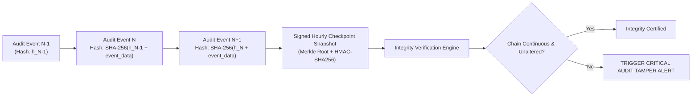

# Tamper-Evident Audit Integrity Verification Architecture

## 1. Overview
The Tamper-Evident Audit Integrity Verification engine augments KELVIN's append-only audit log with cryptographic chaining, Merkle tree checkpointing, and scheduled verification.

## 2. Cryptographic Chaining & Checkpointing

### Cryptographic Formulae
1. **Hash Chain Linkage**:
   $$\text{CurrentHash}_i = \text{SHA-256}(\text{PreviousHash}_i \parallel \text{ID}_i \parallel \text{Action}_i \parallel \text{EntityType}_i \parallel \text{EntityID}_i \parallel \text{Payload}_i \parallel \text{CorrelationID}_i \parallel \text{CreatedAt}_i)$$
   Where Genesis record has $\text{PreviousHash}_0 = 0^{64}$.

2. **Merkle Root Accumulation**:
   Binary balanced Merkle tree computed pairwise over all $\text{CurrentHash}_i$ within the checkpoint sequence window.

3. **Signed Checkpoints**:
   Snapshots are signed via HMAC-SHA256 using an isolated HSM or server-side integrity key.

## 3. Detection Capabilities
- **In-Place Modification**: If any field in an existing record is edited, recomputing $\text{ComputeEventHash}$ yields a mismatch against $\text{CurrentHash}$, raising `HASH_MISMATCH`.
- **Record Deletion**: If a row is deleted, the sequence numbers will show a gap ($\text{seq}_{i} \neq \text{seq}_{i-1} + 1$) and the hash link will fail ($\text{prev\_hash}_i \neq \text{curr\_hash}_{i-1}$), raising `CHAIN_BROKEN`.
- **Record Reordering**: Swapping row positions invalidates both hash links and sequence ordering.
- **Checkpoint Forgery**: Altering Merkle root or bounds triggers `SIGNATURE_INVALID` or `MERKLE_MISMATCH`.

## 4. Threat Model & Architectural Limitations

> [!IMPORTANT]
> **Limitations Disclosure & Database Superuser Boundary:**
> Cryptographic hash chaining and Merkle checkpoints detect unauthorized modifications or deletions performed by application users, API consumers, or unauthorized compromised application roles.
> However, an attacker with PostgreSQL superuser / root operating system privileges could theoretically drop or rewrite both the audit table and checkpoint records unless checkpoints are replicated off-host to write-once-read-many (WORM) cloud storage (e.g., AWS S3 Object Lock in Compliance Mode) or an immutable external ledger. Off-host replication is recommended for highest-tier compliance environments.
