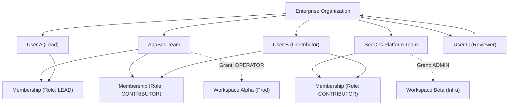

# Team and Group Management

**Milestone:** P4-03 (Issue #201)  
**Workstream:** Workstream A — Organization & Team Administration  
**Status:** Approved / Implemented  

---

## 1. Overview & Purpose

Enterprise security operations require multi-disciplinary collaboration across AppSec, Cloud SecOps, Red Teams, and DevOps engineers. This specification defines the architecture, authorization boundaries, and lifecycle operations for **Teams** in the Kelvin Security Platform.

Teams allow organizations to group users, delegate administrative ownership, map collective workspace permissions, and assign security remediation tasks without compromising organization-level tenancy boundaries.

---

## 2. Team Architecture & Membership Model

### Team Roles & Privileges

| Role | Responsibility | Permitted Actions |
| :--- | :--- | :--- |
| **`LEAD`** | Team owner / manager | Manage team membership, update team profile, assign workspace grants, oversee team remediation tasks. |
| **`CONTRIBUTOR`** | Active security engineer / practitioner | Execute assessments, triage findings, update assigned remediation tasks. |
| **`REVIEWER`** | Quality / compliance auditor | Review triage justifications, verify follow-up scans, inspect evidence. |
| **`MEMBER`** | General team member | Read workspace resources and view assigned tasks. |

---

## 3. Security & Boundary Invariants

1. **Strict Organization Boundary Enforcement**:
   - A user can only be added to a team if they possess an active membership in the team's parent organization (`organization_memberships`).
   - Attempting to add a user from another organization returns `ErrUserNotInOrganization` and aborts.
2. **Multi-Team Membership**:
   - Users may simultaneously belong to multiple teams within an organization with distinct roles in each.
3. **Archival & Reference Preservation**:
   - Teams cannot be hard-deleted if they are referenced by active remediation tasks, workspace grants, or audit logs.
   - Calling `ArchiveTeam` marks the team as `ARCHIVED`. Archived teams are excluded from active access resolution, but historic references and audit records remain intact.
   - Any attempt to add members or modify an archived team returns `ErrTeamArchived`.
4. **Least-Privilege Administrative Delegation**:
   - Org Owners and Org Admins retain administrative override across all teams in their organization.
   - Team Leads possess delegated administration strictly over their own team and its assigned workspaces.

---

## 4. Structured Audit Trail

All team operations generate immutable structured audit events:

- `team.created`: Emitted when a new team is provisioned.
- `team.updated`: Emitted when a team's name or description is modified.
- `team.archived`: Emitted when a team is archived.
- `team.member_added`: Emitted when a user joins the team, recording the assigned role.
- `team.member_removed`: Emitted when a user is removed from the team.

---

## 5. Verification & Testing

The team domain model, organization boundary enforcement, and archival behavior are verified by comprehensive unit and integration tests in `apps/api/internal/hierarchy/team_test.go`.
