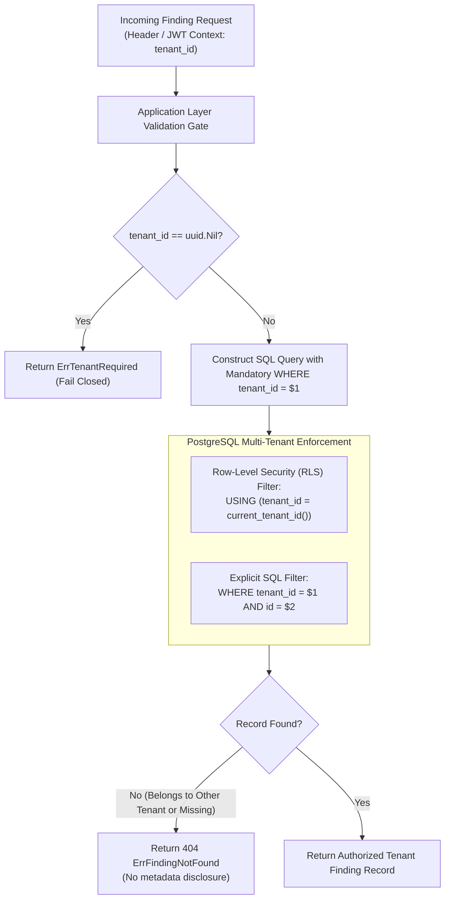

# Tenant-Scoped Finding Repository Boundaries Architecture

## 1. Overview & Purpose

This document details the multi-tenant isolation and security architecture enforced across the finding and observation repositories as part of **P3-07** (Issue #159).

In multi-tenant SaaS environments, Insecure Direct Object Reference (IDOR) attacks and cross-tenant data leakage represent severe risks. The Finding Repository enforces strict defense-in-depth: mandatory application-level tenant parameters combined with PostgreSQL Row-Level Security (RLS).

---

## 2. Security Invariants & Defense-in-Depth

### 2.1 Mandatory Tenant Context
- Every repository method (`GetFindingsByProject`, `GetFindingByID`, `ListFindings`, `UpdateFindingStatus`, `GetObservationsByFinding`, `ObservationExists`, `SaveFinding`, `SaveObservation`, `SaveEvent`) checks that `tenantID != uuid.Nil`.
- Unscoped queries fail closed with `ErrTenantRequired`.

### 2.2 IDOR Prevention & Anti-Enumeration
- If an actor queries a finding UUID that exists in the database but belongs to a foreign tenant, the repository returns `ErrFindingNotFound`.
- This ensures zero information disclosure (no leak of finding existence or metadata across tenant boundaries).

### 2.3 Row-Level Security (RLS) Synergy
- PostgreSQL tables `findings`, `finding_observations`, and `finding_events` have `ENABLE ROW LEVEL SECURITY` and `FORCE ROW LEVEL SECURITY`.
- The explicit application filter (`WHERE tenant_id = $1`) combined with the database RLS policy (`USING (tenant_id = current_tenant_id())`) guarantees multi-tenant isolation even in cases of misconfigured connection pooling.

### 2.4 Status Updates & Mutation Boundaries
- `UpdateFindingStatus` restricts updates via `WHERE tenant_id = $3 AND id = $4 AND deleted_at IS NULL`.
- An update cannot cross tenant boundaries or modify findings belonging to another organization.
