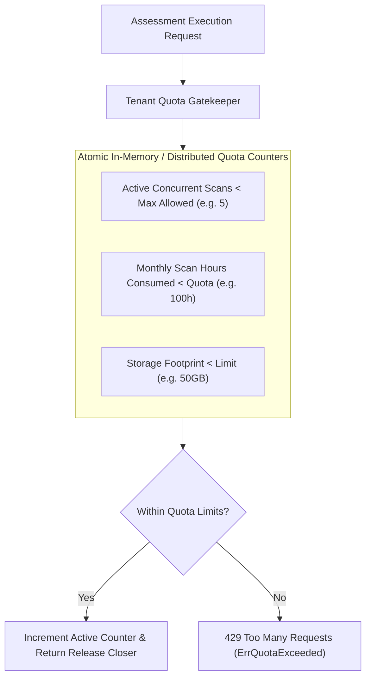

# Tenant Usage Metering & Quota Enforcement Architecture

## 1. Overview
The Tenant Usage Metering and Quota Enforcement subsystem bounds operational resource consumption across enterprise organizations and workspaces. It prevents unfair resource starvation, ensures system stability, and guards against race conditions in concurrent execution.

## 2. Architecture & Quota Gatekeeper Pipeline

## 3. Usage Dimensions & Defaults

| Usage Dimension | Key | Platform Default | Throttling Action |
|---|---|---|---|
| **Concurrent Scans** | `concurrent_scans` | 5 active | Throttles submission until an active scan finishes (`release()`) |
| **Monthly Scan Compute Hours** | `monthly_scan_hours` | 100 hours | Rejects new scan scheduling |
| **Storage Footprint** | `storage_gb` | 50 GB | Blocks evidence uploads and artifact storage |
| **Active Service Identities** | `service_identities` | 20 accounts | Prevents provisioning additional M2M service accounts |
| **Monthly Integration Events** | `monthly_events` | 10,000 events | Suppresses non-critical webhook and notification dispatch |

## 4. Race Condition Protection
Concurrent scan acquisition uses atomic reservations. When multiple simultaneous requests compete for a limited number of execution slots, only the exact quota limit succeeds, while excess requests receive structured `QuotaExceededError` without blocking or creating deadlocks.
