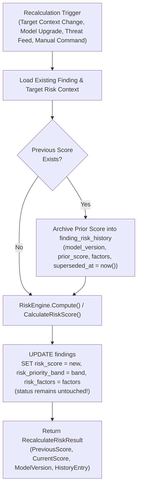

# Versioned Risk Recalculation and History Architecture

## Overview
The Kelvin **Versioned Risk Recalculation and History** subsystem guarantees that risk assessments can evolve alongside changing target contexts, enriched threat intelligence, and algorithm upgrades without silently overwriting or distorting historical risk decisions.

When a recalculation occurs, previous calculation states are atomically archived into `finding_risk_history` before `findings.risk_score` is updated. A fundamental invariant is maintained: **recalculating risk scores never alters finding lifecycle status (`findings.status`)**.

## Recalculation Triggers

| Trigger Code | Cause | Automated vs Manual |
|---|---|---|
| `INITIAL_INGESTION` | First-time observation intake and fingerprint resolution | Automated |
| `CONTEXT_UPDATE` | Target asset environment, exposure, criticality, or PII updated (`PUT /api/v1/projects/{id}/targets/context`) | Automated |
| `MODEL_UPGRADE` | Enterprise algorithm specification or engine rules version upgraded | Controlled Migration |
| `THREAT_INTEL_UPDATE` | CISA KEV catalog or EPSS scoring feed updated | Automated |
| `MANUAL_RECALCULATION` | Analyst initiates on-demand score refresh (`POST /api/v1/findings/{id}/recalculate-risk`) | Manual Command |

## Architectural Invariants

1. **Lifecycle Status Invariance:**
   - Finding lifecycle state (`NEW`, `IN_PROGRESS`, `CONFIRMED`, `RESOLVED`, `FALSE_POSITIVE`, `ACCEPTED_RISK`) is governed strictly by human and automated triage decisions (P3-09, P3-10, P3-16).
   - Recalculating risk scores updates numeric prioritization metrics only and **never transitions finding status**.

2. **Immutable Point-in-Time History:**
   - Every prior score is written to `finding_risk_history` with its model version, raw factors, timestamp, and trigger reason before replacement.
   - Historical records are queryable via `GET /api/v1/findings/{id}/risk-history`.

3. **Tenant Boundary Isolation (ADR-0002):**
   - Both `findings` and `finding_risk_history` enforce Row-Level Security (`tenant_id = current_tenant_id()`).
   - Cross-tenant history leakage is strictly prohibited.

## API Endpoints

- `POST /api/v1/findings/{id}/recalculate-risk`
  - Re-evaluates risk score, archives previous score into history, and returns current score alongside archived history metadata.
- `GET /api/v1/findings/{id}/risk-history`
  - Returns chronological list of all prior risk score calculations for a finding.
