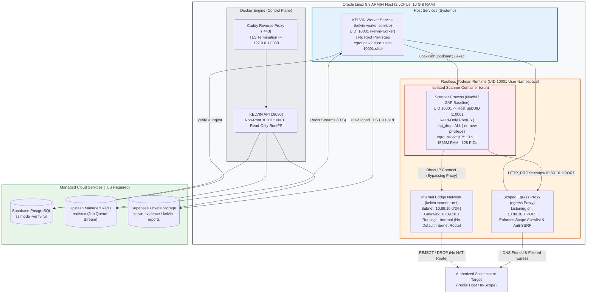
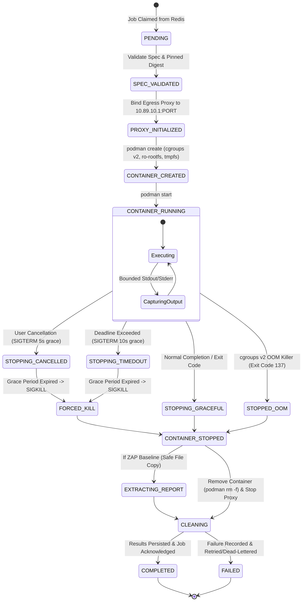
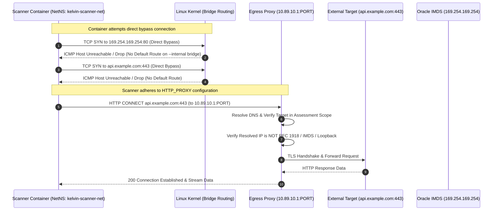

# ADR-0008: Secure OCI Execution Architecture for Sandboxed Scanners

**Document Control**

| Field | Value |
| :--- | :--- |
| **Status** | Proposed / Architecture Review Approved |
| **Date** | 2026-11-14 |
| **Author** | Platform Engineering & Security Architecture Team |
| **Planning Reference** | Issue 001 (`EXEC-001`, GitHub Issue [#488](https://github.com/eOzkull/Kelvin/issues/488)) |
| **Supersedes** | None |
| **Superseded by** | None |
| **Target Environment** | Oracle Linux Server 9.8, ARM64 / aarch64 (2 vCPUs, 10 GiB RAM) |
| **Related Documents** | [ADR-0007](ADR-0007.md), [SCANNER_EXECUTION_ARCHITECTURE.md](../../deployment/SCANNER_EXECUTION_ARCHITECTURE.md) |
| **Classification** | Internal — Architecture Decision Record |

---

## 1. Context and Problem Statement

KELVIN is an enterprise security assessment platform executing active and passive vulnerability diagnostic tools (e.g., OWASP ZAP baseline, ProjectDiscovery Nuclei, SSLScan, Nmap) against authorized target infrastructure. Because security diagnostic tools execute dynamic, potentially malicious code or parse untrusted external inputs, executing scanner containers introduces severe operational security challenges.

### 1.1 Existing Staging Environment & Constraints
The current staging environment deployed on Oracle Cloud Infrastructure consists of:
- **Operating System:** Oracle Linux Server 9.8 (RHCK / UEK kernel).
- **Architecture:** ARM64 / aarch64 (Ampere Altra).
- **Compute Resources:** 2 vCPUs, 10 GiB RAM.
- **Host Container Engine:** Docker Engine is available on the host.
- **Control Plane Deployment:** KELVIN API runs inside Docker (`kelvin-staging-api`), bound to loopback `127.0.0.1:8080`, reverse-proxied by Caddy with TLS.
- **Data Services:** Supabase PostgreSQL (managed, TLS `sslmode=verify-full`), Supabase Private Storage (`kelvin-evidence`, `kelvin-reports`), Upstash Redis (managed, TLS `rediss://`).
- **Worker Status:** The worker container image (`kelvin-worker:staging`) exists but is not deployed in staging (held behind Compose profile `profiles: [worker, scanner-runner]`).

### 1.2 Known Architectural Problems Identified
1. **Worker Container Missing Runtime:** `apps/worker/Dockerfile` builds from `alpine:3.21` without `docker` or `podman` CLI tools.
2. **Runtime Discovery Inside Container:** `apps/worker/internal/sandbox/oci.go:NewOCIExecutor()` calls `exec.LookPath("podman")` followed by `exec.LookPath("docker")` within the worker process environment, which fails inside the container.
3. **Prohibition of Unrestricted Socket Mounting:** Mounting `/var/run/docker.sock` into the worker is **strictly prohibited**. The Docker socket grants unauthenticated root-equivalent control over the host kernel, permitting arbitrary volume mounts (`-v /:/host`) and immediate host takeover.
4. **Loopback Egress Proxy Inaccessibility:** `apps/worker/internal/egress/proxy.go:NewProxy()` binds to `127.0.0.1:0`. When a scanner executes in a container with a separate network namespace, `127.0.0.1` refers to the container's own loopback interface, making the proxy unreachable.
5. **Lack of Enforced Network Isolation:** Setting `HTTP_PROXY` and `HTTPS_PROXY` environment variables is advisory. Malicious or compromised scanner tools can ignore environment variables, bypass proxies, and make direct raw socket connections to the internet, private RFC 1918 subnets, or cloud metadata endpoints (`169.254.169.254`).
6. **Inconsistent Proxy Enforcement:** Scanner adapters (such as Nuclei) do not unconditionally enforce a valid egress proxy when network access is enabled.
7. **Conflicting Release Manifests:** `deploy/scanner-image-lock.yaml` declares images as `locked` while `deploy/scanners/images.lock.json` marks them as `not-released`.
8. **Architecture Mismatch in Build Pipelines:** `scripts/scanners/build-images.sh` hardcodes `--platform linux/amd64`, whereas the Oracle staging VM is ARM64 (`linux/arm64`).
9. **Uncertified Scanner Images:** Scanner container images have not been published, certified, or cryptographically locked for deployment.

---

## 2. Decision Drivers

- **Zero Host Socket Sharing:** The host Docker socket (`/var/run/docker.sock`) must **never** be exposed to worker processes or containers.
- **Rootless & Non-Root Execution:** Scanner containers must execute as unprivileged UID/GID `10001:10001`, mapped to non-root user namespaces on the host. An in-container breakout must yield zero host capabilities.
- **Strict Network Egress & Anti-SSRF:** Scanner containers must have **zero direct internet access**. All outbound traffic must be forced through the scoped egress proxy, blocking cloud metadata (IMDS) and private RFC 1918 ranges.
- **Host Resource Protection:** Hard cgroups v2 quotas (CPU, memory, swap, PIDs) must protect the 2 vCPU / 10 GiB RAM VM from denial of service, memory exhaustion, and fork bombs.
- **Deterministic Lifecycle & Cleanup:** Containers, tmpfs scratch spaces, and proxy listeners must be guaranteed to terminate and clean up upon job completion, cancellation, or deadline expiration.
- **Truth in Probing:** Control plane readiness probes (`/health/ready`, `/readyz`) must report `scannerRunner: UNAVAILABLE` unless a certified, verified runtime is operational.

---

## 3. Evaluation of Considered Architectural Options

We evaluated three isolated runtime design options against the rejected status quo:

| Dimension | Option A: Host Worker with Rootless Podman | Option B: Dedicated Scanner Execution Service (gRPC/IPC) | Option C: Containerized Worker with Rootless Podman Socket | Option D: Worker with /var/run/docker.sock (Status Quo) |
| :--- | :--- | :--- | :--- | :--- |
| **Runtime Mechanism** | Worker runs as host systemd service under dedicated unprivileged user `kelvin-worker` (UID 10001) using Rootless Podman (`crun`). | Worker remains in Docker; communicates via narrow local UNIX socket / gRPC with host execution daemon (`kelvin-runner`). | Worker container runs as UID 10001; packages `podman` CLI and mounts `/run/user/10001/podman/podman.sock`. | Worker mounts host Docker socket (`/var/run/docker.sock`) directly. |
| **Host Privilege Level** | Unprivileged host user (UID 10001, subuid 100000:65536). Zero host root access. | Runner daemon runs as unprivileged user (UID 10001). Worker has no direct container engine access. | Unprivileged user socket. Worker has full control over UID 10001 Podman instance. | **Root-equivalent control of entire host VM and kernel.** |
| **Blast Radius of Compromise** | Confined to `kelvin-worker` user namespace. Cannot read root files, cannot modify host firewall or Docker daemon. | Worker compromise only allows calling narrow `ExecuteScan(JobSpec)` API. Runner enforces bounds. | Confined to UID 10001 user namespace. Can create arbitrary containers as UID 10001. | Total host compromise. Escaped container or worker can compromise all databases and host credentials. |
| **Network Egress Enforcement** | Podman creates internal bridge network (`--internal`). Proxy binds to bridge gateway IP (`10.89.10.1`). Direct egress dropped at kernel bridge. | Runner daemon manages isolated network namespace and routes traffic through scoped proxy. | Podman network created inside rootless namespace. Proxy must bind to accessible bridge IP. | Requires host-level iptables rules or Docker bridge configuration. |
| **ARM64 & cgroups v2 Support** | Native on Oracle Linux 9.8 via `systemd --user` cgroups v2 slices and `crun`. | Native on Oracle Linux 9.8 via `crun` and cgroups v2. | Supported, but requires cgroup delegation into container and fuse-overlayfs. | Supported by Docker Engine on ARM64. |
| **Operational & Code Complexity** | **Low:** Directly utilizes existing `apps/worker` codebase, `exec.LookPath("podman")`, and standard systemd management. | **High:** Requires designing, implementing, securing, and maintaining a separate daemon, RPC protocol, and IPC serialization. | **Medium:** Complex container packaging (Podman in Docker), subuid/subgid mapping inside container. | Low initial setup; unacceptable security posture. |
| **Verdict** | **APPROVED for Staging Baseline** | **APPROVED as Future Production Scale Architecture** | **REJECTED (Operational fragility)** | **STRICTLY REJECTED (Critical Vulnerability)** |

---

## 4. Architectural Decision

We adopt a **Two-Tier Strategy**:

1. **Staging Architecture (Immediate Baseline):**  
   We implement **Option A: Dedicated Unprivileged Host Execution Runner with Rootless Podman**.  
   - The KELVIN worker runner process executes directly on the Oracle Linux ARM64 host as an unprivileged service (`kelvin-worker.service`, user `kelvin-worker`, UID 10001).  
   - The worker executes rootless Podman (`/usr/bin/podman`) using the `crun` OCI runtime, backed by systemd user session cgroups v2 (`loginctl enable-linger kelvin-worker`).  
   - Scanner containers are executed with dropped capabilities (`cap_drop: ALL`), read-only root filesystems, `no-new-privileges:true`, and strict cgroup resource constraints.  
   - Scanner containers attach to an internal Podman bridge network (`kelvin-scanner-net`) created with `--internal`, completely disabling default internet routing.  
   - The worker's scoped egress proxy (`egress.Proxy`) binds to the internal bridge gateway IP (`10.89.10.1:PORT`), allowing scanner containers to connect to the proxy while preventing direct external egress.

2. **Interface Abstraction for Production Evolution:**  
   The Go `sandbox.Executor` interface (`apps/worker/internal/sandbox/executor.go`) remains the single architectural boundary. In Phase 0/1, `sandbox.NewOCIExecutor()` provides the local Rootless Podman implementation (`LocalPodmanExecutor`). In future phases (multi-node production pools), a remote adapter (`RemoteDaemonExecutor`) will implement the identical `sandbox.Executor` contract over mutual TLS (mTLS) or authenticated Redis job distribution without altering daemon orchestration or scanner adapters.

---

## 5. Detailed Technical Architecture Specifications

### 5.1 Architecture Diagram



---

### 5.2 Comprehensive Threat Model

We evaluate the five core threat categories required by Issue 001:

| Threat Category | Attack Vector / Scenario | Inherent Impact | Architectural Mitigation Controls | Residual Risk |
| :--- | :--- | :--- | :--- | :--- |
| **1. Host Compromise via Container Escape** | Vulnerability in scanner binary or OCI runtime (`crun`/Linux kernel) allowing code execution outside the container boundary. | Complete takeover of the host operating system, local files, and network stack. | - **Rootless User Namespace:** Container UID `10001` maps to unprivileged host subuid `110001`. An escape drops the attacker into an unprivileged host account with zero root privileges.<br/>- **Dropped Capabilities:** `cap_drop: ALL` drops all Linux capabilities (including `CAP_SYS_ADMIN`, `CAP_NET_RAW`).<br/>- **No Privilege Escalation:** `no-new-privileges:true` prevents `setuid` binary execution.<br/>- **Read-Only Root Filesystem:** Prevents filesystem tampering or rootkit installation.<br/>- **Zero Socket Exposure:** `/var/run/docker.sock` is absent. | **Very Low:** Requires a simultaneous container breakout AND a local kernel privilege escalation from an unprivileged user namespace. |
| **2. Host Runtime Compromise via Daemon Exposure** | Compromised worker service attempts to abuse container engine socket to spawn root containers with host root filesystem mounts. | Complete host compromise, extraction of API keys, database credentials, and SSL certs. | - **Zero Host Docker Socket Sharing:** The host Docker socket is never mounted into any container.<br/>- **Rootless Podman:** The worker process operates solely within its own rootless Podman user instance (`UID 10001`). Even if the worker invokes arbitrary Podman commands, it cannot mount `/root` or host system files owned by root. | **Low:** Worker process compromise is strictly confined to user `kelvin-worker` files and its assigned Redis stream tasks. |
| **3. Network Bypass & Out-of-Scope Abuse (SSRF)** | Exploited or rogue scanner tool ignores `HTTP_PROXY` environment variables and directly attacks AWS/Oracle IMDS (`169.254.169.254`), RFC 1918 subnets, or lateral services. | Cloud credential theft via IMDS, lateral movement into internal staging services, unauthorized denial of service. | - **Kernel Bridge Isolation (`--internal`):** Podman bridge `kelvin-scanner-net` is created with `--internal`. The Linux kernel will not route packets from this bridge to external interfaces.<br/>- **Gateway-Only Egress:** Scanner container can only establish TCP connections to the proxy listening on the bridge gateway (`10.89.10.1:PORT`).<br/>- **Egress Proxy Enforcement:** The proxy validates destination hosts against the signed assessment scope, enforces DNS pinning, and blocks RFC 1918 and IMDS IP addresses. | **Very Low:** Network-layer isolation prevents packet transmission regardless of application-level behavior. |
| **4. Denial of Service & Resource Starvation** | Scanner job attempts fork bomb, excessive memory allocation, or unbounded disk writes to crash the 2 vCPU / 10 GiB RAM VM. | Host OS freeze, OOM killing of KELVIN API, disruption of active assessments. | - **cgroups v2 Quotas:** Hard limit of `0.75` CPU (`--cpus=0.75`), `1536 MiB` RAM with zero swap (`--memory-swap=1536m`), and maximum `128` PIDs (`--pids-limit=128`).<br/>- **Tmpfs Quota:** Temporary scratch space `/tmp` mounted as tmpfs with `size=256m,noexec,nosuid,nodev`.<br/>- **Concurrency Limit:** Worker executes strictly with concurrency `1` in staging.<br/>- **Wall-Clock Deadline:** Hard 15-minute execution limit with external SIGTERM/SIGKILL supervisor. | **Negligible:** Resource violations trigger Linux kernel cgroup OOM killer or pids limit rejection cleanly. |
| **5. Cross-Tenant Data & Credential Leakage** | Scanner job accesses persistent artifacts or environment variables belonging to another tenant or prior scan. | Data spill across customer boundaries, violating multi-tenant isolation. | - **Zero Long-Lived Storage in Container:** Scanner containers run with ephemeral `tmpfs` mounts that are discarded upon container destruction.<br/>- **No Database / Secret Sharing:** Containers receive zero database connection strings, JWT secrets, or Supabase service keys.<br/>- **Direct-to-Storage Presigned Upload:** Artifacts are uploaded directly to private storage using short-lived (15m) presigned URLs.<br/>- **Guaranteed Container Removal:** Automatic `--rm` and deferred `podman rm -f` calls in Go ensure no stopped containers linger. | **Negligible:** Each execution context has distinct temporary credentials and isolated ephemeral workspaces. |

---

### 5.3 Runtime Lifecycle State Machine

The scanner container execution follows a deterministic, fail-closed lifecycle managed by `sandbox.Executor`:



#### Lifecycle Step Invariants:
1. **Spec Validation:** Prior to process invocation, `spec.Validate()` enforces that executable paths are absolute, not shells, and match approved scanners. Mutable image tags (`:latest`) are rejected; only pinned `sha256:` digests are accepted.
2. **Proxy-First Initialization:** If the scanner requires network access, the proxy is bound to the internal bridge gateway IP **before** the container is launched. If the proxy fails to bind, the job fails immediately without creating a container.
3. **Bounded Stream Capture:** Stdout and stderr are captured using bounded memory buffers (`outputcapture.NewBoundedWriter(10 << 20)`) with a 10 MiB ceiling, preventing memory exhaustion from noisy scanner logs.
4. **Guaranteed Post-Run Cleanup:** In Go, `defer proxy.Close()` and `defer e.removeContainer(containerName)` guarantee that failure, panic, or context cancellation removes the container and frees the network port.

---

### 5.4 Network Topology & Scoped Egress Routing

To solve Problem 4 (loopback binding) and Problem 5 (proxy bypass):



#### Implementation Configuration:
1. **Podman Network Creation:**
   ```bash
   podman network create \
     --internal \
     --subnet 10.89.10.0/24 \
     --gateway 10.89.10.1 \
     kelvin-scanner-net
   ```
2. **Proxy Binding (`apps/worker/internal/egress/`):**
   The egress proxy is configured to bind to the gateway IP of the internal bridge network:
   ```go
   gatewayIP := "10.89.10.1"
   listener, err := net.Listen("tcp", fmt.Sprintf("%s:0", gatewayIP))
   // Resulting endpoint: http://10.89.10.1:PORT
   ```
3. **Container Network Flag:**
   The OCI executor launches scanner containers with `--network=kelvin-scanner-net` and passes `HTTP_PROXY=http://10.89.10.1:PORT` and `HTTPS_PROXY=http://10.89.10.1:PORT`.

---

### 5.5 ARM64 Compatibility & cgroups v2 Enforcement

Oracle Linux 9.8 on Ampere Altra (aarch64) uses systemd with the unified cgroup hierarchy (`cgroups v2`).

#### Cgroups v2 User Delegation:
Rootless containers manage resources through systemd user session slices. To permit unprivileged users to enforce CPU and memory limits, systemd controller delegation is enabled:
```ini
# /etc/systemd/system/user@.service.d/delegate.conf
[Service]
Delegate=cpu cpuset io memory pids
```

#### OCI Runtime Configuration:
- Rootless Podman uses `crun` as its default OCI runtime on ARM64. `crun` is written in C, has zero CGO dependencies, extremely low memory overhead (< 2 MiB), and natively supports cgroups v2 memory limits (`memory.max`), CPU quotas (`cpu.max`), and PID limits (`pids.max`).
- **Memory Hard Ceiling:** `--memory=1536m --memory-swap=1536m` disables swap, ensuring processes that exceed 1.5 GiB are immediately terminated by the kernel OOM killer rather than degrading host disk I/O.
- **Process Limit:** `--pids-limit=128` prevents fork-bomb denial-of-service attacks.
- **CPU Limit:** `--cpus=0.75` guarantees that active scans cannot saturate more than 75% of a single core, leaving at least 1.25 vCPUs dedicated to the host OS, reverse proxy, and KELVIN API.

---

### 5.6 Runtime Verification & Fail-Closed Readiness

To prevent silent simulation or false readiness reporting:

1. **Worker Startup Verification:**
   On startup, `apps/worker/cmd/runner/main.go` invokes `OCIExecutor.VerifyRuntime(ctx)`.
   The verifier executes `podman info --format json` and verifies:
   - Podman executable is present, executable, and responsive within 3 seconds.
   - Host architecture matches `arm64` / `aarch64`.
   - Cgroup version is strictly `v2` and controllers (`memory`, `pids`, `cpu`) are delegated.
   - OCI runtime is explicitly identified as `crun`; missing or unknown runtime metadata fails closed.
   - Rootless mode is `true` and the worker process UID != 0.
   - Internal bridge network `kelvin-scanner-net` is verified with `Internal=true`, subnet `10.89.10.0/24`, and gateway `10.89.10.1`.
   - Canonical release lock `deploy/scanners/images.lock.json` is loaded, validated for cryptographic digest format and schema consistency.
   - Environment configuration is validated: unconfigured template marker `KELVIN_CONFIG_STATUS=TEMPLATE_NOT_CONFIGURED` or any placeholder tokens (`REPLACE_WITH_...`) fail startup immediately.
   - Database CA certificate path `/etc/kelvin/certs/supabase-root-ca.crt` is validated for existence and access permissions (`0600`/`0400`).
   If any check fails, the worker terminates immediately with an explicit fatal error (`os.Exit(1)`).

2. **Scanner Release Governance & Execution Gate:**
   - In staging and production environments, any attempt by the worker orchestrator to execute an uncertified scanner image (`status: "not-released"`) fails closed immediately prior to container instantiation (`ErrUncertifiedScannerExecutionBlocked`).
   - The worker readiness probe (`ReleaseManifestProbe`) truthful health check marks the platform `scannerRunner: UNAVAILABLE` while scanner release artifacts are uncertified.

3. **API Control Plane Probing:**
   The API readiness endpoint (`/health/ready` and `/readyz`) monitors active worker registration via authenticated Redis heartbeats. If no worker has emitted a valid heartbeat within the last 30 seconds:
   - Probe returns `scannerRunner: "UNAVAILABLE"`.
   - Any API request attempting to schedule or trigger a scan is rejected with `HTTP 503 Service Unavailable`:
     ```json
     {
       "error": "SCANNER_RUNNER_UNAVAILABLE",
       "message": "No active scanner runner is registered on this control plane instance."
     }
     ```

---

## 6. Deployment and Rollback Strategy

### 6.1 Staging Deployment Topology
- **Control Plane:** Deployed via Docker Compose (`deploy/staging/docker-compose.yml`) containing `api` and `caddy`.
- **Worker Execution Plane:** Deployed as a dedicated systemd service on the host:
  ```ini
  # /etc/systemd/system/kelvin-worker.service
  [Unit]
  Description=KELVIN Security Scanner Execution Worker
  After=network-online.target docker.service
  Wants=network-online.target

  [Service]
  Type=simple
  User=kelvin-worker
  Group=kelvin-worker
  WorkingDirectory=/var/lib/kelvin-worker
  EnvironmentFile=/etc/kelvin/worker.env
  Environment="XDG_RUNTIME_DIR=/run/user/10001"
  Environment="DBUS_SESSION_BUS_ADDRESS=unix:path=/run/user/10001/bus"
  Environment="PATH=/usr/local/bin:/usr/bin:/bin:/opt/kelvin/bin"
  ExecStart=/opt/kelvin/bin/kelvin-worker
  Restart=on-failure
  RestartSec=5s
  TimeoutStopSec=30s
  KillMode=control-group
  LimitNOFILE=65535

  # Enable cgroups v2 resource delegation to rootless containers
  Delegate=yes

  # Hardening directives
  NoNewPrivileges=true
  ProtectSystem=strict
  ProtectHome=read-only
  PrivateTmp=false
  ReadWritePaths=/var/lib/kelvin-worker /run/user/10001 /var/log/kelvin /tmp

  [Install]
  WantedBy=multi-user.target
  ```

### 6.2 Rollback Procedure & Automated Fault Recovery
If worker compilation, validation, or service activation fails during staging deployment (`staging-deploy.sh`):
1. **Atomic Installation Guard:** The new binary is compiled in an isolated temporary location (`/tmp/kelvin-worker-build.XXXXXX`) and validated for size, execution bits, and ARM64 ELF architecture headers before touching `/opt/kelvin/bin`.
2. **Automated Rollback Trap:** A bash `EXIT` trap intercepts any abnormal termination. If active service activation fails:
   - If `/opt/kelvin/bin/kelvin-worker.prev` exists: the script automatically restores the previous known-good binary and restarts `kelvin-worker.service`.
   - If no previous binary exists (first deployment): the script reports `ROLLBACK UNAVAILABLE` and leaves host state clean.
3. **Control Plane Isolation:** Existing Docker Compose services (`api`, `caddy`), Supabase databases, and Redis clusters are never restarted or modified during worker deployment or rollback.
4. **Honest Readiness Separation:** An active systemd process indicates daemon availability for queue consumption; live scanner container execution remains strictly `UNAVAILABLE` until canonical image manifests are certified.

---

## 7. Required Repository Changes for Subsequent Issues

Implementing this architecture establishes the roadmap for Issues 002 through 010:

1. **Issue 002 (Contracts):**
   - Update `apps/worker/internal/sandbox/executor.go` to formalize the execution spec: require immutable `sha256:` image digests, environment variable allowlists, and mandatory egress policies for network-enabled scanners.
2. **Issue 003 (Manifests):**
   - Harmonize `deploy/scanner-image-lock.yaml` and `deploy/scanners/images.lock.json` into a single authoritative lock schema.
3. **Issue 004 (OCI Runtime Implementation):**
   - Enhance `apps/worker/internal/sandbox/oci.go` to implement `VerifyRuntime` inspecting ARM64, cgroups v2, and rootless network state.
4. **Issue 005 (Lifecycle Management):**
   - Implement explicit lifecycle state machine, bounded stdout/stderr capture, and grace-period termination.
5. **Issue 006 (Worker Configuration & Certificates):**
   - Mount and validate Supabase CA certificates (`sslmode=verify-full`) and Upstash TLS configurations.
6. **Issue 007 & 008 (Network Isolation & Egress Proxy Accessibility):**
   - Update `apps/worker/internal/egress/proxy.go` to accept a listener address/gateway IP parameter rather than hardcoding `127.0.0.1:0`.
   - Configure Podman network integration to attach containers to `kelvin-scanner-net`.
7. **Issue 009 & 010 (Proxy Enforcement & Bypass Tests):**
   - Implement strict policy checks in Nuclei/ZAP adapters and comprehensive network bypass integration tests.

---

## 8. Risks and Unresolved Decisions

1. **Cold Pull Latency for Scanner Images:**
   - *Risk:* Pulling large scanner images (e.g., ZAP baseline ~1.5 GB) on demand causes job timeouts.
   - *Mitigation:* Pre-pull and verify pinned images during host provisioning or worker startup via `podman pull <digest>`.
2. **Multi-Node Production Runner Protocol (Phase 5 Decision):**
   - *Decision Point:* When scaling beyond a single host VM, will the worker communicate with remote runner pools via authenticated gRPC/mTLS or via distributed Redis consumer groups per node?
   - *Recommendation:* Distributed Redis consumer groups per runner pool preserve stateless simplicity and avoid direct inbound network exposure on runner nodes.
3. **Nuclei Curated Template Digest Stability:**
   - *Risk:* Template updates could alter catalog digests unexpectedly.
   - *Mitigation:* Handled in Issue 003 and Issue 015 via deterministic SHA256 catalog hashing in CI.

---

## 9. Conclusion & Recommendation

The dedicated unprivileged host runner with Rootless Podman and cgroups v2 on Oracle Linux 9.8 ARM64 provides complete protection against host compromise, container escape, and network SSRF, without mounting `/var/run/docker.sock` and without introducing unnecessary multi-tier daemon complexity.

**Recommendation:** Proceed to Issue 002 upon stakeholder review of this ADR.
