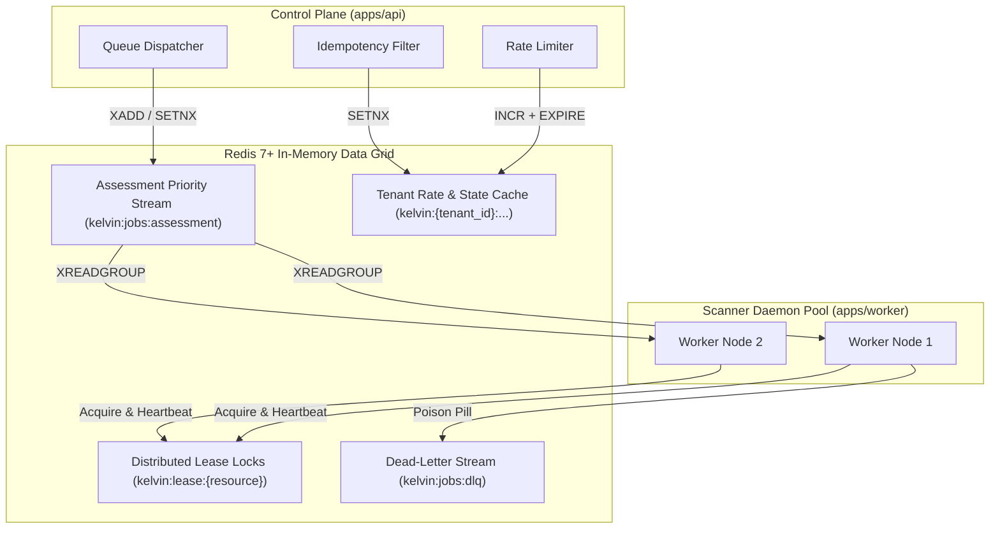

# KELVIN Architecture — Redis 7+ Integration

## 1. Overview & System Role

Redis 7+ serves as the low-latency state coordination and transient data tier in the KELVIN Enterprise Security Assessment Platform. It provides:
1. **Priority Job Queues & Streams**: Enqueuing and routing asynchronous assessment tasks to distributed scanner workers.
2. **Distributed Worker Lease Locks (ADR-0003)**: Atomic lease locking preventing split-brain scanning and ensuring exactly-once scanner execution.
3. **Tenant-Scoped Rate Limiting & Fair-Share Scheduling**: Sliding-window rate limit counters to ensure multi-tenant noisy-neighbor isolation.
4. **Idempotency Store**: Deduplication of scan creation and mutation requests within sliding time windows.
5. **Dead-Letter Queue (DLQ)**: Reliable routing, persistence, and redrive facilities for poison-pill assessment messages.



---

## 2. Distributed Lease Lock Protocol

To prevent multiple worker processes from concurrently scanning the same target or assessment instance, KELVIN implements an atomic lease lock backed by Redis Lua scripts.

### 2.1 Acquisition
- **Key Format**: `kelvin:lease:{resource}`
- **Command**: `SET key owner NX PX ttl_ms`
- **Behavior**: If the key does not exist, it is created with the worker's unique ID and the specified TTL. If it already exists, the acquisition fails immediately.

### 2.2 Atomic Heartbeat & Renewal
- Active scanners maintain a periodic background heartbeat at interval $T_{\text{renew}} = \frac{T_{\text{lease}}}{3}$.
- The renewal is executed via an atomic Lua script that verifies the caller owns the lock before resetting the TTL:
  ```lua
  if redis.call("get", KEYS[1]) == ARGV[1] then
      return redis.call("pexpire", KEYS[1], ARGV[2])
  else
      return 0
  end
  ```

### 2.3 Safe Atomic Release
- When scanning finishes or terminates gracefully, the lease is released only if the caller remains the owner:
  ```lua
  if redis.call("get", KEYS[1]) == ARGV[1] then
      return redis.call("del", KEYS[1])
  else
      return 0
  end
  ```

---

## 3. Tenant Key Namespacing & Isolation

All application cache keys and rate limits must strictly follow the tenant-prefixed convention:
```
kelvin:{tenant_id}:{resource}:{identifier}
```

Examples:
- `kelvin:tenant-42a:ratelimit:scan_create:173000000`
- `kelvin:tenant-42a:idempotency:req-99120`
- `kelvin:tenant-42a:cache:assessment:assm-88741`

Key validators reject operations attempting to cross tenant namespaces, upholding KELVIN's multi-tenant isolation guarantees.

---

## 4. Connection Pooling, TLS, & Failure Handling

The Go Redis client (`packages/common/redis`) configures:
- **Pool Size**: Defaults to 20 connections per process with 5 minimum idle connections.
- **Dial Timeout**: 5 seconds.
- **Read / Write Timeout**: 3 seconds.
- **TLS**: Supports `rediss://` scheme and TLS 1.2+ encryption for cloud-hosted environments.
- **Circuit Breaking & Health**: Periodic PING health check integrated with `/health/redis` endpoint.
