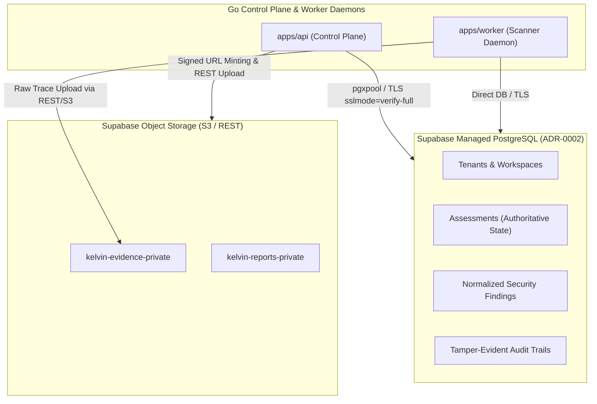

# KELVIN Architecture — Supabase Integration

## 1. Overview & System Role

KELVIN utilizes **Supabase Managed Cloud Infrastructure** as the authoritative persistence and artifact storage tier. The integration covers two primary subsystems:
1. **Supabase Managed PostgreSQL**: Authoritative relational data store housing tenants, workspaces, assessments, findings, audit trails, and access policies with Row Level Security (RLS).
2. **Supabase Object Storage**: Private, S3-compatible blob storage for raw assessment evidence (sanitized HTTP request/response traces) and generated compliance reports (PDF/HTML).



---

## 2. PostgreSQL Connection Pooling & Security

- **Driver**: `jackc/pgx/v5/pgxpool` with support for high concurrency.
- **Connection Parameters**:
  - `sslmode=verify-full` mandatory in production to prevent man-in-the-middle attacks.
  - Connection pooling configured with `max_open_conns=25`, `max_idle_conns=5`, and `conn_max_lifetime=1h`.
- **Database Migrations**:
  - Managed via `golang-migrate/migrate/v4`.
  - Supabase PostgreSQL executes the standard migration suite without modification, maintaining schema portability.
- **Dedicated Health Probe**:
  - `GET /health/db` runs a low-overhead `SELECT 1` query via `CheckSupabaseHealth` with a 2-second deadline.

---

## 3. Storage Hierarchy & Tenant Isolation

Storage objects are partitioned into private buckets with tenant prefixing:
```
{bucket}/{tenant_id}/{assessment_id}/{file_id}
```

### 3.1 Buckets
- `kelvin-reports-private`: Encrypted PDF and HTML compliance snapshots.
- `kelvin-evidence-private`: Sanitized raw HTTP traces, tool dumps, and screenshots.

### 3.2 Access Verification & Signed URLs
- Direct bucket access is strictly private (no public read permissions).
- Authorized users download artifacts through short-lived signed URLs generated by the API:
  - URLs expire in 300 seconds ($5 \text{ minutes}$).
  - Cryptographic token computed using HMAC-SHA256 with the Supabase Service Role key.
- Pre-upload validation enforces:
  - **Size**: Maximum 50 MB per object (`ErrFileTooLarge`).
  - **MIME & Magic Bytes**: Whitelisted MIME types validated against byte headers (`%PDF-` for PDF, valid parse for JSON).
