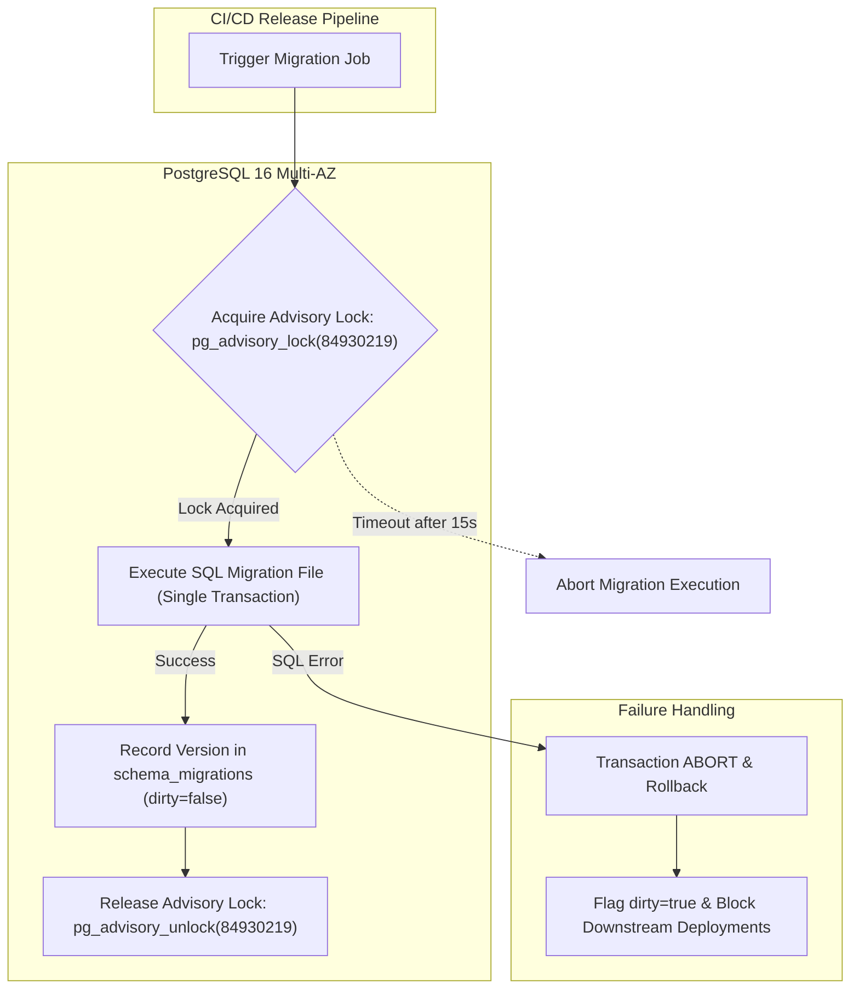
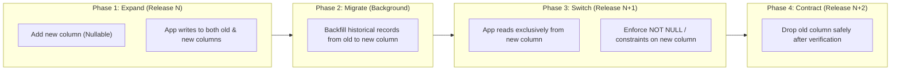

# KELVIN Safe Database Migration and Release Rollback Procedures

**Document Control**

| Field | Value |
| :--- | :--- |
| **Status** | Approved — Production Engineering Standard |
| **Milestone** | Phase 5 — Production Hardening, Deployment & Release (`P5-10`) |
| **Parent Roadmap** | [KELVIN Engineering Roadmap](../ISSUE-02_ENGINEERING_ROADMAP.md) |
| **Parent Issue** | Issue #366 (`P5-10`) |
| **Migration Directory** | [`apps/api/db/migrations/`](../../apps/api/db/migrations/) |
| **Review Cadence** | Quarterly |
| **Classification** | Internal — Enterprise Database Standard |

---

## 1. Migration Architecture & Locking Strategy

KELVIN uses deterministic, versioned SQL migration files (`NNNNNN_name.up.sql` and `NNNNNN_name.down.sql`) executed exclusively by the restricted `kelvin_migrator` role:

---

## 2. The Expand-and-Contract Pattern

In zero-downtime multi-node architectures, rolling updates mean that both the **current application version ($V_n$)** and the **new version ($V_{n+1}$)** access the database simultaneously during deployment transitions.

Breaking schema changes (e.g. renaming columns, splitting tables, changing column types) must **never** be executed as a single destructive migration. They must follow the multi-phase **Expand-and-Contract** pattern:

---

## 3. Concurrency Protection & Timeout Policies

To avoid deadlock or application starvation during production migrations:
1. **Advisory Locking:** All migration executions require acquisition of PostgreSQL session advisory lock `84930219` (`pg_advisory_lock`), preventing concurrent executions across multiple deployment runners or replicas.
2. **Lock Timeout:** `SET lock_timeout = '15s'` prevents migrations from queueing behind long-running analytical queries.
3. **Statement Timeout:** `SET statement_timeout = '60s'` caps individual migration statement execution time.
4. **Transactional DDL:** Every migration is wrapped in an explicit `BEGIN ... COMMIT` block. If any statement fails, all changes are rolled back automatically.

---

## 4. Rollback and Recovery Limitations

> [!WARNING]
> Down migrations (`.down.sql`) are safe **only** if no application data has been written to the newly created tables or columns. If user traffic has generated persistent findings or observations, applying `.down.sql` causes catastrophic irreversible data loss.

### Safe Rollback Decision Framework
1. **Zero Data Ingestion Window:** If a deployment fails smoke tests immediately (< 5 minutes) and no user data was created, `.down.sql` may be applied safely via `scripts/database/rollback-production.sh`.
2. **Active Traffic Window:** If user data has been ingested, `.down.sql` is **prohibited**. A **compensating forward migration** (hotfix) must be deployed instead.
3. **Catastrophic Failure:** In the event of severe data corruption, point-in-time recovery (PITR) is restored from automated WAL archives to a timestamp prior to migration start.
