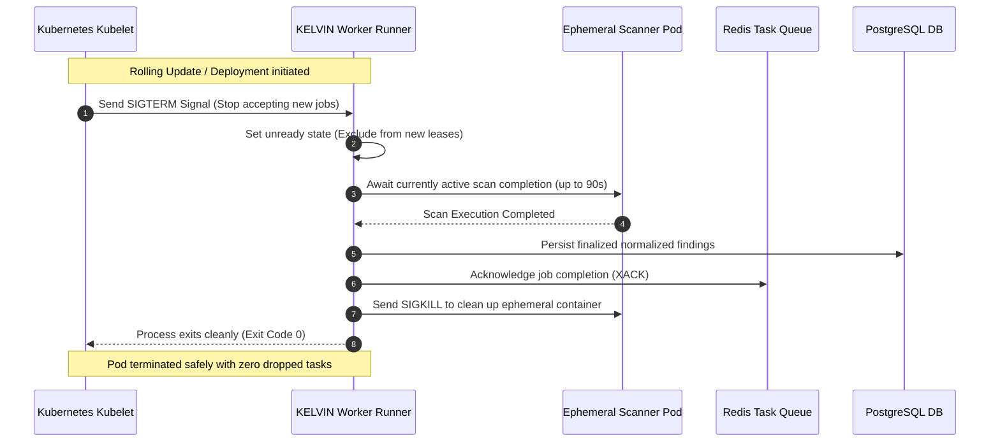

# KELVIN Application and Worker Runtime Deployment Specification

**Document Control**

| Field | Value |
| :--- | :--- |
| **Status** | Approved — Production Engineering Specification |
| **Milestone** | Phase 5 — Production Hardening, Deployment & Release (`P5-03`) |
| **Parent Roadmap** | [KELVIN Engineering Roadmap](../ISSUE-02_ENGINEERING_ROADMAP.md) |
| **Parent Issue** | Issue #359 (`P5-03`) |
| **Architecture Reference** | [`docs/architecture/PRODUCTION_DEPLOYMENT_ARCHITECTURE.md`](../architecture/PRODUCTION_DEPLOYMENT_ARCHITECTURE.md) |
| **Review Cadence** | Quarterly or upon any workload topology change |
| **Classification** | Internal — Enterprise Engineering Baseline |

---

## 1. Executive Summary & Purpose

This document specifies the operational runtime configurations, resource baselines, health monitoring strategies, and graceful termination semantics for all KELVIN container workloads across Staging and Production.

### Core Workloads Covered
1. **Frontend UI SPA:** React / Vite statically served by non-root Alpine Nginx edge pods.
2. **Go API Service:** Stateless control-plane HTTP/WebSocket pods.
3. **Go Worker Fleet:** Asynchronous task queue consumer and scanner orchestrator pods.
4. **Scanner Execution Sandbox:** Ephemeral, disposable scanner runtimes (Nuclei, ZAP, HTTP/TLS tools).

---

## 2. Workload Lifecycle & Graceful Termination Flow



---

## 3. Workload Sizing & Resource Allocations

| Component | Target Replicas (Prod) | CPU Request | CPU Limit | Memory Request | Memory Limit | Grace Period |
| :--- | :--- | :--- | :--- | :--- | :--- | :--- |
| **Frontend UI** | 2–4 | 100m | 500m | 128Mi | 256Mi | 30s |
| **Go API** | 3–24 (HPA) | 500m | 2000m | 512Mi | 2048Mi | 60s |
| **Worker Fleet** | 4–32 (KEDA) | 1000m | 4000m | 1024Mi | 4096Mi | 120s |
| **Scanner Sandbox** | Ephemeral | 500m | 2000m | 512Mi | 2048Mi | 30s (Hard Limit) |

---

## 4. Container Security Hardening Matrix

| Security Control | API Pods | Worker Pods | Scanner Sandbox Pods |
| :--- | :--- | :--- | :--- |
| **Run As Non-Root** | `true` (UID 10001) | `true` (UID 10001) | `true` (UID 10001) |
| **Read-Only Root Filesystem** | `true` | `false` (ephemeral scratch tmpfs) | `true` (ephemeral scratch tmpfs) |
| **Allow Privilege Escalation** | `false` | `false` | `false` |
| **Dropped Capabilities** | `ALL` | `ALL` | `ALL` |
| **Seccomp Profile** | `RuntimeDefault` | `RuntimeDefault` | `RuntimeDefault` |
| **Automount ServiceAccount Token** | `true` (Scoped SA) | `true` (Scoped SA) | `false` (NEVER mount SA tokens) |
| **DB Credentials Injected** | `true` (PgBouncer) | `true` (Read/Write) | `false` (ZERO DB access) |

---

## 5. Health, Readiness, and Liveness Probes

### 5.1 Go API Probes
- **Liveness Probe (`/healthz`):** Verifies the HTTP process is responsive. Failure triggers container restart.
- **Readiness Probe (`/readyz`):** Checks database pool connectivity and Redis ping. Returns 503 if downstream pool is full or unavailable, safely removing pod from ALB routing without restarting.

### 5.2 Worker Fleet Monitoring
- Emits continuous heartbeats via Redis key `kelvin:worker:heartbeat:<worker_id>`. If a worker pod crashes ungracefully, worker watchdog revokes the lease after 60 seconds and requeues pending jobs.

---

## 6. Verification and Staging Validation Procedures

To verify application and worker deployments in Staging:
```bash
# Apply staging overlay
kubectl apply -k deploy/kubernetes/overlays/staging

# Verify rollout status
kubectl rollout status deployment/staging-kelvin-api -n kelvin-staging
kubectl rollout status deployment/staging-kelvin-worker -n kelvin-staging

# Check health endpoints
curl -fsS https://staging.kelvinsecurity.io/healthz
curl -fsS https://staging.kelvinsecurity.io/readyz
```
