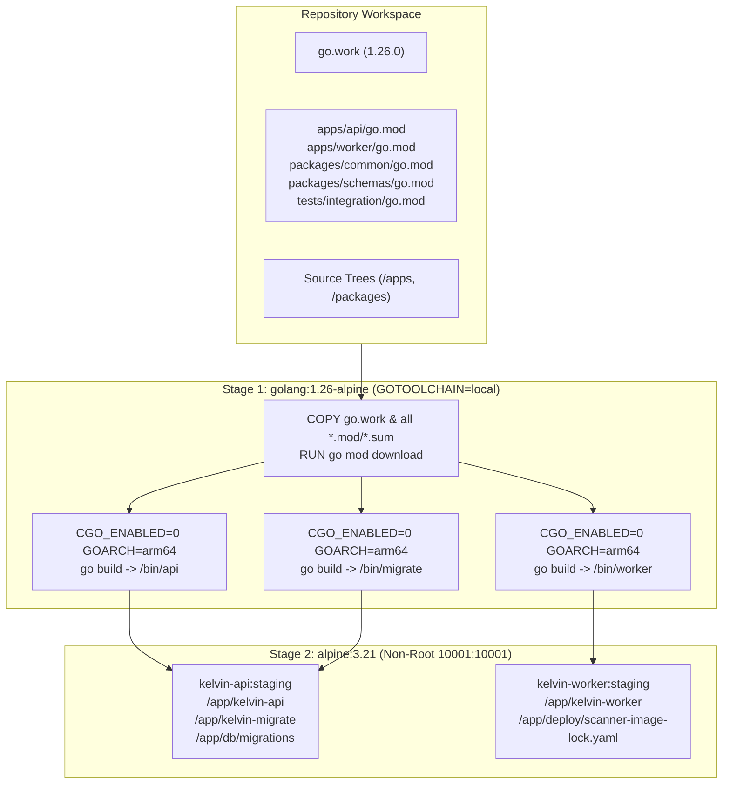

# KELVIN ARM64 Container Image Build & Go 1.26 Toolchain Specification

**Document Version:** 1.0.0-staging  
**Classification:** Deployment Operations & Container Architecture  
**Target Environment:** Oracle Linux ARM64 (Ampere A1, 1 OCPU, 6 GiB RAM)  
**Reference Issue:** PRE-09, Branch `fix/deploy-go-126-arm64-images`  

---

## 1. Overview & Root Cause Analysis

### 1.1 Confirmed Failure
During staging image compilation on Oracle Linux ARM64 instances, `docker build` failed during the dependency download stage:

```text
RUN go mod download
--> /src/go.work requires go >= 1.26.0 (running go 1.24.13; GOTOOLCHAIN=local)
```

### 1.2 Root Cause
1. **Toolchain Version Mismatch**: The repository workspace definition ([`go.work`](file:///e:/Projects/kelvin%202/Kelvin/go.work)) and primary application modules ([`apps/api/go.mod`](file:///e:/Projects/kelvin%202/Kelvin/apps/api/go.mod), [`apps/worker/go.mod`](file:///e:/Projects/kelvin%202/Kelvin/apps/worker/go.mod)) declare `go 1.26.0`. However, both [`apps/api/Dockerfile`](file:///e:/Projects/kelvin%202/Kelvin/apps/api/Dockerfile) and [`apps/worker/Dockerfile`](file:///e:/Projects/kelvin%202/Kelvin/apps/worker/Dockerfile) pinned the builder image to `golang:1.24-alpine`.
2. **Missing Workspace Module Caching**: `go.work` declares five workspace modules (`apps/api`, `apps/worker`, `packages/common`, `packages/schemas`, `tests/integration`). In previous Dockerfiles, only `apps/api`, `apps/worker`, and `packages/common` `go.mod` files were copied prior to `go mod download`, risking workspace resolution failures.

### 1.3 Resolution Summary
- Builder stages upgraded to explicit `golang:1.26-alpine` across all Go container images.
- Strict toolchain reproducibility enforced with `ENV GOTOOLCHAIN=local` to prevent unpredictable runtime toolchain auto-downloads.
- All workspace module manifests (`packages/schemas/go.mod`, `tests/integration/go.mod`) included in the dependency caching layer.
- Migration CLI binary (`/bin/migrate`) verified to compile from the exact same builder stage and packaged into `kelvin-api:staging`.

---

## 2. Authoritative Toolchain Inventory

The KELVIN repository enforces **Go 1.26.0** as the authoritative workspace baseline:

| File / Component | Version Requirement | Purpose / Scope |
| :--- | :--- | :--- |
| **`go.work`** | `go 1.26.0` | Root multi-module workspace coordination |
| **`apps/api/go.mod`** | `go 1.26.0` | Control Plane REST/GraphQL API & Migration CLI |
| **`apps/worker/go.mod`** | `go 1.26.0` | Security Scanner Execution Worker |
| **`tests/integration/go.mod`** | `go 1.26.0` | End-to-end service integration test suite |
| **`packages/common/go.mod`** | `go 1.22.0` | Shared errors, logging, Redis, and queue libraries (1.26 compatible) |
| **`packages/schemas/go.mod`** | `go 1.22.0` | Shared domain and findings schemas (1.26 compatible) |
| **`apps/api/Dockerfile`** | `golang:1.26-alpine` | Builder stage (ARM64 & AMD64) |
| **`apps/worker/Dockerfile`** | `golang:1.26-alpine` | Builder stage (ARM64 & AMD64) |
| **Runtime Base** | `alpine:3.21` | Hardened, minimal non-root execution container (`10001:10001`) |

> [!IMPORTANT]
> **No Downgrades:** In compliance with security and architectural governance, `go.work` and module requirements are **never downgraded** to accommodate outdated builder images. The builder image must always match or exceed the workspace requirement.

---

## 3. Architecture & Build Pipeline



---

## 4. Reproducible Build Commands

### 4.1 Native Build on Oracle Linux ARM64
Execute directly on the staging VM where the host architecture is already `linux/arm64`:

```bash
# Ensure working directory is the repository root
cd /path/to/Kelvin

# 1. Build KELVIN Control Plane API & Migration CLI image
docker build \
  --build-arg TARGETARCH=arm64 \
  -f apps/api/Dockerfile \
  -t kelvin-api:staging .

# 2. Build KELVIN Scanner Worker image
docker build \
  --build-arg TARGETARCH=arm64 \
  -f apps/worker/Dockerfile \
  -t kelvin-worker:staging .
```

### 4.2 Cross-Platform Multi-Arch Build via Buildx (from AMD64 Dev Hosts)
To build ARM64 images from an x86_64 development workstation using QEMU / `buildx`:

```bash
# Create buildx builder if not already active
docker buildx create --use --name kelvin-arm64-builder 2>/dev/null || docker buildx use kelvin-arm64-builder

# 1. Build and load ARM64 API image
docker buildx build \
  --platform linux/arm64 \
  --load \
  -f apps/api/Dockerfile \
  -t kelvin-api:staging .

# 2. Build and load ARM64 Worker image
docker buildx build \
  --platform linux/arm64 \
  --load \
  -f apps/worker/Dockerfile \
  -t kelvin-worker:staging .
```

### 4.3 Staging Compose Automated Build
The Compose configuration at `deploy/staging/docker-compose.yml` automatically supplies `TARGETARCH: arm64`:

```bash
# Build all services defined in staging Compose
docker compose -f deploy/staging/docker-compose.yml build
```

---

## 5. Image Naming & Tag Consistency

To guarantee operational compatibility between deployment scripts and containers, the following naming contract is strictly maintained:

| Service / Tool | Image Name & Tag | Dockerfile Path | Invoking Script / Configuration |
| :--- | :--- | :--- | :--- |
| **Control Plane API** | `kelvin-api:staging` | `apps/api/Dockerfile` | `deploy/staging/docker-compose.yml` (`api`) |
| **Scanner Worker** | `kelvin-worker:staging` | `apps/worker/Dockerfile` | `deploy/staging/docker-compose.yml` (`worker`) |
| **Database Migrator** | `kelvin-api:staging` | `apps/api/Dockerfile` | `deploy/staging/docker-compose.yml` (`migrate`) & `deploy/staging/migrate.sh` |

The `migrate` service does not maintain a separate image build; it executes `/app/kelvin-migrate` directly from `kelvin-api:staging`, guaranteeing zero drift between API code and database schema migrations.

---

## 6. Verification Checklist

- [x] Workspace `go.work` requires `go 1.26.0`.
- [x] `apps/api/Dockerfile` uses `golang:1.26-alpine` with `GOTOOLCHAIN=local`.
- [x] `apps/worker/Dockerfile` uses `golang:1.26-alpine` with `GOTOOLCHAIN=local`.
- [x] Missing module files (`packages/schemas/go.mod`, `tests/integration/go.mod`) included in Docker cache layers.
- [x] All unit test suites pass (`apps/api`, `apps/worker`, `packages/common`).
- [x] Migration binary compiles cleanly alongside the API binary in the same container stage.
- [x] Docker Compose staging file `deploy/staging/docker-compose.yml` config validation passes.
- [x] ARM64 static cross-compilation verified for all three binaries (`api`, `migrate`, `worker`).
