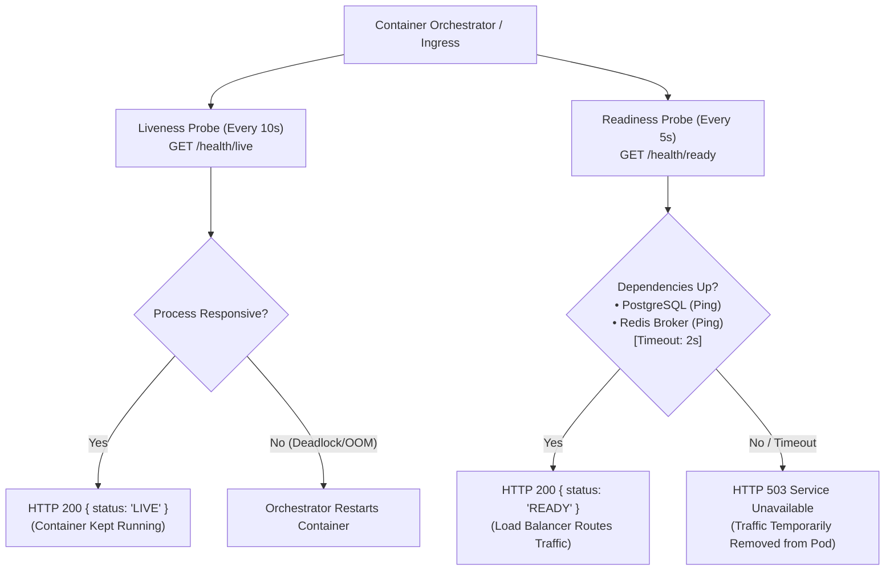

# Kelvin Security Platform — Health Checks & Container Probes Specification

**Document Control**

| Field | Value |
| :--- | :--- |
| **Status** | Active — Architecture & Operations Standard |
| **Milestone** | Phase 1 — Foundation & Core Architecture (`P1-22`) |
| **Related Docs** | `docs/architecture/decisions/ADR-0001.md` through `ADR-0003.md`, `docs/architecture/OBSERVABILITY.md` |
| **Owner** | Platform Engineering / SRE |

---

## 1. Executive Summary & Principles

Container orchestrators (Kubernetes, Docker Swarm, Nomad) and cloud application load balancers (AWS ALB, GCP Cloud Load Balancing) require deterministic, segregated health endpoints.

Kelvin implements two strictly separated probe mechanisms:
1. **Liveness Probe (`GET /health/live`):** Confirms that the Go HTTP event loop is alive and not deadlocked. It makes **zero** external database or queue calls.
2. **Readiness Probe (`GET /health/ready`):** Confirms that the container is ready to accept user and scanner traffic by validating connectivity to core dependencies (PostgreSQL 15+, Redis 7+ broker). Enforces a strict 2-second timeout.
3. **Zero Infrastructure Disclosure:** Health probe responses are sanitized. They never expose internal IP addresses, ports, database credentials, hostnames, or specific engine version strings that attackers could use for reconnaissance.

---

## 2. Probe Segregation & Failure Cascade Prevention

> [!CAUTION]
> **Never conflate liveness and readiness.**
> If `/health/live` depends on PostgreSQL or Redis, a momentary network blip will cause the orchestrator to kill and restart all healthy API containers simultaneously, precipitating a cascading cluster blackout.



---

## 3. Endpoint Specifications

### 3.1 Liveness Endpoint: `GET /health/live`
- **Purpose:** Process health and event loop responsiveness.
- **Dependencies:** None.
- **Success Response (HTTP 200):**
  ```json
  {
    "data": {
      "status": "LIVE"
    }
  }
  ```

### 3.2 Readiness Endpoint: `GET /health/ready`
- **Purpose:** Dependency availability gate before receiving user traffic.
- **Checks:**
  - PostgreSQL 15+ pool ping (`jackc/pgx/v5`).
  - Redis 7+ task broker ping (`github.com/redis/go-redis/v9`).
- **Timeout:** Maximum 2.0 seconds per check cycle.
- **Success Response (HTTP 200):**
  ```json
  {
    "data": {
      "status": "READY",
      "database": "UP",
      "broker": "UP",
      "timestamp": "2026-10-28T00:15:30Z"
    }
  }
  ```
- **Failure Response (HTTP 503):**
  Returns standard RFC 7807 problem envelope without internal connection strings or hostnames:
  ```json
  {
    "type": "urn:kelvin:problem:service_unavailable",
    "title": "Service Unavailable",
    "status": 503,
    "detail": "one or more essential dependencies are unavailable",
    "correlation_id": "7b8d80f8-b3d9-455b-b939-ff8283e3328e",
    "timestamp": "2026-10-28T00:15:31Z"
  }
  ```

---

## 4. Kubernetes Manifest Configuration

Below is the standard configuration template for Kelvin deployments in Kubernetes:

```yaml
apiVersion: apps/v1
kind: Deployment
metadata:
  name: kelvin-api
  labels:
    app.kubernetes.io/name: kelvin-api
    app.kubernetes.io/part-of: kelvin
spec:
  replicas: 3
  template:
    spec:
      containers:
        - name: api
          image: kelvin/api:1.0.0-alpha
          ports:
            - containerPort: 8080
              name: http
          livenessProbe:
            httpGet:
              path: /health/live
              port: http
            initialDelaySeconds: 5
            periodSeconds: 10
            timeoutSeconds: 2
            failureThreshold: 3
          readinessProbe:
            httpGet:
              path: /health/ready
              port: http
            initialDelaySeconds: 5
            periodSeconds: 5
            timeoutSeconds: 2
            failureThreshold: 2
```

---

## 5. Docker Compose Healthcheck Configuration

For local development and continuous integration environments (`docker-compose.yml`):

```yaml
services:
  api:
    image: kelvin/api:local
    ports:
      - "8080:8080"
    healthcheck:
      test: ["CMD", "wget", "--no-verbose", "--tries=1", "--spider", "http://localhost:8080/health/ready"]
      interval: 10s
      timeout: 2s
      retries: 3
      start_period: 5s
```

