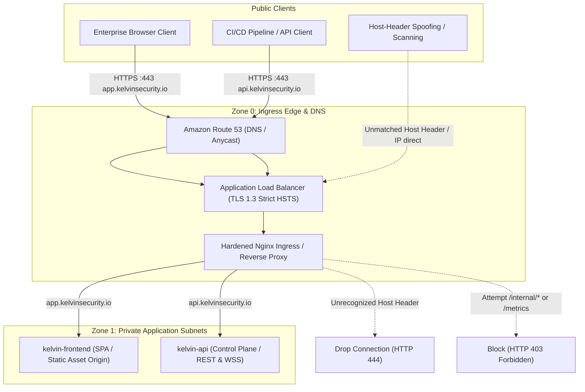

# KELVIN Production DNS, TLS, Ingress and Reverse-Proxy Routing Specification

**Document Control**

| Field | Value |
| :--- | :--- |
| **Status** | Approved — Production Engineering Specification |
| **Milestone** | Phase 5 — Production Hardening, Deployment & Release (`P5-04`) |
| **Parent Roadmap** | [KELVIN Engineering Roadmap](../ISSUE-02_ENGINEERING_ROADMAP.md) |
| **Parent Issue** | Issue #360 (`P5-04`) |
| **Architecture Reference** | [`docs/architecture/PRODUCTION_DEPLOYMENT_ARCHITECTURE.md`](../architecture/PRODUCTION_DEPLOYMENT_ARCHITECTURE.md) |
| **Review Cadence** | Quarterly |
| **Classification** | Internal — Enterprise Engineering Baseline |

---

## 1. Public Hostname and Ingress Architecture

KELVIN exposes distinct fully-qualified domain names (FQDNs) to decouple browser presentation, cross-origin security contexts, and API traffic ingestion:



---

## 2. Production Hostname Matrix

| Environment | Frontend Application URL | API Control Plane URL | Path-Prefix Fallback URL |
| :--- | :--- | :--- | :--- |
| **Development** | `https://dev-app.kelvinsecurity.io` | `https://dev-api.kelvinsecurity.io` | `https://dev.kelvinsecurity.io/app` & `/api` |
| **Staging** | `https://staging-app.kelvinsecurity.io` | `https://staging-api.kelvinsecurity.io` | `https://staging.kelvinsecurity.io/app` & `/api` |
| **Production** | `https://app.kelvinsecurity.io` | `https://api.kelvinsecurity.io` | `https://kelvinsecurity.io/app` & `/api` |

---

## 3. Cryptographic TLS Baseline

1. **Protocol Versions:**
   - Supported: **TLS 1.3** (preferred), **TLS 1.2** (minimum).
   - Prohibited: SSL 2.0, SSL 3.0, TLS 1.0, TLS 1.1.
2. **Approved Cipher Suites:**
   - `ECDHE-ECDSA-AES128-GCM-SHA256`
   - `ECDHE-RSA-AES128-GCM-SHA256`
   - `ECDHE-ECDSA-AES256-GCM-SHA384`
   - `ECDHE-RSA-AES256-GCM-SHA384`
   - `DHE-RSA-AES128-GCM-SHA256`
3. **Certificate Lifecycle:**
   - Automated provisioning and DNS-01 validation via AWS Certificate Manager (ACM) and Let's Encrypt `cert-manager`.
   - Automated 60-day renewal cycle before the 90-day expiration threshold.

---

## 4. Reverse Proxy Header Security & Request Handling

### 4.1 Forwarded Header Trust
To prevent IP spoofing and bypass of rate-limiting controls, forwarded headers (`X-Forwarded-For`, `X-Forwarded-Proto`, `X-Forwarded-Host`) are accepted **exclusively** from trusted upstream proxy CIDRs (`10.0.0.0/16`, `10.100.0.0/16`, `10.200.0.0/16`). All edge proxy nodes rewrite headers before passing downstream to Go API services.

### 4.2 Security Response Headers Enforced
- **HTTP Strict Transport Security:** `Strict-Transport-Security: max-age=63072000; includeSubDomains; preload`
- **MIME Type Sniffing Prevention:** `X-Content-Type-Options: nosniff`
- **Clickjacking Prevention:** `X-Frame-Options: DENY`
- **Content Security Policy:**
  ```text
  default-src 'self';
  script-src 'self';
  style-src 'self' 'unsafe-inline';
  img-src 'self' data: https:;
  font-src 'self';
  connect-src 'self' https://api.kelvinsecurity.io wss://api.kelvinsecurity.io;
  object-src 'none';
  frame-ancestors 'none';
  base-uri 'self';
  form-action 'self';
  ```
- **Referrer Policy:** `strict-origin-when-cross-origin`
- **Permissions Policy:** `geolocation=(), camera=(), microphone=(), payment=()`

### 4.3 Protection of Internal Services
- `/internal/*` routes return `403 Forbidden` at the ingress tier.
- `/metrics` is strictly restricted to authorized internal Prometheus scraper VPC CIDRs.
- Unmatched Host headers are dropped immediately with TCP reset (`return 444`).
- Direct access to databases, queues, and scanner sandboxes from public ingress is physically blocked by VPC subnet boundaries.
