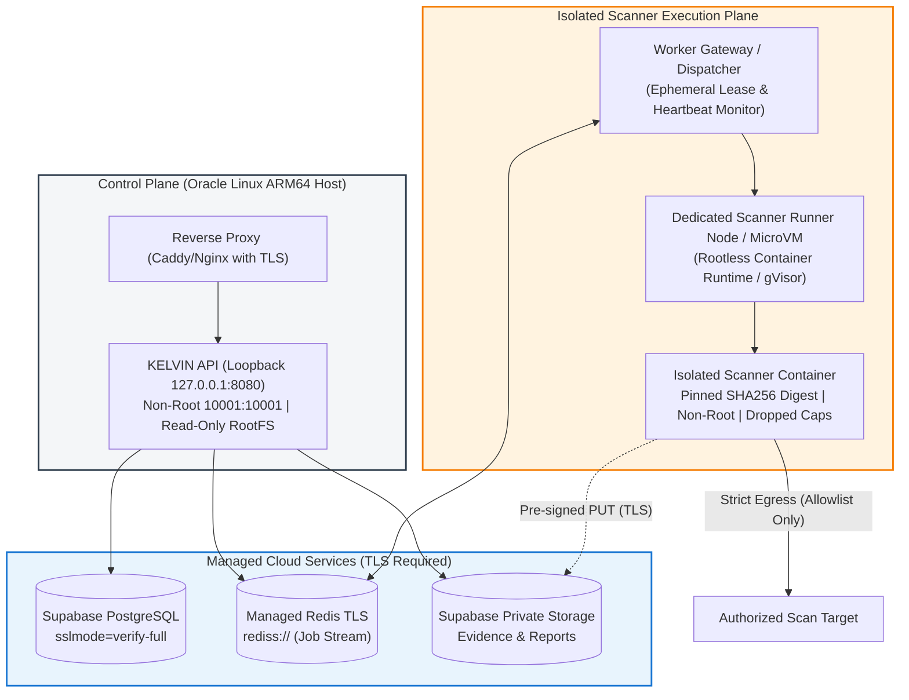
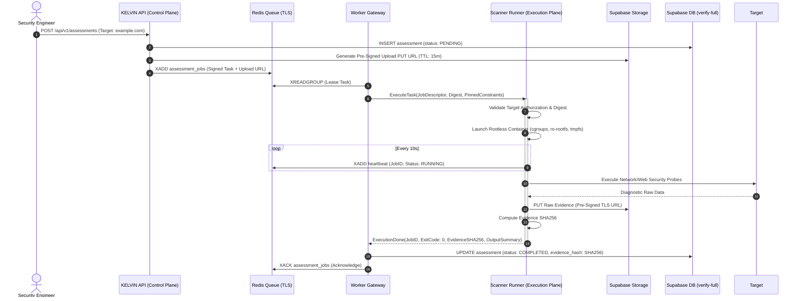

# KELVIN Scanner Execution Architecture & Security Specification

**Document Version:** 1.0.0-staging  
**Classification:** Engineering Architecture & Security Specification  
**Status:** Approved for PRE-09 Release Gate  
**Reference Issues:** PRE-09, INFRA-01, SEC-01, Issue 001 (EXEC-001)  
**Governing Architecture Decision:** [ADR-0008: Secure OCI Execution Architecture](../architecture/decisions/ADR-0008.md)  

---

## 1. Executive Summary & Core Security Principles

KELVIN is an enterprise-grade automated security assessment platform. By its fundamental nature, the scanner execution plane must run security diagnostic tools (e.g., network probes, vulnerability scanners, dependency analyzers) against authorized target infrastructure. Executing dynamic scanner tools introduces unique operational security risks:
1. Untrusted execution artifacts or tool exploits must never escalate to host-level compromise.
2. Compromise of a scanner job must never grant access to the relational database, customer credentials, or control-plane secrets.
3. The host container runtime engine must never be directly exposed to application services.

To address these risks, KELVIN enforces **strict Control Plane / Execution Plane separation**.



### Core Architecture Axioms:
- **Zero Host Socket Sharing:** `/var/run/docker.sock` is **strictly prohibited** inside `apps/api` and `apps/worker` staging containers. Exposing the host Docker socket provides unauthenticated root-equivalent control over the host VM and kernel.
- **Zero Credential Sharing:** Scanner execution containers never receive database connection strings, Supabase service-role keys, or JWT master signing secrets.
- **Direct-to-Storage Evidence Handoff:** Evidence and scan artifacts are pushed directly to Supabase private storage using short-lived, presigned upload URLs generated on-demand by the API control plane.
- **Truth in Probing:** If a secure scanner runner is not registered and active, KELVIN's API explicitly marks `scannerRunner: "UNAVAILABLE"` in its readiness endpoints (`/health/ready` and `/readyz`) and rejects scan dispatch. It **never** silently simulates or mocks scan executions in staging or production.

---

## 2. Component Boundaries & Ownership Matrix

KELVIN defines clear operational boundaries across the job lifecycle:

| Lifecycle Phase | Owning Component | Responsibilities & Invariants | Security Boundary |
| :--- | :--- | :--- | :--- |
| **Job Submission & Authorization** | `apps/api` | Validates target authorization, ensures tenant ownership, creates DB record in Supabase, enqueues signed dispatch token into Redis Stream. | Verifies target ownership and tenant rate limits before enqueueing. |
| **Job Leasing & Dispatch** | `apps/worker` (Gateway) | Leases job token via atomic Redis consumer group (`XREADGROUP`), creates execution assignment with short-lived lease TTL (default 15m). | Verifies HMAC signature on job descriptor; checks runner health. |
| **Job Execution** | Dedicated Scanner Runner | Pulls pinned container image by SHA256 digest, sets cgroup limits, configures network filters, executes scanner tool. | Rootless / microVM isolation; dropped capabilities (`ALL`); no new privileges. |
| **Heartbeat & Liveness** | Runner & Worker Gateway | Runner emits heartbeats every 10 seconds via authenticated Redis channel. Worker monitors dead-man timer (30s threshold). | Automatic termination and cleanup if heartbeat expires. |
| **Timeout & Cancellation** | Worker Gateway | Enforces hard wall-clock timeout (max 15m). If user cancels or timeout triggers, dispatches `SIGTERM` followed by `SIGKILL` (3s grace). | Enforced via external supervisor, not container voluntary compliance. |
| **Evidence & Artifact Upload**| Scanner Runner | Writes scan output to local `tmpfs`, uploads directly to Supabase Storage via pre-signed TLS PUT URL, computes SHA256 checksum. | Runner possesses zero Supabase storage credentials; URL expires in 15m. |
| **Result Ingestion & Final State**| `apps/worker` & `apps/api` | Worker verifies evidence SHA256, writes structured findings to Supabase PostgreSQL, updates job status to `COMPLETED` or `FAILED`. | Control plane alone updates database state via verified TLS connection. |
| **Cleanup & Post-Run Sanitation**| Scanner Runner | Destroys container, scrubs temporary volumes, flushes scratch directories. | Assures zero multi-tenant residual data left on execution host. |

---

## 3. Dedicated Scanner Runner Architecture

### 3.1 Control Plane vs. Execution Plane Separation
On the primary Oracle Linux ARM64 host, `deploy/staging/docker-compose.yml` runs only control-plane services:
- `kelvin-staging-api` (HTTP REST & GraphQL API)
- Reverse proxy (Caddy / Nginx) terminating TLS

The scanner runner resides on a **dedicated execution boundary**:
- **Option A (Staging Default):** Ephemeral microVM or isolated runner VM with unprivileged rootless Podman / Docker Engine.
- **Option B (Production Scale):** Managed Kubernetes worker pool running gVisor (`runsc`) or Firecracker microVMs (`containerd-shim-firecracker`).

Communication between the Worker Gateway and the Scanner Runner occurs over mutual TLS (mTLS) or encrypted Redis Streams using short-lived HMAC-signed execution tokens.

### 3.2 Job Execution Flow Sequence



---

## 4. Execution Plane Hardening & Isolation Constraints

Any container launched by the Scanner Runner must strictly comply with the following runtime security configuration:

### 4.1 Linux Kernel & Runtime Controls
- **User Namespace:** Executed as unprivileged user `10001:10001`. The container UID maps to an unprivileged subuid on the runner host.
- **Read-Only Root Filesystem:** Root filesystem mounted strictly `read_only: true`.
- **Capability Dropping:** All Linux capabilities dropped (`cap_drop: ALL`).
- **No Privilege Escalation:** `security_opt: ["no-new-privileges:true"]`.
- **Scratch Space:** Temporary workspace mounted as `tmpfs` at `/tmp` with `rw,nosuid,nodev,size=512m` (execution disabled where supported by scanner tool requirements).
- **Process Limit (PIDs Cgroup):** Maximum of 256 simultaneous processes per job to prevent fork bombs.

### 4.2 Resource Quotas (ARM64 VM Preservation)
- **CPU Quota:** Hard limit of `0.50` CPU per scan job.
- **Memory Quota:** Hard ceiling of `1024 MB` with swap disabled (`--memory-swap=1024m`). If the tool exceeds 1024 MB, it is terminated by OOM killer and cleanly reported as `FAILED_RESOURCE_EXCEEDED`.
- **Time Quota:** Hard execution limit of `900 seconds` (15 minutes). The Worker Gateway triggers SIGKILL if execution exceeds this ceiling.

### 4.3 Image Pinned Digests (`deploy/scanner-image-lock.yaml`)
Mutable tags such as `:latest`, `:stable`, or `:v1` are prohibited in staging and production. All scanner images must be pinned to immutable SHA256 digests verified against an approved registry:

```yaml
# deploy/scanner-image-lock.yaml
version: 1.0.0
registry: ghcr.io/eozkull/kelvin-scanners
images:
  nuclei:
    tag: "v3.2.0"
    digest: "sha256:d8a9e0f1883712b7a8d56b02008451152a41cb52822a13807217521e1a53e6b2"
    signed_by: "cosign:security@kelvin.security"
  nmap:
    tag: "7.94"
    digest: "sha256:4a38dfc6d996e382d3345f1bce8b33534a029a242f3ea99d5a6b0c2a7e75e114"
    signed_by: "cosign:security@kelvin.security"
```

---

## 5. Network Egress Restrictions

Scanners inevitably generate outbound network traffic. However, scanner containers must be strictly prevented from attacking lateral cloud infrastructure or private networks:

1. **Cloud Metadata Protection:**
   - Egress to Link-Local Metadata Services (`169.254.169.254`, `169.254.170.2`, Oracle IMDS / AWS IMDS) is **blocked at the host firewall layer** (`iptables -A FORWARD -d 169.254.169.254 -j DROP`).
2. **Private Network (RFC 1918) Isolation:**
   - Outbound connections to `10.0.0.0/8`, `172.16.0.0/12`, and `192.168.0.0/16` are rejected unless the assessment target is explicitly designated as an internal VPC assessment with cryptographically verified authorization.
3. **Control Plane & Database Isolation:**
   - Scanner containers are assigned to an isolated Docker bridge network (`kelvin-scanner-sandbox`) that has no route to the control plane network (`kelvin-staging-net`) or the Supabase PostgreSQL port (5432).
4. **Scoped Egress Proxy (`KELVIN_EGRESS_PROXY`):**
   - For web assessment tools, all outbound HTTP/HTTPS traffic is routed through an auditing egress proxy that logs destination IPs, SNI headers, and validates targets against the job's authorized scope.

---

## 6. Staging Deployment Profiles & Readiness Verification

### 6.1 Supported Deployment Modes in `deploy/staging/docker-compose.yml`

| Mode | Command | Running Services | Intended Environment |
| :--- | :--- | :--- | :--- |
| **API-Only Staging (Default)** | `docker compose -f deploy/staging/docker-compose.yml up -d` | `kelvin-staging-api` | Oracle Linux ARM64 (Initial release gate, frontend validation, Auth/DB testing). |
| **Worker Enabled** | `docker compose -f deploy/staging/docker-compose.yml --profile worker up -d` | `api`, `worker` | Host with approved container runtime or remote runner connectivity. |
| **One-Shot Migration** | `docker compose -f deploy/staging/docker-compose.yml run --rm migrate up` | `migrate` (ephemeral) | Manual release gate database schema application. |

### 6.2 Probes & Health Signal Handling
When deployed in API-Only mode:
- `/healthz` returns `HTTP 200 OK` (Control plane process alive).
- `/health/ready` and `/readyz` return `HTTP 200 OK` with JSON:
  ```json
  {
    "status": "READY",
    "version": "1.0.0-staging",
    "checks": {
      "database": "UP",
      "redis": "UP",
      "storage": "UP",
      "scannerRunner": "UNAVAILABLE"
    }
  }
  ```
- Any client attempting to trigger an active scan when `scannerRunner` is `"UNAVAILABLE"` receives `HTTP 503 Service Unavailable`:
  ```json
  {
    "error": "SCANNER_RUNNER_UNAVAILABLE",
    "message": "No active scanner runner is registered on this control plane instance. Configure an approved runner node to execute scans."
  }
  ```

---

## 7. Audit & Compliance Verification Checklist

- [x] Host Docker socket `/var/run/docker.sock` is absent from all staging Compose configurations.
- [x] API and worker containers run as non-root user `10001:10001` with `read_only: true` and `cap_drop: ALL`.
- [x] Readiness probe reports `scannerRunner: "UNAVAILABLE"` when runner is unconfigured.
- [x] One-shot database migrations execute from identical image `kelvin-api:staging` with `sslmode=verify-full`.
- [x] Resource limits enforced (API: 0.25 CPU / 1 GiB; Worker: 0.50 CPU / 2 GiB) leaving ~2.5 GiB headroom on Oracle Linux ARM64 VM.
- [x] Scanner execution boundary specification documented and approved for PRE-09 release gate.
