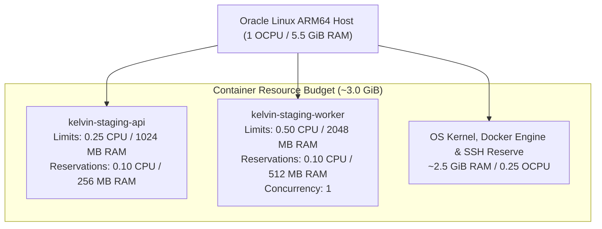

# KELVIN Staging Docker Compose Architecture & Operations Guide (PRE-09)

## 1. Overview

The staging deployment configuration located at `deploy/staging/docker-compose.yml` provides a production-grade container topology tailored for a single **Oracle Linux ARM64** virtual machine (1 OCPU / 6 GB RAM).

Unlike the local development compose file (`docker-compose.yml`), the staging configuration does **not** run local data store containers. All stateful infrastructure is offloaded to managed cloud providers:
- **Relational Database**: Supabase PostgreSQL over verified TLS (`sslmode=verify-full`).
- **Task Broker / Queue**: Managed Redis over TLS (`rediss://`).
- **Object Storage**: Supabase Private Storage (`kelvin-reports` and `kelvin-evidence`).
- **Frontend**: Vercel Edge hosting (accessing the API via reverse proxy).

---

## 2. Architecture Comparison: Development vs. Staging

| Attribute | Local Development (`docker-compose.yml`) | Staging (`deploy/staging/docker-compose.yml`) |
| :--- | :--- | :--- |
| **PostgreSQL** | Local container (`postgres:15-alpine`) | Managed Supabase PostgreSQL with verified TLS |
| **Redis** | Local container (`redis:7-alpine`) | Managed Redis cluster over TLS (`rediss://`) |
| **Object Store** | Local MinIO container (`minio/minio`) | Managed Supabase Private Storage API |
| **Mock Target** | Local Juice Shop container | External target validation |
| **Host Ports** | `8080` (public), `5432` (internal), `6379` (internal) | `127.0.0.1:8080:8080` only (Loopback bound) |
| **Database Pool** | 25 max conns / 5 min conns | 5 max conns / 1 min conn (Bounded Oracle VM sizing) |
| **Docker Socket** | Never mounted | Never mounted (`/var/run/docker.sock` prohibited) |
| **User Context** | Non-root `10001:10001` | Non-root `10001:10001`, `read_only: true`, `cap_drop: ALL` |
| **Worker Concurrency**| Variable | Strictly `1` (1 OCPU preservation) |

---

## 3. Oracle VM ARM64 Resource Allocation Model

The staging host is configured on an Oracle Cloud Infrastructure (OCI) Ampere A1 Compute instance running **Oracle Linux 9.8**:
- **vCPU / OCPU**: 1 OCPU (2 vCPUs)
- **Host RAM**: Approximately 5.5 GiB memory + 4 GiB swap
- **Disk**: 30 GB Root Filesystem
- **Architecture**: ARM64 (aarch64)
- **Host CA Bundle Path**: `/etc/pki/tls/certs/ca-bundle.crt`

To ensure ample headroom for Oracle Linux kernel operations, Docker daemon, systemd journal, and administrative SSH sessions, conservative resource limits are enforced:



---

## 4. Scanner Runtime Connectivity & Execution Boundaries

A primary security architectural decision in KELVIN is the **strict isolation of the host Docker socket**:
- The staging worker container runs as an unprivileged user (`10001:10001`) with a read-only root filesystem (`read_only: true`).
- Mounting `/var/run/docker.sock` into the container is **strictly prohibited**, as granting socket access is effectively equivalent to root access on the host VM.
- `NewOCIExecutor` searches for local `podman` or `docker` binaries in `PATH` and verifies engine responsiveness via `VerifyRuntime()`.
- **Runtime Limitation**: Because the staging worker does not mount the host Docker socket, it cannot directly spawn sibling containerized scanners on the staging control plane host.
- **Architectural Boundary Specification**: For complete design details on the dedicated execution plane, target authorization enforcement, pinned digest locks, egress controls, and heartbeat integration, refer to [SCANNER_EXECUTION_ARCHITECTURE.md](./SCANNER_EXECUTION_ARCHITECTURE.md).

---

## 5. Network Model & Ingress Security

1. **Loopback Port Binding**:
   The API container binds strictly to `127.0.0.1:8080:8080`. It is never exposed directly on public host interfaces (`0.0.0.0`). Ingress is routed through a host-level reverse proxy (such as Caddy or Nginx) handling TLS termination and certbot renewal.
2. **Data Stores Unmapped**:
   Neither port `5432` nor `6379` is published to the host.
3. **Bridge Network**:
   Services attach to `kelvin-staging-net` with outbound internet egress enabled to communicate with Supabase and Redis over encrypted TLS tunnels.

---

## 6. Security Controls & Container Hardening

- **Non-Root Execution**: Runs under UID/GID `10001:10001` (`kelvin`).
- **Read-Only Root Filesystem**: `read_only: true` is enforced for API, Worker, and Migration containers.
- **Temporary Storage**: Dedicated `tmpfs` mounts at `/tmp` (`size=256m` for API, `size=1024m` for Worker) with `noexec` and `nosuid` where applicable.
- **Capabilities & Privilege Escalation**: `cap_drop: [ALL]` and `no-new-privileges: true` block privilege escalation.
- **Log Rotation**: Docker JSON logging is capped at 5 files of 50 MB each (`max-size: "50m"`, `max-file: "5"`).
- **Socket Isolation**: Docker daemon socket (`/var/run/docker.sock`) is **never** mounted into either container.

---

## 7. Deployment Commands

### 7.1 Initial Staging Deployment (API-Only Mode - Default)
In initial staging, only the control-plane API service is started. The worker container is kept dormant under an explicit profile to protect Oracle VM stability:
```bash
# 1. Source staging environment variables (chmod 0600)
set -a
source /etc/kelvin/staging.env
set +a

# 2. Validate configuration syntax (using sudo on Oracle Linux)
sudo docker compose -f deploy/staging/docker-compose.yml config

# 3. Pull / Build ARM64 images and start API-only control plane
sudo docker compose -f deploy/staging/docker-compose.yml up -d --build

# 4. Check readiness probe (reports scannerRunner: UNAVAILABLE)
curl -s http://127.0.0.1:8080/health/ready | jq .
```

### 7.2 Running Database Migrations via Staging Container
Execute schema migrations against Supabase using the identical `kelvin-api:staging` container image:
```bash
# Via helper script with automatic sudo detection:
./deploy/staging/migrate.sh up

# Or directly via sudo docker compose:
sudo docker compose -f deploy/staging/docker-compose.yml run --rm \
  -v "${SUPABASE_CA_CERT_PATH}:${SUPABASE_CA_CERT_PATH}:ro" \
  migrate up
```

### 7.3 Enabling Worker Execution (Optional Profile)
When an approved execution runner or runtime environment is provisioned:
```bash
sudo docker compose -f deploy/staging/docker-compose.yml --profile worker up -d
```
