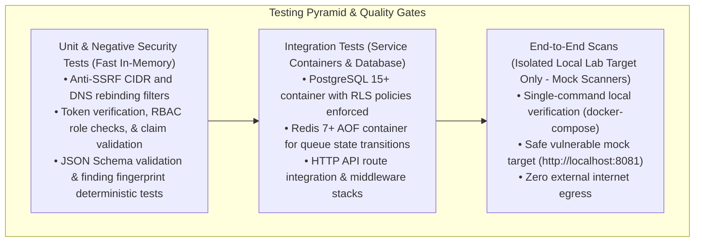

# Kelvin Security Platform — Engineering Testing Strategy & Quality Gates

**Document Control**

| Field | Value |
| :--- | :--- |
| **Status** | Active — Mandatory Engineering Standard |
| **Milestone** | Phase 1 — Foundation & Core Architecture (`P1-17`) |
| **Related Docs** | `docs/architecture/decisions/ADR-0001.md` through `ADR-0005.md`, `docs/security/ACCEPTABLE_USE.md`, `docs/security/THREAT_MODEL.md`, `docs/development/LOCAL_SETUP.md` |
| **Owner** | Platform Engineering / Product Security |

---

## 1. Executive Summary & Principles

Kelvin is an enterprise security assessment platform that orchestrates vulnerability scanners against target networks. Flawed testing practices in this domain create catastrophic operational and legal hazards:
- **Zero Outbound Internet Requests:** Unit, integration, and CI test suites must **never** make live network requests to external internet hosts. Accidental internet traffic risks unintended scanning violations, third-party disruption, and non-deterministic CI results.
- **Fail-Safe & Negative Testing Primacy:** Security controls (anti-SSRF, DNS rebinding guards, scope boundary validation, authentication/RBAC, and tenant Row-Level Security) must have exhaustive negative test suites proving malicious, malformed, and out-of-scope inputs fail closed.
- **Strict Coverage Quality Gates:** Security-critical modules (`scope`, `auth`, `validation`) require ≥ 85% statement coverage. General application services require ≥ 70% coverage.
- **Mock-First Architecture:** External scanner binaries (Nuclei, Nmap, ZAP) and backing services are completely mocked in automated test environments via structured fixtures (`packages/schemas/fixtures/`).

---

## 2. Testing Pyramid & Boundaries



### 2.1 Boundary Definitions

| Test Level | Scope | Execution Speed | External Dependencies | Mocking Rules |
| :--- | :--- | :--- | :--- | :--- |
| **Unit Tests** | Single package / struct / function | < 50ms per test | None (in-memory only) | All network I/O, DB, Redis, and OS processes must be mocked. |
| **Integration Tests** | Multi-component & database boundaries | < 2s per suite | Local service containers (PostgreSQL 15, Redis 7) | Outbound scanners and public internet mocked; local services live. |
| **End-to-End (E2E)** | Full scan lifecycle orchestration | < 30s per scenario | Sandboxed local stack (`mock-target`) | Real container network; mock target lab only. |

---

## 3. Go Testing Conventions & Tooling (ADR-0001)

### 3.1 Approved Testing Libraries

| Tool | Purpose | Standard Usage |
| :--- | :--- | :--- |
| `testing` (Go standard library) | Core test runner, subtests, and benchmarks | `func TestXYZ(t *testing.T) { t.Run(...) }` |
| `github.com/stretchr/testify` | Assertions and require statements | `assert.Equal(t, ...)` and `require.NoError(t, ...)` |
| `github.com/DATA-DOG/go-sqlmock` | Mocking relational database queries for unit tests | Unit testing database repositories without live PostgreSQL |
| `github.com/alicebob/miniredis/v2` | Pure in-memory Redis mock | Unit testing BullMQ queue dispatch and worker lock routines |
| `net/http/httptest` | Mocking HTTP servers and recording responses | Verifying API handlers and client adapters |

### 3.2 Network Prohibition Rule in Unit Tests
To guarantee zero outbound internet requests:
- Never initialize an unconfigured `http.Client` that dials out.
- Use `httptest.NewServer` or mock interfaces implementing `RoundTripper` for testing outbound HTTP adapters.
- In unit tests for scanner workers, scanner command execution must use mock binary executors returning recorded outputs from `packages/schemas/fixtures/raw/`.

---

## 4. Frontend Testing Conventions (ADR-0004)

- **Test Runner:** [Vitest](https://vitest.dev/) for high-performance ESM-native testing.
- **Component Testing:** [React Testing Library](https://testing-library.com/) focusing on user persona accessibility (queries by ARIA role, label, and keyboard navigation per WCAG 2.1 AA).
- **Mock Service Worker (MSW) / Fetch Mocks:** All frontend API calls mocked to return envelope-compliant responses (`packages/schemas/api-envelope.schema.json`).

---

## 5. Mandatory Negative Security Test Suites

Pull requests that introduce or modify security controls **must** include negative test cases. A feature is incomplete and blocked from merge without them.

### 5.1 Scope Enforcement & Anti-SSRF (`apps/api/internal/scope`, `apps/worker/internal/egress`)
Every scope rule must be tested with adversarial payloads:
- IPv4/IPv6 private ranges: `10.0.0.0/8`, `172.16.0.0/12`, `192.168.0.0/16`, `127.0.0.0/8`, `::1`.
- Cloud metadata endpoints: `169.254.169.254`, `metadata.google.internal`.
- Alternative IP notations: Decimal (`2130706433`), Hex (`0x7f.0x0.0x0.0x1`), Octal (`0177.0.0.01`).
- DNS Rebinding simulations: Ensuring IP addresses are validated immediately prior to socket dial (DNS pinning).
- Malformed inputs: Leading/trailing whitespace, URL smuggling, unexpected protocol schemes (`file://`, `gopher://`).

### 5.2 Authentication & RBAC (`apps/api/internal/auth`)
- Missing or malformed Authorization headers.
- Expired, future-dated, or revoked session tokens (`auth_sessions`).
- Tampered token signatures (wrong signing key, algorithm confusion).
- Role escalation attempts: `READ_ONLY_AUDITOR` attempting mutation endpoints (assert `403 Forbidden`).
- Cross-tenant access: Requesting tenant A resources with tenant B credentials (assert `403 Forbidden` or `404 Not Found`).

### 5.3 Row-Level Security (RLS) Regression Tests
- Unset `app.tenant_id` session setting: Assert fail-closed (0 rows returned).
- Spoofed `tenant_id` in `INSERT` or `UPDATE`: Assert PostgreSQL RLS policy violation.
- Cross-tenant composite foreign key attach: Assert constraint violation.

---

## 6. Standardized Scanner Test Fixtures

External scanner outputs are standardized and maintained in `packages/schemas/fixtures/`:

```
packages/schemas/fixtures/
├── positive/                   # Normalized Kelvin Unified Finding v1 fixtures
│   ├── nmap.tls-cbc.json       # Nmap weak cipher finding
│   ├── nuclei.cve-2021-44228.json # Nuclei Log4Shell finding
│   └── zap.sqli.json           # OWASP ZAP SQL injection finding
├── negative/                   # Invalid payloads for schema validation
│   ├── invalid-fingerprint.json
│   ├── invalid-severity.json
│   ├── missing-title.json
│   ├── redacted-fields-wrong-type.json
│   └── unexpected-root-field.json
├── raw/                        # Raw scanner output captures for adapter parsing
│   ├── nmap-raw.xml            # Raw Nmap XML run output
│   ├── nuclei-raw.json         # Raw Nuclei JSON streaming output
│   └── zap-raw.json            # Raw OWASP ZAP report JSON
└── fingerprint-vectors.json    # Canonical vectors for deterministic deduplication
```

---

## 7. Code Coverage Thresholds & Quality Gates

In pull requests and CI pipelines (`.github/workflows/ci.yml`), automated checks enforce minimum code coverage:

| Subsystem / Package | Minimum Coverage Target | Blocking Threshold |
| :--- | :--- | :--- |
| **Security Controls** (`internal/scope`, `internal/auth`, `common/validation`) | **85%+** | **< 80% Blocks Merge** |
| **API Control Plane & Core Orchestrator** (`apps/api`) | **75%+** | **< 70% Blocks Merge** |
| **Scanner Worker Daemon & Queue** (`apps/worker`) | **75%+** | **< 70% Blocks Merge** |
| **Shared Packages** (`packages/common`, `packages/schemas`) | **85%+** | **< 80% Blocks Merge** |
| **Frontend Web** (`apps/web`) | **70%+** | **< 60% Blocks Merge** |

### Execution Commands:

```bash
# Run all Go tests with race detection and coverage
npm run test:go

# Run schema and fingerprint validation
npm run test:schemas

# Run frontend tests
npm run test:web

# Run full quality gate (lint, test, build)
npm run lint && npm test && npm run build:web
```

