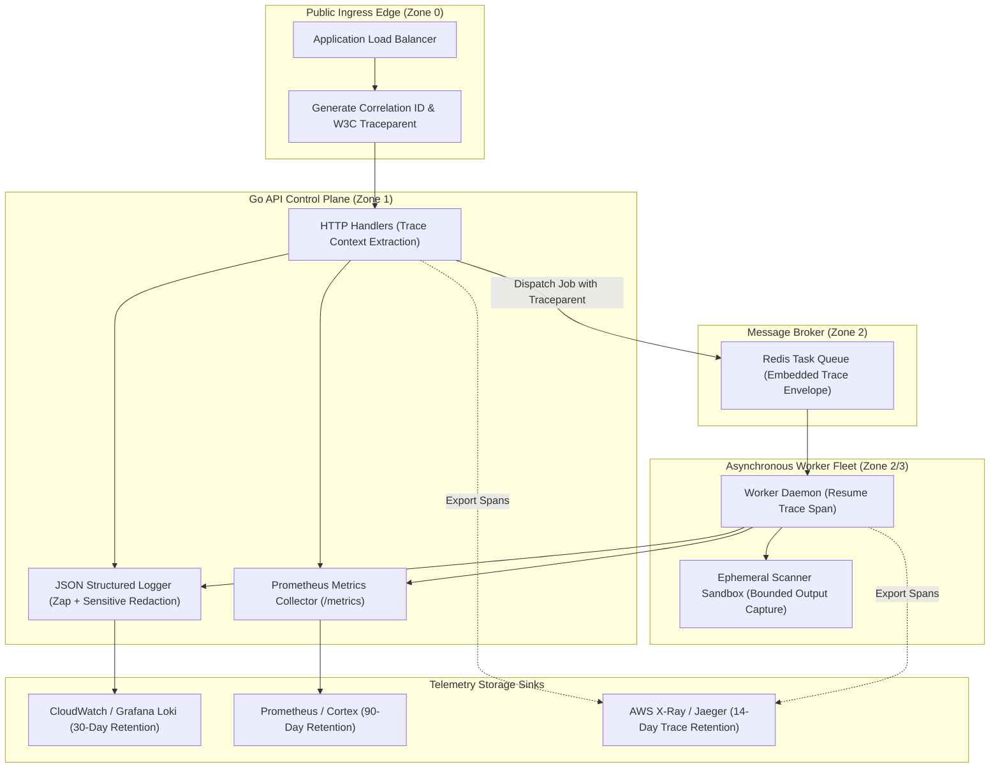

# KELVIN Centralized Production Logging, Metrics and Distributed Tracing Specification

**Document Control**

| Field | Value |
| :--- | :--- |
| **Status** | Approved — Production Engineering Specification |
| **Milestone** | Phase 5 — Production Hardening, Deployment & Release (`P5-11`) |
| **Parent Roadmap** | [KELVIN Engineering Roadmap](../ISSUE-02_ENGINEERING_ROADMAP.md) |
| **Parent Issue** | Issue #367 (`P5-11`) |
| **Packages Reference** | [`packages/common/logging/`](../../packages/common/logging/), [`packages/common/tracing/`](../../packages/common/tracing/) |
| **Review Cadence** | Quarterly |
| **Classification** | Internal — Enterprise Observability Baseline |

---

## 1. Observability Architecture & Telemetry Pipeline

KELVIN integrates logs, metrics, and traces into a unified operational telemetry pipeline adhering to OpenTelemetry and W3C TraceContext standards:

---

## 2. Structured Logging & Redaction Governance

1. **Log Format:** Canonical single-line JSON format with fields:
   - `ts`: ISO 8601 UTC timestamp.
   - `level`: `INFO`, `WARN`, `ERROR`, `FATAL`.
   - `logger`: Subsystem identifier (e.g. `api.http`, `worker.runner`, `db.pool`).
   - `msg`: Static, human-readable log message.
   - `correlation_id`: Unified correlation ID tracking the request across service boundaries.
   - `trace_id` & `span_id`: W3C distributed tracing identifiers.
2. **Mandatory Redaction Interceptors:**
   - Any key or query parameter matching case-insensitive substrings (`authorization`, `token`, `password`, `secret`, `jwt`, `api_key`) is intercepted and masked with `[REDACTED]`.
   - Raw scanner standard output is captured within bounded buffers and scrubbed before log ingestion.

---

## 3. Metric Naming Standards & Low-Cardinality Rules

To maintain high query performance and prevent metric explosion:
- **Rule 1 (Bounded Cardinality):** Metric labels MUST NOT contain arbitrary user inputs, dynamic URLs, target domain names, or UUIDs.
- **Rule 2 (Approved Metric Dimensions):**

| Metric Name | Type | Description | Allowed Dimensions / Labels |
| :--- | :--- | :--- | :--- |
| `kelvin_http_requests_total` | Counter | Total HTTP requests processed | `method`, `status_code`, `route` |
| `kelvin_http_request_duration_seconds` | Histogram | Request latency distribution | `method`, `route`, `le` |
| `kelvin_active_assessments` | Gauge | Currently running assessment scans | `cluster_zone` |
| `kelvin_assessment_completions_total` | Counter | Total scans completed | `status` (`completed`, `failed`, `cancelled`) |
| `kelvin_scanner_duration_seconds` | Histogram | Scanner adapter execution time | `adapter` (`nuclei`, `zap`, `tls`) |
| `kelvin_queue_depth` | Gauge | Pending tasks in Redis broker | `queue_name` |
| `kelvin_db_pool_connections` | Gauge | PostgreSQL pool allocation | `state` (`active`, `idle`, `wait`) |

---

## 4. Distributed Tracing & W3C TraceContext

- **Propagation Header:** `traceparent: 00-<32-hex-traceid>-<16-hex-spanid>-01`
- **Context Preservation:** When the API enqueues a scan job into Redis (`kelvin:queue:assessments`), the active `traceparent` and `X-Correlation-ID` are serialized into the job manifest metadata. The background worker unpacks these headers and initializes child spans, creating an unbroken trace from user button click to target probe completion.

---

## 5. Telemetry Retention & Access Control Matrix

| Telemetry Type | Hot Storage Engine | Cold Tier Retention | Access Permissions |
| :--- | :--- | :--- | :--- |
| **Application Logs** | CloudWatch / Loki | 30 Days (Hot) &rarr; 90 Days S3 | Platform Engineering & On-Call |
| **System Metrics** | Prometheus TSDB | 90 Days Rolling | All Engineering & DevOps |
| **Distributed Traces** | Jaeger / AWS X-Ray | 14 Days (10% Sampled) | Platform Engineering |
| **Audit Logs** | Immutable PostgreSQL | 365 Days &rarr; 7 Years Glacier | Security & Compliance Auditors |
