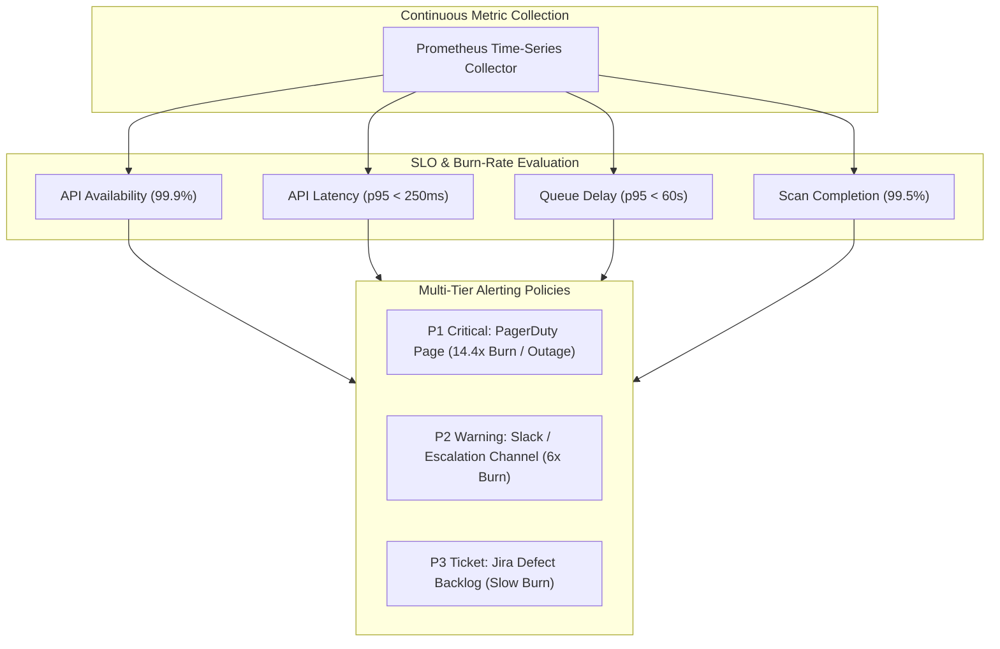

# KELVIN Production SLOs, Dashboards and Alerting Policies Specification

**Document Control**

| Field | Value |
| :--- | :--- |
| **Status** | Approved — Production Engineering Specification |
| **Milestone** | Phase 5 — Production Hardening, Deployment & Release (`P5-12`) |
| **Parent Roadmap** | [KELVIN Engineering Roadmap](../ISSUE-02_ENGINEERING_ROADMAP.md) |
| **Parent Issue** | Issue #368 (`P5-12`) |
| **Rules Reference** | [`deploy/monitoring/alerts/kelvin-slo-alerts.yml`](../../deploy/monitoring/alerts/kelvin-slo-alerts.yml) |
| **Review Cadence** | Quarterly |
| **Classification** | Internal — Enterprise Reliability Standard |

---

## 1. Executive Summary & Reliability Framework

KELVIN defines explicit, measurable **Service-Level Indicators (SLIs)** and **Service-Level Objectives (SLOs)** to govern platform reliability, alert on abnormal degradation, and manage engineering feature velocity against an objective **Error Budget**.

---

## 2. Core Service-Level Indicators (SLIs) and Objectives (SLOs)

| Service Dimension | Service-Level Indicator (SLI) | Target SLO | Measurement Window |
| :--- | :--- | :--- | :--- |
| **API Availability** | Good requests (status `< 500`) / Total requests | **99.9%** | 30-day rolling |
| **API Response Latency** | Successful requests completed in `< 250ms` | **95.0%** | 30-day rolling |
| **Queue Dispatch Delay** | Time between assessment enqueue and worker claim `< 60s` | **95.0%** | 7-day rolling |
| **Scan Completion Rate** | Valid assessment jobs reaching terminal state without platform crash | **99.5%** | 30-day rolling |
| **Database Pool Health** | Time spent acquiring client connection from PgBouncer `< 50ms` | **99.9%** | 7-day rolling |
| **Evidence Presigned URL**| Presigned URL generation response time `< 100ms` | **99.0%** | 7-day rolling |
| **Report Generation Time**| Compliance PDF and HTML reports assembled within `< 15s` | **95.0%** | 30-day rolling |
| **Webhook Delivery** | Outbound webhooks delivered successfully within 3 retries | **99.0%** | 30-day rolling |

---

## 3. Disentangling Platform Failures from External Target Failures

> [!IMPORTANT]
> **Core Principle:** KELVIN assessment reliability metrics must **not** penalize platform SLOs when external target hosts are unreachable, reset TCP connections, or experience upstream network timeouts.

- **Classified as Target Faults (Excluded from Platform SLOs):**
  - `target_unreachable` (DNS NXDOMAIN or network route failure to target).
  - `target_connection_refused` (Target server closed port or actively blocked probe).
  - `target_rate_limited` (Target HTTP 429 / WAF block).
- **Classified as Platform Faults (Burn Error Budget):**
  - Worker Out-Of-Memory (OOM) or unexpected container exit.
  - Failure to write normalized findings to PostgreSQL.
  - Message broker timeout or lease starvation.
  - S3 artifact upload failure due to internal KMS or bucket errors.

---

## 4. Multi-Window Multi-Burn-Rate Alerting Rules

To eliminate alerting noise while providing instantaneous notification during critical platform incidents:

1. **Fast Burn Alert (P1 — Critical):**
   - **Threshold:** 14.4x burn rate (2% error budget consumed in 1 hour).
   - **Response:** Automated page to primary on-call engineer via PagerDuty. Immediate triage within 15 minutes.
2. **Medium Burn Alert (P2 — Warning):**
   - **Threshold:** 6x burn rate (5% error budget consumed in 6 hours).
   - **Response:** Notification to `#ops-alerts` Slack channel. Investigation within 2 hours.
3. **Slow Burn Alert (P3 — Info):**
   - **Threshold:** 1x burn rate (10% error budget consumed in 3 days).
   - **Response:** Automated Jira ticket created for platform reliability sprint planning.
