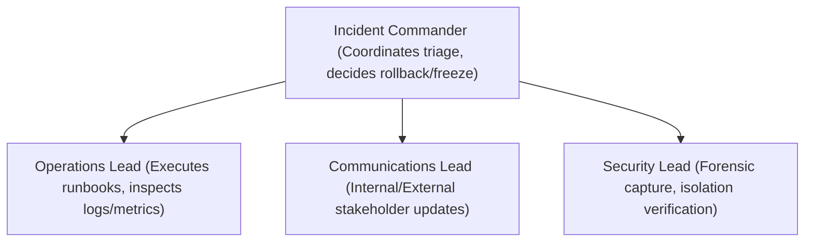

# KELVIN Production Incident Response Framework

**Document Control**

| Field | Value |
| :--- | :--- |
| **Status** | Approved — Operational Standard |
| **Milestone** | Phase 5 — Production Hardening, Deployment & Release (`P5-13`) |
| **Parent Roadmap** | [KELVIN Engineering Roadmap](../ISSUE-02_ENGINEERING_ROADMAP.md) |
| **Parent Issue** | Issue #369 (`P5-13`) |
| **Runbooks Directory** | [`docs/operations/runbooks/`](runbooks/README.md) |
| **Review Cadence** | Bi-annual or post-SEV-1 incident |
| **Classification** | Internal — Enterprise Operational Standard |

---

## 1. Incident Severity Classification & Response SLAs

| Severity | Definition | Target Triage SLA | Target Resolution SLA | Incident Commander | Communication Cadence |
| :--- | :--- | :--- | :--- | :--- | :--- |
| **SEV-0** | Complete platform outage, active data breach, or cross-tenant data leak | **< 5 minutes** | **< 1 hour** | VP of Eng / Lead Architect | Every 15 mins to Execs / Customers |
| **SEV-1** | Core API down, assessment queue stalled, or persistent database connection failures | **< 15 minutes** | **< 2 hours** | Primary On-Call Lead | Every 30 mins to Engineering |
| **SEV-2** | Partial degradation (e.g. single scanner adapter failing, slow report generation) | **< 30 minutes** | **< 8 hours** | On-Call Engineer | Hourly to Slack `#ops-incidents` |
| **SEV-3** | Non-critical dashboard cosmetic defect or scheduled maintenance disruption | **< 2 hours** | Next sprint | Component Owner | Ticket updates |

---

## 2. Incident Command System (ICS) Roles

- **Incident Commander (IC):** Holds ultimate decision authority on service rollbacks, traffic isolation, and failovers.
- **Operations Lead (Ops):** Executes tactical diagnostic commands and verified runbook procedures.
- **Communications Lead:** Maintains status page updates (`status.kelvinsecurity.io`) and notifies executive stakeholders.
- **Security Lead:** Oversees forensic evidence preservation, credential rotation, and tenant boundary verification.

---

## 3. Post-Incident Review (PIR) & Blameless Post-Mortem

- Mandatory for all SEV-0 and SEV-1 incidents within **48 hours** of incident closure.
- Documents: root cause analysis (5 Whys), impact duration, detection lag, remediation timeline, and preventative action items (assigned in Jira with P1 priority).
